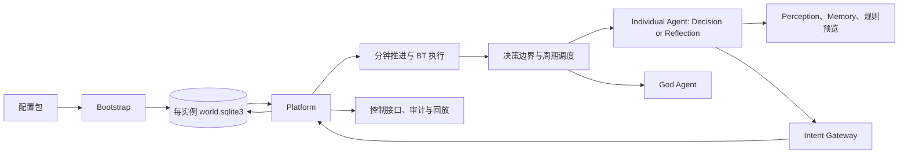

# 沙盘世界与自动演化 Agent 运行时设计

> 类型: 需求设计
> 来源: 沙盘游戏自动演化运行时
> 需求文档: 用户需求：可导入任意故事背景并运行人物与世界自动演化的沙盘游戏
> 需求结论: 交付一个由配置包创世、由 SQLite 持有实例状态、由 LLM Agent 驱动语义演化、由长时行为树执行计划、由 Platform 推进和校验状态的沙盘运行时。
> 架构结论: 第一阶段采用 Python 模块化单体；LLM Agent 是目标、选择、学习和世界演化的核心，Platform 是唯一状态变更入口和世界约束层。
> 交付范围: 配置导入、Agent 决策与演化、God Agent 世界演化、感知与知识、元动作、行为树、SQLite 回放和控制接口。
> 首要风险: LLM 意图越权或不符合世界规则，因此所有状态改变必须经过 Platform 的 Schema、权限、资源、前置条件和 BT 校验。
> 创建时间: 2026-11-07
> 更新时间: 2026-11-07
> 代码位置: docs/design.md；详细设计见 docs/design/details.md

## 需求

用户提供世界观、地点、势力、初始 Agent、元动作、行为树、规则、提示词和开局事件，系统将其导入一个全新的 SQLite 世界实例。初始化完成后，配置文件不再参与运行；Platform 从该 SQLite 读取当前状态并把每次演化写回同一文件。

运行时只有两类参与者：每个个体一个 `Agent`，以及每个世界一个 `God Agent`。个体 Agent 在一次唤醒中进入“决策”或“反思/演化”阶段：决策阶段快速选择一个 Platform 已验证的 BT；行为完成后，反思阶段比较预期与实际结果，只把新的、持久且有助于下次决策的结论写成经验、信念、目标或 BT 提案。God Agent 同样读取世界提案的实际结果，再决定是否提出下一次世界变化。创建新世界时使用独立的 `WorldBuilder Agent` 生成模板草稿。所有 Agent 只表达 Intent，Platform 执行所有副作用。

世界时间以分钟推进，Platform 主要推进当前 BT 和长时 Action。LLM 不在每一分钟调用，也不由模拟分钟驱动 ReAct；需要语义决策时启动一次有预算的会话，模型可以在该会话内连续调用工具、读取结果和修正 Intent，直到 Platform 接受、Agent 等待或会话预算耗尽。会话结束后，长时 BT 由 Platform 独立推进。LLM 只在没有活动计划、进入语义决策节点、紧急中断后、反思窗口或创新窗口介入。探索和沟通都会形成持久化结果：世界事件保存真实变化，Agent 的 `knowledge_fact` 保存其主观知识，`memory_item` 保存经历和摘要。

首版不包含实时多人联网、复杂图形渲染、训练专用模型和任意代码生成执行。质量目标是：同一配置、随机种子和冻结 LLM 响应可确定性回放；长时 Action 执行期间不重复调用 Decision Agent；1,000 个 Agent 的非 LLM 模拟分钟 p95 小于 200 毫秒；所有状态变化都有来源和审计记录。开发顺序和模块依赖见 [docs/development-plan.md](development-plan.md)。

## 工程原则与行业依据

本设计采用配置即代码、Schema First、领域边界、模块化单体、Intent Gateway、事件日志加状态投影和确定性回放。外部资料与采用结论见 [docs/design/references.md](design/references.md)。

行为结果的逐项闭环验收见 [行为闭环矩阵](design/behavior-closure-matrix.md)。矩阵区分行为自身的直接结果与 Story、God、Reflection 在边界上的后续消费，避免把世界策略硬编码进 Platform。

能力成长、发现、文明进度和规则的因果链见 [进步与文明设计](design/progression-and-civilization.md)。

属性由世界包导入，Platform 只保留执行信封；实例创建后，SQLite 作为唯一事实来源，God 可通过声明式定义提案动态注册属性、世界属性、能力、Action、BT 和 Recipe，Platform 校验后写回 SQLite。动态社会制度、账本和完全不同属性世界的边界见 [动态世界 Schema](design/dynamic-world-schema.md)。

- ReAct 采用“工具反馈修正计划”，但副作用由 Platform 控制。
- Generative Agents 采用观察、记忆、反思和计划分层。
- Voyager 采用版本化技能库、执行反馈和错误迭代；本项目使用声明式 BT，不执行任意生成代码。
- Unreal Behavior Tree 采用 Blackboard、事件驱动和长任务中断；本项目的模拟分钟只推进 BT，事件才触发重规划。
- Maslow、Self-Determination Theory 和需求研究支持多需求并行、社会联结、胜任感和自主感；本项目使用配置化非线性驱动，不硬编码固定阶梯。

## 架构设计



### 业务模块

首版包含 12 个业务模块，全部运行在一个进程内：

| 模块 | 主要职责 |
|---|---|
| `bootstrap` | 读取配置包、校验引用、创建新 SQLite 并导入初始数据 |
| `platform` | 世界分钟、调度、事务、暂停、恢复和副作用协调 |
| `world` | 实体、地点、势力、关系、社会规则和世界约束 |
| `perception` | 按视角、位置、距离、权限和信息渠道生成观察 |
| `actions` | 配置化元动作、持续时间、成本、进度和结果 |
| `behavior` | BT 定义、版本、候选目录和运行实例 |
| `intents` | Intent 生命周期、权限、资源、前置条件、幂等和错误反馈 |
| `agents` | 个体 Agent 的决策/反思阶段与 God Agent |
| `memory` | 知识事实、情节记忆、信念、摘要、关系证据和 FTS5 |
| `llm` | 模型适配、Prompt、Function Schema、预算、超时和审计 |
| `persistence` | SQLite 连接、事务、事件日志、投影、快照和备份 |
| `api` | 创建、启动、暂停、单步、查询、注入、导出和恢复 |

依赖方向为 `api → platform → world/perception/actions/behavior/intents → persistence`。Agent 通过 `perception`、`memory` 和 `llm` 工作，不能直接访问 SQLite。

## 详细设计

### 配置创世与 SQLite 实例

配置目录包含故事、地点、势力、Agent、能力、配方、`actions/`、`behavior_trees/`、提示词、规则和开局事件。元动作是声明式配置，包含目标、参数 Schema、前置条件、持续时间、每分钟成本、成功/失败条件、资源效果、退款和中断策略；配置禁止嵌入 Python、SQL、Shell 或网络代码。

Platform 采用通用 `target_resolver`、`condition_engine`、`effect_pipeline` 和 `event_writer` 执行配置动作。Action 是原子能力，Recipe 是输入到输出的变换，BT 是组合 Action、Recipe 和子 BT 的长期控制流，Capability 是执行资格和熟练度；它们都由配置导入，Platform 不为每个语义动作编写专用业务分支。完整边界见 [platform-action-schema.md](design/platform-action-schema.md)。LLM 读取精简的 XML-like 文本上下文，工具和 Intent 使用原生 JSON Schema/JSON；世界模板由独立的 `WorldBuilder Agent` 生成草稿，经 Platform 校验后创建新实例，协议见 [agent-world-schema.md](design/agent-world-schema.md)。

每次初始化都生成新的 `world_instance_id` 和新的 `world.sqlite3`。Bootstrap 在事务中导入初始实体、Agent、需求、初始知识、元动作、BT、提示词、调度任务和事件，并记录 `config_version`、`config_hash` 和 `bootstrap_report`。已有实例 ID 直接拒绝，不做同实例配置升级或数据库迁移。

初始化后 SQLite 是实例唯一事实来源。数据库保存世界状态、Agent 状态、知识、记忆、能力、配方、BT 定义和实例、意图、事件、调度、提示词和 LLM 审计。原始配置文件不参与模拟分钟推进。

YAML 只负责初始化。运行中 God 可以提交声明式定义提案，Platform 校验后把新的属性、世界属性、能力、Action、BT 或 Recipe 写入当前 SQLite；新定义不会立即执行，必须在后续 AgentView 中通过正常条件、成本、时间和效果管线使用。Story 只能推进剧情、进度和已注册 BT 解锁，不能通过叙事直接注册底层机制。

### 模拟分钟、Action 与 BT

每个模拟分钟按以下顺序执行：

1. 应用世界时间和基础分钟效果，例如需求衰减、冷却、天气和关系衰减。
2. 处理软事件、可中断事件和硬中断。
3. 在当前世界快照中处理聊天、交易和遭遇等即时互动；影响世界的互动必须在本 tick 的 Platform 提交屏障内完成，不能让世界时间先进入下一 tick。
4. 推进已有 BT 的当前 Action，结算每分钟成本、预锁资源、检查点和完成条件；普通互动不改变 BT 游标。
5. 对没有活动计划或进入语义决策节点的 Agent 生成可执行 BT 目录。
6. 唤起 Decision Agent 选择 BT、分支、等待或提交新 BT 意图。
7. Platform 校验并创建执行实例，失败时返回错误进入 ReAct。
8. 在一个 SQLite 事务中写入事件和当前状态投影。

下一状态为：当前状态加分钟基础效果、Action 增量效果、环境效果和已接受意图效果。成本可以为零；时间、体力、资源、风险、注意力、声誉和冷却分别配置。Action 默认叠加分钟基础效果，显式配置的恢复或抵消效果可以降低需求和消耗。

Action 启动时由 Platform 预锁定所需资源；暂停保留游标、进度和锁，取消或失败才按配置释放。只有配置了 `interaction_policy: allow` 的执行中 Action 才能与外部即时互动并行，移动和探索等行动默认拒绝互动。

每个 Agent 的运行状态包含执行信封字段 `status`、`location_id`、`active_bt_instance`、`active_action`、`action_progress`、`remaining_minutes`、`current_goal_id`、`inventory` 和 `last_platform_result`；世界属性和需求由 `attributes.yaml` 与规则配置声明，不固定要求存在 `health`、`energy` 或 `satiety`。Platform 在攻击、疾病、事故和环境事件后按配置更新属性与状态效果；治疗和恢复 Action 通过 Platform 消除或减轻配置中的伤势。

### Agent 与上下文

两类运行时参与者都只产生 Intent：

- `Individual Agent`：在决策阶段读取自身视角、需求驱动、知识、记忆、关系、活动 BT 和 `eligible_bt_catalog`，选择已有 BT、分支或等待；在反思/演化阶段读取行为 outcome，只保留值得复用的经验并提出记忆、信念、目标和 `BehaviorTreeProposalIntent`。
- `God Agent`：按周/月或带来源的行为结果触发，读取世界提案的实际影响和长期指标，生成创建世界实体、规则、势力、技术和事件的 Intent，再在后续窗口复盘结果。它不直接增加资源、需求、关系或生产数值。
- `Story Agent`：消费探索、研究、关系和文明里程碑结果，推进剧情、角色目标、知识传播和已注册行为解锁。
- `WorldBuilder Agent`：只在创建新世界模板时运行，生成声明式配置草稿并交给 Platform 校验。

上下文按缓存友好的顺序排列，并只生成当前决策切片，不传完整世界：

```text
共享全局规则
角色策略与工具 Schema
世界规则版本
Agent 稳定身份
当前世界分钟、需求、观察、知识、记忆、直接关系、目标、活动 BT、错误结果
```

System Prompt 定义身份、职责和不变量；Function Schema 使用简短英文描述可请求的感知、记忆、规则预览和 Intent 函数；动态信息定义当前可见事实和可执行候选。Agent 稳定身份放在共享前缀之后，动态状态之后更新。单次 Agent 决策默认只保留当前地点、最高 3 个驱动、3 到 8 条相关知识或记忆、直接关系、最多 5 个候选行为和最近一次 Platform 结果。完整 SQLite、隐藏世界真相和其他 Agent 私有记忆不进入上下文。上下文协议见 [agent-world-schema.md](design/agent-world-schema.md)。

### 感知、知识、记忆与社会驱动

`perception` 生成 `ObservationSnapshot`，提供 `observe_area`、`inspect_entity`、`listen`、`read_public_record`、`check_route` 和 `query_known_fact`。探索是配置化长时 Action；完成后 Platform 写入 `exploration.completed` 和 `exploration_result`，并给执行者写入带来源、置信度、时间和有效期的 `knowledge_fact`。

沟通通过 `talk`、`ask` 和资料读取产生 `dialogue_exchange`。说话者只能传递自身已知且愿意披露的内容；听者获得带来源的 testimony，不直接获得世界真相。`memory_item` 保存情节和摘要，`knowledge_fact` 保存 Agent 认为自己知道的结构化事实。

需求驱动由 Platform 计算。需求缺口使用幂函数，临界压力使用 Sigmoid，需求之间使用配置门控；安全需求进入临界区时可以提高逃生驱动并压低自我实现目标。外驱包含奖励、惩罚、规范、势力命令、声誉和关系压力。

### Platform 与验证

所有 Agent 输出封装成 `IntentEnvelope`，状态为 `received`、`validated`、`accepted`、`executing`、`committed` 或 `rejected`。Platform 提供只读的 `preview_intent`、`check_preconditions` 和 `estimate_cost`。新 BT 经过节点、循环、深度、时长、函数白名单、资源、副作用和权限验证后才能注册；God Agent 创建实体也必须经过 Schema、引用、位置、容量、因果和可见性验证。

## 验证与验收

| 场景 | 成功标准 |
|---|---|
| 配置创世 | 新实例完整导入配置；非法引用导致整次初始化回滚 |
| 单实例 SQLite | 每个实例拥有独立数据库；删除原始配置后仍可继续运行 |
| 长时 Action | 1,000 分钟 Action 期间只推进实例，不重复调用 Decision Agent |
| 感知与探索 | 探索产生事件、探索结果和 Agent 知识记录；未探索内容保持未知 |
| 沟通 | 对话写入证词和来源，听者置信度可被反思调整 |
| BT 注册 | 非法 BT 被拒绝并返回可修正错误，合法 BT 注册新版本 |
| God Agent 实体 | 合法实体进入 SQLite 和事件日志，非法意图不产生副作用 |
| 结果闭环 | 行为完成/失败/中断写入 expected/actual/delta；结果留在 SQLite，个体 Agent 在下一个日/周窗口、God 在下一个周/月窗口读取并复盘 |
| 非线性驱动 | 需求接近临界阈值时驱动增压，输出保持在 0 到 1 |
| 确定性回放 | 冻结配置、种子和 LLM 响应后事件序列一致 |

## 影响评估

首版新增配置导入、单实例 SQLite、Platform、12 个业务模块和两类运行时参与者，不改变现有空仓库行为。发布顺序为：固定 SQLite Schema、配置创世、世界与分钟推进、元动作和 BT、Intent 校验、感知与知识、LLM Agent、控制接口和回放工具。最高风险是 LLM 成本、延迟和意图错误，通过决策边界调用、Token 预算、Function 白名单、Platform 拒绝反馈和安全待机控制。详细模块实现见 [docs/design/details.md](design/details.md)，资料依据见 [docs/design/references.md](design/references.md)，AgentView 协议见 [docs/design/agent-world-schema.md](design/agent-world-schema.md)。

第一个验收世界为 [雾溪村设计](worlds/starter-village.md)，其配置包位于 `worlds/starter_village/`，包含 9 个 Agent、17 个通用元动作、19 棵基础 BT、14 个地点、10 个物体、能力、配方、世界属性、初始知识和玩家入口。
