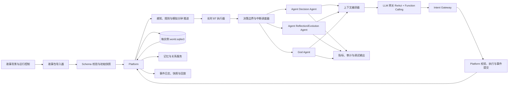
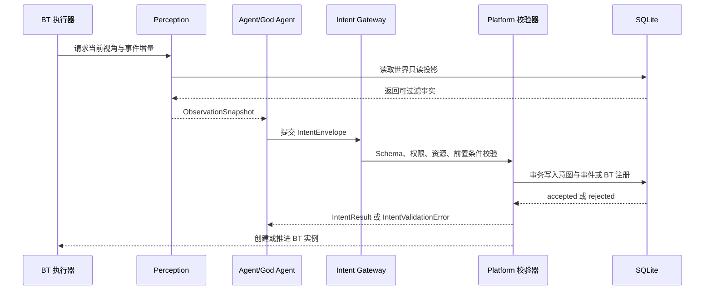

# 沙盘世界与自动演化 Agent 详细设计附录

本文件承载模块职责、Agent 上下文、感知与知识、分钟推进、BT、意图和 SQLite 的实现细节。总体架构、范围和验收结论以 [docs/design.md](../design.md) 为准；数据驱动 Action 的执行契约见 [platform-action-schema.md](platform-action-schema.md)；外部资料与取舍见 [references.md](references.md)。

> 类型: 需求设计
> 来源: 沙盘游戏自动演化运行时
> 需求文档: 用户需求：可导入任意故事背景并运行人物与世界自动演化的沙盘游戏
> 需求结论: 交付一个可导入故事包、由 Agent 决策 Agent 选择行为树、由 Agent 反思演化 Agent 更新个体、由上帝 Agent 推动世界演化、并由 Platform 推进状态的沙盘运行时。
> 架构结论: 第一阶段采用 Python 模块化单体，使用事件溯源保存世界状态，使用长时行为树执行计划，使用 LLM 作为所有语义选择的决策策略，使用 Platform 作为唯一意图入口和状态变更权威。
> 交付范围: 故事包导入、世界时钟、实体与关系模型、内外驱模型、Agent 决策 Agent、Agent 反思演化 Agent、上帝 Agent、LLM 函数调用、记忆与创新函数、事件回放和运行观测。
> 首要风险: LLM 输出不可控会破坏世界一致性并造成成本失控，因此所有 LLM 结果只能生成发送给 Platform 的意图，Platform 必须完成 Schema、权限、前置条件、资源和行为树安全校验后才允许执行。
> 创建时间: 2026-11-07
> 更新时间: 2026-11-07
> 代码位置: docs/design.md；实现目录规划为 src/sim2

## 需求

本需求交付一个“故事即配置”的沙盘游戏内核。用户提供世界观、地点、势力、角色、规则和开局事件后，系统完成结构化导入，创建可运行的世界。每个角色拥有状态、关系、记忆、需求、目标和行为树，由一个统一的个体 Agent 在“决策”和“反思/演化”两个阶段工作：决策只选择已验证 BT，反思比较执行结果并决定是否留下可复用经验或提出演化提案。每个世界拥有一个上帝 Agent，负责世界事件、规则、势力和长期内容的演化，并读取提案执行后的结果继续优化。Agent 只能表达意图，所有状态变化都必须经过 Platform 处理并由 Platform 生成事件；LLM 不直接写数据库或调用具有副作用的实现函数。

核心使用场景包括：暂停、继续和按步推进世界；查看角色当前需求、行为、记忆和关系；注入事件或修改规则；回放同一时间线；导出故事状态。首版包含单世界、多角色、回合制或离散时间推进、文本型 LLM 交互和结构化函数调用。不包含实时多人联网、复杂图形渲染、训练专用模型、完全自动生成不可审计的规则，以及让 LLM 直接执行宿主机命令。

质量目标如下：同一故事包、随机种子和冻结的 LLM 响应能够得到一致的事件回放；长时 Action 执行期间不重复调用 Agent 决策 Agent；非 LLM 的单次世界 模拟分钟 在基准规模 1,000 个 Agent 时 p95 小于 200 毫秒；单个 Agent 的上下文始终受配置的 token 预算约束；所有状态变化均有事件、来源、时间和校验结果；函数调用失败不会提交部分状态。

## 工程原则与行业实践

本设计采用配置即代码、Schema First、领域驱动的模块边界、六边形架构和事件溯源与当前状态投影并存的组合。配置文件是创世输入，SQLite 是实例化后的运行时唯一权威；内存缓存、向量索引和导出文件都属于可重建投影。Platform 通过单一意图入口收敛所有副作用，LLM、文件系统和数据库都通过适配器接入领域层。

配置包和提示词使用版本号与哈希；每个实例只记录本次初始化采用的配置版本和哈希，不在已有实例内执行配置迁移。所有外部输入先经过结构校验，再经过引用、权限、资源和业务规则校验；初始化和意图执行使用事务，失败时整批回滚。事件日志追加写入，当前状态由事件投影加速读取，快照只用于恢复性能。每次 LLM 调用持久化模型、提示词版本、输入摘要、结构化输出和校验结果，以支持审计、成本控制和确定性回放。

## 架构设计

系统采用事件驱动的模块化单体。Platform 拥有世界状态、时间推进、意图校验、行为树注册和事件提交权；Agent 决策 Agent 拥有角色的语义决策权；Agent 反思演化 Agent 拥有角色学习和个体创新提案权；上帝 Agent 拥有世界级演化提案权。LLM 网关只拥有生成结构化意图的权限，任何 Agent 都不能直接修改世界状态。故事导入器将配置文件转换为受 Schema 约束的故事包，实例创建后所有运行时读写都经过 SQLite Platform，运行时不再直接读取配置文件。



| 组件 | 职责 | 权威状态 | 对外契约 |
|---|---|---|---|
| 故事包导入器 | 解析版本化配置目录和可选 Markdown 背景，生成统一故事包并执行一次性初始化 | 导入任务状态、配置哈希 | `StoryPackage`、`BootstrapReport` |
| Platform | 接收并校验意图，管理时钟、实体、规则、资源、空间、长时 Action、行为树注册和事件提交 | 当前世界快照、执行实例和 BT 注册表 | `IntentEnvelope`、`World模拟分钟`、`ActionProgress`、事件流 |
| Agent 决策 Agent | 在计划边界、中断和行为树决策节点选择行为树或分支 | Agent 的语义决策 | `PlanDecision` |
| Agent 反思演化 Agent | 总结经历、更新信念和目标，提出个体能力与行为树候选 | Agent 的学习提案 | `ReflectionProposal`、`EvolutionProposal` |
| God Agent | 观察全局并提出世界事件、势力、规则和长期内容演化 | 世界演化提案 | `WorldEvolutionProposal` |
| LLM 网关 | 组装角色提示词、路由模型、限制预算、解析结构化响应 | 调用记录与模型版本 | `DecisionRequest`、`DecisionResponse` |
| 函数注册表 | 声明函数 Schema、权限、前置条件、成本和副作用 | 函数元数据 | `ToolSchema` |
| 事件存储 | 保存追加事件、快照、时间线和回放游标 | 事件日志 | `WorldEvent`、`Snapshot` |
| 记忆服务 | 保存情节、语义、社会和工作记忆，并按相关性检索 | Agent 记忆 | `MemoryItem`、`RecallQuery` |
| SQLite 持久化 | 保存实例配置、实体投影、执行实例、意图、记忆、调度和审计数据 | 运行时数据库 | SQL Schema、事务和备份 |

### 模块划分

首版采用一个进程内的模块化单体，划分 12 个业务模块。个体 Agent 的决策/反思阶段与 God Agent 是 `agents` 模块中的两类运行时参与者，不拆成独立服务；WorldBuilder 只在创建期使用。横向观测和审计作为基础设施包贯穿各模块。感知模块单独承担信息过滤和授权，防止 Agent 直接读取世界数据库。

| 模块 | 目录 | 单一职责 |
|---|---|---|
| 配置与初始化 | `src/sim2/bootstrap` | 读取配置包、校验引用、创建新的 SQLite 实例并导入初始数据 |
| Platform 运行时 | `src/sim2/platform` | 推进时钟和 模拟分钟、调度边界、执行事务、协调所有模块 |
| 世界领域 | `src/sim2/world` | 实体、属性、地点、势力、关系、社会规则和世界约束 |
| 感知与信息 | `src/sim2/perception` | 从世界只读投影生成带权限和视角的观察、查询和信息渠道结果 |
| 元动作 | `src/sim2/actions` | 声明和执行长时 Action，维护进度、资源锁、完成和失败结果 |
| 行为树 | `src/sim2/behavior` | BT Schema、版本注册、候选过滤、实例推进和条件结果 |
| 意图网关 | `src/sim2/intents` | 接收 `IntentEnvelope`、权限校验、幂等、ReAct 错误反馈和提交状态 |
| Agent 运行时 | `src/sim2/agents` | 个体 Agent 的决策/反思阶段与 God Agent 的上下文和任务调度 |
| 记忆与社会认知 | `src/sim2/memory` | 记忆、信念、关系证据、摘要、遗忘和 FTS5 检索 |
| LLM 网关 | `src/sim2/llm` | 模型适配、提示词编译、结构化输出、预算、超时和调用审计 |
| SQLite 持久化 | `src/sim2/persistence` | 连接、事务、Repository、事件日志、投影、快照和备份 |
| 控制接口 | `src/sim2/api` | 导入、启动、暂停、单步推进、查询、注入事件和导出 |

依赖方向固定为 `api → platform → world/perception/behavior/actions/intents → persistence`。`agents` 通过 `perception`、`memory` 和 `llm` 生成意图，不能直接依赖 `persistence`；`world`、`perception`、`actions` 和 `behavior` 不依赖 Web 框架或具体 LLM。所有副作用必须经过 Platform 和 Intent Gateway，观测、审计和 trace 由横向基础设施注入。

### 模块详细设计

#### 1. 配置与初始化模块

`bootstrap` 接收一个配置目录和新的 `world_instance_id`，读取 `manifest.yaml`，解析故事、Agent、元动作、BT、提示词、规则和开局事件，生成规范化对象。它先执行 Schema 校验，再执行引用完整性、BT 结构、动作白名单、权限、资源和随机种子校验，最后在新建的 SQLite 文件中开启事务并导入全部初始数据。导入失败删除未完成文件并返回带文件路径的错误报告；成功返回实例 ID、配置版本、配置哈希和初始事件游标。

#### 2. Platform 运行时模块

`platform` 是唯一的写入协调器和单实例调度器。它管理世界时钟、模拟分钟 阶段、暂停、继续、单步推进、决策边界、周期任务和恢复策略。Platform 使用一个写入队列串行化同一实例的事务，读取可以并行。每个 模拟分钟 先应用环境事件，再处理中断、需求衰减、长时 Action 进度、决策边界和周期任务，最后在一个事务中提交事件和投影。Platform 不生成 Agent 叙事选择，只执行已接受的意图和安全规则。

#### 3. 世界领域模块

`world` 保存实体、组件、地点、势力、关系、社会规范、资源和规则。实体使用类型加组件表示，关系使用有方向的证据边表示，规则使用声明式条件和效果表示。该模块提供纯领域函数，例如移动合法性、资源扣减、交易结算、关系变化、伤害结算和时间效果；函数只返回 `DomainEffect`，由 Platform 将效果转换为事件，模块本身不访问 LLM 或文件。

世界时间规则通过配置声明 模拟分钟 基础效果。基础效果不依赖当前是否存在 Action，例如需求自然衰减、冷却减少、天气推进、状态持续时间、关系衰减和环境资源再生。Platform 每个 模拟分钟 先计算基础效果，再叠加活动 Action、环境事件和已接受意图的效果，最终在同一事务中更新状态并写入一条带来源的 `world_minute.effects_applied` 记录。基础效果不由 LLM 决定。

```yaml
world_minute_effects:
  - id: hunger_decay
    scope: agent
    every_minutes: 1
    effect: {need: hunger, delta: -0.02}
  - id: weather_cycle
    scope: world
    every_minutes: 60
    effect: {world_clock: advance_weather}
```

#### 4. 感知与信息模块

`perception` 是 Agent 获取外部信息的唯一入口。它读取 Platform 提供的世界只读投影，根据 Agent 身份、位置、距离、视线、听觉、时间、公开性、势力权限和信息延迟生成 `ObservationSnapshot`。Agent 不能查询实体表、事件表或全局快照。

首版只读函数包括：`observe_area` 获取可见区域事实，`inspect_entity` 获取允许查看的实体属性，`listen` 获取听觉范围内的事件，`read_public_record` 获取公开记录，`check_route` 获取已知路线和通行条件，`query_local_event` 获取地点相关事件，`query_known_fact` 查询该 Agent 已经知道的事实。每个返回值必须携带 `observed_at`、`source`、`visibility`、`confidence` 和 `expires_at`。传闻、错误信念和过期信息以信息类型显式标注，Platform 不把它们提升为世界事实。`perception` 只读，不创建事件；查询结果进入 Agent 上下文，是否形成记忆由 Memory Intent 决定。

探索是配置好的长时 Action，例如 `explore_area`、`scout_route` 或 `search_ruins`，不是一次感知查询。探索 Action 完成后，Platform 生成 `exploration.completed` 事件，保存探索范围、发现对象、证据、消耗、时间和执行者，并为执行者创建或更新 `knowledge_fact`。未探索区域可以在世界实体表中存在，但对没有相应知识或观察权限的 Agent 保持未知；Agent 不能通过 `observe_area` 查询越过可见范围的内容。

沟通也是信息来源。`talk`、`ask`、`trade_information` 和 `read_public_record` 等行为通过 Platform 记录对话或资料事件；说话者只能传递自己已知且愿意披露的事实，听者收到的是带来源的 testimony，不直接获得世界真相。Platform 根据说话者的知识、陈述内容、关系信任、欺骗可能性和资料公开性创建 `knowledge_fact` 或待确认线索，最终置信度由听者的 Reflection/Evolution Agent 通过反思更新。

#### 5. 元动作模块

元动作完全由配置文件配置，运行时不从 LLM 接收可执行代码。配置文件只声明动作契约和 Platform 已注册的处理器 ID，例如：

```yaml
id: gather_resource
version: 1
description: 在可见资源节点采集指定类型资源
parameters:
  location_id: string
preconditions:
  - actor.can_gather
  - location.has_food
duration:
  minutes: 1000
progress_effects:
  - type: fatigue_delta
    value: 1
costs:
  reserve: {}
  per_minute:
    fatigue: 1
  on_success: {}
  on_failure: {}
  refund: {}
success:
  condition: inventory.food >= 1
  effects:
    - type: inventory_add
      item: food
failure:
  condition: actor.incapacitated
  result: interrupted
executor: effect_pipeline
interrupt_policy: pause
```

`actions` 负责加载和校验 `ActionDefinition`，创建 `ActionInstance`，每个模拟分钟执行进度、资源锁和检查点，并返回成功、失败、暂停或取消结果。每个 Action 都必须声明成本与影响契约，成本可以明确为零。首版成本类型包括时间、体力或疲劳、物品和货币、风险或暴露度、注意力、社会声誉、冷却时间和环境影响；契约区分 `reserve`、`per_minute`、`on_success`、`on_failure` 和 `refund`。长时 Action 的每个模拟分钟成本由 Platform 原子结算，资源不足时按配置进入暂停、失败或降级结果。Action 效果默认与模拟分钟 基础效果叠加，动作可以通过显式的恢复或抵消效果降低需求和消耗，不能隐式覆盖基础规则；相同成本组的替换或互斥必须在配置中声明。执行器只使用 Platform 的通用效果原语，不能引用 Python 路径、SQL 或 Shell。动作的持续时间、条件、结果、成本和增量效果全部进入 SQLite，BT 只引用动作 ID 和参数 Schema。

#### 6. 行为树模块

`behavior` 负责 BT AST、节点 Schema、版本注册、可执行目录、实例游标和结果传播。节点包含条件、顺序、选择、并行、动作、等待和装饰器；每个决策节点声明候选子节点、进入条件、成功结果和失败结果。Platform 先过滤候选，`Decision Agent` 再在候选中作语义选择；没有语义分歧时只推进唯一节点。长时动作由 `actions` 执行，BT 实例只保存当前节点、上下文、检查点和下一次决策边界。

#### 7. Intent 意图网关模块

`intents` 接收个体 Agent（决策或反思阶段）、God Agent 以及创建期 WorldBuilder Agent 的 `IntentEnvelope`，统一执行身份、作用域、Schema、可见性、能力、前置条件、资源、版本、并发、预算和幂等校验。它同时提供无副作用的 `preview_intent`、`check_preconditions` 和 `estimate_cost` 查询，让 Agent 在提交前看到当前规则契约、资源需求、预计消耗、成功条件和可能失败原因。它维护 `received → validated → accepted → executing → committed` 和 `rejected` 状态，并将 `IntentResult` 返回给调用 Agent。被拒绝的意图必须包含错误码、字段路径、当前状态摘要和修正上下文；ReAct 根据该结果继续迭代。

该模块统一处理 `SelectBehaviorIntent`、`BehaviorTreeProposalIntent`、`MemoryUpdateIntent`、`CreateEntityIntent`、`WorldRuleProposalIntent` 和 `ActionIntent`。Intent Gateway 是所有副作用的单一入口，其他模块不能绕过它写入实体、关系、记忆、BT 或事件。

#### 8. Agent 运行时模块

`agents` 只负责构造上下文、调用 LLM、解析结构化输出和提交意图，不直接读取 SQLite 或修改领域对象。每个角色挂载一个统一 Agent，按任务进入决策或反思/演化阶段；每个世界固定挂载一个 God Agent。两类参与者共用基础运行框架，但拥有独立的身份、可见范围、提示词、函数白名单、触发器和预算。

**Agent Decision Agent**

Decision Agent 在没有活动 BT、BT 完成或失败、进入语义决策节点、硬中断结束和当前目标失效时唤起。它接收当前需求和驱动排序、自己的状态、最近观察、记忆检索结果、关系摘要、活动树结果以及经过 Platform 过滤的 `eligible_bt_catalog`。每棵候选 BT 的入口条件、预计时长、资源成本、中断策略、成功和失败结果必须在上下文中明确展示；候选 Action 的公开规则契约、所需资源和 模拟分钟 基础消耗也必须一并提供。

Decision Agent 只能调用只读感知函数、只读记忆函数、规则预览函数和意图提交函数。正常输出是 `SelectBehaviorIntent` 或 `WaitIntent`；需要新方案时输出 `BehaviorTreeProposalIntent`。Platform 接受后创建 BT 实例，执行阶段不再重复调用 LLM。Platform 拒绝意图时，错误结果进入同一会话的下一轮 ReAct；默认最多 6 次模型调用，并限制相同工具参数的重复次数，达到预算后进入安全待机或事件绑定的安全树。Agent 看到的是当前决策所需的规则契约，Platform 内部的安全规则和不可披露规则只通过校验结果约束执行。

**Agent Reflection/Evolution phase**

反思/演化阶段每个游戏日最多唤醒一次，每个游戏周最多执行一次个体创新。重大经历、连续失败、目标完成或记忆冲突只记录为下一次窗口的待复盘信号，不在行为完成后立即启动新会话。它读取本 Agent 的 expected/actual/delta outcome、需求曲线、关系变化、记忆、信念、目标、能力和行为树使用统计。没有新的、持久且对未来决策有帮助的结论时返回 `wait`，不写重复经验；有结论时输出 `MemoryUpdateIntent`、`BeliefUpdateIntent`、`GoalUpdateIntent`、技能候选和 `BehaviorTreeProposalIntent`。

它不能直接改变当前资源、关系或世界实体。Platform 验证通过后才写入记忆、信念、目标或 BT 注册表；BT 校验失败时把结构化错误和失败节点返回给该 Agent，Agent 在同一 ReAct 任务中修正版。个体创新默认作用域为该 Agent，扩展到势力或世界需要 Platform 授权。

**God Agent**

God Agent 每个游戏周产生局部世界创新，每个游戏月产生结构世界创新，也可以由全局指标、重大事件或用户干预触发。它读取世界全局投影、最近提案的 expected/effect 前后值、各角色行为 outcome、势力、历史事件摘要、长期指标、配置规则和可用的世界实体类型，但只能通过 `perception` 的 God 专用全局读模型读取。已接受的世界提案结果写入事件日志，God 在下一次周/月窗口比较实际结果并决定是否优化，不为每个提案立即启动一次会话。

God Agent 输出 `CreateEntityIntent`、`UpdateWorldRuleIntent`、`CreateWorldEventIntent`、势力策略和内容候选。它可以提出地点、势力、Agent、物品、资源节点、任务、制度、规则实例和传闻的创建，但 Platform 负责唯一标识、引用、位置、初始状态、容量、因果、可见性和权限校验。合法意图提交 `entity.created` 或对应领域事件；非法意图不产生状态变化，并由 ReAct 继续修正。

**Agent 上下文与 ReAct**

上下文编译器根据 `agent_role` 生成不同视图：Decision 只看角色视角和可执行 BT；Reflection 只看个体历史和长期趋势；God 看世界全局投影。上下文包含系统约束、当前状态、驱动、观察、记忆、候选目录、函数 Schema、最近一次 Platform 结果和输出协议。LLM 只产生意图或只读查询，Platform 结果作为下一轮输入。隐藏思维链不持久化，只记录决策摘要、意图、Platform 结果和审计信息。

Prompt 使用半结构化标签标出局部边界，而不是把整个上下文伪装成可解析 XML。稳定的角色策略位于 system 消息；原生 JSON Schema 工具定义通过 API 的 `tools` 通道传递，不复制进 Prompt。每次唤醒的世界快照、Agent 基本信息、驱动、记忆和可执行 BT 位于动态消息；当前 ReAct 的 assistant/tool/result 消息按原生消息角色追加。BT AST、内部 predicate 和 handler 永远不传给 Agent。

一次 ReAct 会话不等待世界分钟，也不把每个工具调用写成模拟事件。`AgentEngine` 维护有限的会话 transcript，并按以下状态转换运行：

```text
ready
  → model_call
  → tool_call → validate arguments → execute read/intent tool
  → tool_result/error → compact result into next context → model_call
  → final_intent → Platform validate/commit
  → accepted | wait | rejected-and-retry | budget_exhausted
```

工具 Schema 在调用前限制必填字段、类型、数值范围和额外字段；工具执行器再次校验，避免只依赖模型。只读工具的结果必须短、带状态和来源；Platform 拒绝结果包含 `failed_check`、`message` 和是否可重试。Intent 工具只有在 Platform 返回 `accepted` 时终止会话，普通工具结果和可修正错误都会继续进入下一轮。原生 OpenAI-compatible `tool_calls` 和本地模型在文本中返回的 `tool_call` JSON 统一为同一内部格式。每次模型调用只保存上下文哈希、结构化响应、状态和世界分钟，避免把隐藏思维链当成业务数据。

当 Decision Agent 被调度时，如果角色已有 `executing` 或 `paused` 的 BT，Engine 直接返回 `skipped`，不发起 LLM 请求；只有 Platform 的完成、失败或中断边界才会重新开启决策会话。



#### 9. 记忆与社会认知模块

`memory` 同时维护 Agent 的知识面和主观记忆，但两者使用不同的数据结构。`knowledge_fact` 保存“Agent 认为自己知道的结构化事实”，字段包括 `subject`、`predicate`、`object`、`source_type`、`source_event_id`、`confidence`、`observed_at`、`expires_at` 和 `truth_status`；`memory_item` 保存情节、摘要、情绪和语义关联。知识事实可以来自配置初始知识、直接观察、探索、沟通、公开资料、传闻或推断，来源和置信度始终保留。

探索完成后 Platform 先写入 `exploration_result` 和 `exploration.completed` 事件，再按发现范围给执行者写入 `knowledge_fact`；沟通完成后 Platform 写入 `dialogue_exchange`，把说话者提供的内容作为带来源的 testimony 写入听者知识面。听者可以在反思阶段通过 `BeliefUpdateIntent` 调整置信度、标记事实为错误或合并重复知识。Knowledge Fact 不代表世界真相，世界真相只来自 `world` 的实体和事件状态。

情节记忆写入、知识更新、摘要和遗忘都通过 Intent Gateway；检索使用 Agent 权限过滤、任务相关性、实体和地点过滤、重要性、来源可信度和激活次数，并使用 SQLite FTS5。反思阶段在提交经验前先做重复性检查：默认使用确定性的词项相似度，配置本地 embedding 模型（例如 BGE）后才启用惰性语义相似度。相似度只返回“可能重复”的质量提示，最终由 Agent 选择写入还是 `wait`，Platform 不自动把不同经历合并。长期记忆不会因为时间单独衰减；显式 recall 会增加激活次数，常用记忆更容易被检索，只有显式 compact/forget 策略才会清理。关系模型属于世界领域的权威状态，记忆模块只保存关系证据和 Agent 的主观认知，不直接决定真实关系数值。决策阶段查询的是与当前目标相关的知识和记忆子集，不获得完整知识库。

#### 10. LLM 网关模块

`llm` 负责模型适配、提示词版本、结构化输出、token 预算、超时、限流和调用审计。它不暴露数据库写工具，只暴露感知、记忆查询和 Intent Gateway 的提交工具。模型响应先经过 JSON Schema 解析，再交给 Intent Gateway；解析失败只生成可重试错误，不产生副作用。Gateway 同时兼容 OpenAI-compatible 原生 `tool_calls` 与本地模型的 JSON 内容，统一转换为 Agent Engine 的 `tool_call` 信封。模型、提示词、工具 Schema、任务类型、上下文哈希和结果状态作为审计字段写入 SQLite。

#### 11. SQLite 持久化模块

`persistence` 管理每个实例的连接、WAL、外键、事务、Repository、事件日志、状态投影、FTS5 索引、快照和在线备份。Platform 是唯一写入协调者，Repository 不向 Agent 暴露。一次意图接受、BT 注册、实体创建或 模拟分钟 提交必须在一个事务中完成；进程重启后从同一 SQLite 文件恢复调度游标和活动 BT 实例。

#### 12. 控制接口模块

`api` 提供创建实例、导入配置、启动、暂停、继续、单步推进、查询实体、查看 Agent 上下文、注入外部事件、导出快照、执行备份和恢复等接口。接口只调用 Platform 命令，不直接访问 Repository。调试接口可以查看意图和审计链，但必须沿用同一感知权限规则，不把 God Agent 视图返回给普通 Agent。

文本入口提供一个 MUD 风格适配器：玩家可以进入配置世界、查看自身视角、移动、发消息、提出/还价/接受/拒绝交易和等待世界推进；每条命令都调用 Platform，不直接写状态。旁观者使用独立的 public observer projection 查看世界时间、角色公开状态、实体统计和公共事件流，但不会看到角色私有记忆、私聊内容或 God 专用上下文。HTTP 也提供同样的观察、对话和交易入口，后续可以替换为 Web 或 TUI 客户端。

## 详细设计

### 1. 故事包与世界模型

故事背景、初始 Agent、元动作、行为树、需求配置、提示词、规则和开局事件全部作为版本化配置包提交。推荐目录结构如下：

```text
worlds/forest_revolt/
  manifest.yaml
  setting.yaml
  locations.yaml
  factions.yaml
  agents/
    hunter.yaml
    mayor.yaml
  actions/
    move.yaml
    trade.yaml
  behavior_trees/
    survive.yaml
    gather.yaml
  prompts/
    agent_decision.yaml
    agent_reflection.yaml
    god.yaml
  opening_events.yaml
```

配置、世界事实、感知、记忆和能力定义保持不同的数据边界：

| 数据类型 | 初始来源 | 运行时位置 | 含义与写入规则 |
|---|---|---|---|
| 世界与 Agent 初始定义 | 配置包 | SQLite 的 `entity`、`agent_state` 等表 | 创世蓝图；初始化后由 Platform 根据事件更新当前状态 |
| 元动作与 BT 定义 | `actions/`、`behavior_trees/` | SQLite 的 `action_def`、`bt_def`、`bt_instance` | Platform 拥有的可执行能力；不属于 Agent 记忆 |
| 世界动态事实 | 开局事件、Platform 规则、已接受意图 | SQLite 的状态投影和 `event_log` | 物品、位置、关系、资源、天气、任务和实体的当前真实状态 |
| 当前感知 | SQLite 世界投影加 Agent 视角 | `ObservationSnapshot`，必要时写入审计 | 当前查询结果；受位置、权限、距离、渠道和信息延迟过滤，不自动成为记忆 |
| 探索与知识 | 探索完成、观察、对话、公开资料和配置初始知识 | SQLite 的 `exploration_result`、`knowledge_fact` 和 `dialogue_exchange` | Agent 对世界的知识面、来源、置信度、时间和有效期；不改变世界真相 |
| Agent 记忆与信念 | 感知、Action 结果、对话和反思 | SQLite 的 `memory_item`、信念和 FTS5 索引 | Agent 的主观经验、摘要、错误认知和关系证据；只能由 Memory Intent 更新 |
| Agent 能力熟练度 | 配置初值和 Platform 事件 | Agent 的能力状态表 | 例如熟练度、疲劳、冷却和掌握程度；它影响 BT 可执行性，但不替代 BT 定义 |
| LLM 创新结果 | Agent 意图 | Platform 校验后进入 BT、实体或事件表 | 通过验证后成为新的平台事实；原始响应保留在审计表 |

因此，感知可以产生知识更新或记忆提案，但感知结果本身不等于记忆；探索结果和沟通结果会被 Platform 持久化为带来源的知识记录；Agent 可以记住 BT 的名称、使用条件和历史结果，但 BT 与元动作仍由 Platform 的能力注册表管理。所有初始静态数据在实例化时导入 SQLite，运行时只从 SQLite 读取和写入；配置文件不参与模拟分钟，也不直接覆盖数据库状态。

`manifest.yaml` 声明配置版本、文件清单、依赖和随机种子。YAML 或 JSON 是运行时规范格式，Markdown 只作为故事背景输入，必须先被转换成结构化配置。元动作是声明式定义，包含参数 Schema、前置条件、持续时间、增量效果、完成条件、失败条件、资源成本和副作用；配置禁止嵌入任意 Python、SQL、Shell 或网络代码。

Agent 配置可以声明 `knowledge_seed`、初始信念和已知实体范围。例如，村长可以初始知道本村居民和公开规则，外来旅者只知道出生地和随身经历；这些初始知识在导入时写入 `knowledge_fact`，并标注来源为 `config_seed`。配置不直接写入 Agent 的全部真相视图。

实例化流程固定为：扫描 manifest；读取并规范化文件；执行 Schema、引用、行为树、权限和资源校验；计算配置哈希；创建新的 SQLite 文件；在该文件的事务中写入世界实例、来源配置版本、初始实体、Agent、元动作、BT 注册表、提示词版本、调度任务、初始记忆和开局事件；写入 `bootstrap_report` 后提交。任何一步失败都回滚整次初始化并删除未完成的 SQLite 文件，不创建半成品世界。

每次初始化都创建新的 `world_instance_id` 和新的 SQLite 文件；重复使用已有实例 ID 时直接拒绝，禁止覆盖已有实例。实例只记录初始化采用的 `config_version`、`config_hash` 和 `bootstrap_report`，不执行同一实例内的配置升级或迁移。实例创建完成后，SQLite 成为该实例的唯一运行时事实来源；Platform 从 SQLite 读取当前投影、事件和待处理任务，并将所有演化结果继续写回 SQLite。运行时需要的故事、元动作、BT、提示词和初始数据均已导入对应表，原始配置文件不再参与运行。

```json
{
  "config_version": "1.0",
  "setting": {"name": "示例世界", "premise": "世界背景与冲突"},
  "rules": [{"id": "trade", "when": {"resource": "gold", "gte": 1}, "effect": {"type": "transfer", "amount": 1}}],
  "locations": [{"id": "town", "tags": ["safe", "market"]}],
  "factions": [{"id": "guild", "goals": ["control_trade"]}],
  "agents": [{"id": "a1", "traits": {}, "needs": {}, "knowledge_seed": ["public:town"], "behavior_tree": {"type": "selector", "children": ["survive", "work", "rest"]}}],
  "opening_events": [{"type": "world.created", "payload": {}}]
}
```

世界实体采用组件化状态：位置、属性、资源、健康、关系、所属势力、可见性、目标和标签分别存储。规则引擎负责资源扣减、移动合法性、伤害、交易、关系变更和时间效果；每次变化生成不可变 `WorldEvent`，事件包含 `event_id`、`world_id`、`world_minute`、`actor_id`、`type`、`payload`、`source`、`precondition_hash` 和 `trace_id`。事件提交采用幂等键，重复提交只返回第一次结果。

### 2. Agent 状态、行为树与调度

每个 Agent 由 `identity`、`traits`、`needs`、`drives`、`beliefs`、`relations`、`memories`、`goals`、`behavior_tree_catalog`、`active_tree_instance`、`inventory` 和 `runtime` 组成，并挂载一个统一 LLM Agent。该 Agent 在决策阶段做快速 BT 选择，在反思/演化阶段读取 expected/actual/delta outcome，判断是否写入新经验并提出改进；两个阶段可以复用同一个 LLM 网关和模型，但使用不同的系统提示词、上下文、工具白名单和预算。行为树定义与行为树执行实例分离：定义描述可复用的行为，实例保存当前执行到的节点、动作进度和中间状态。

每棵行为树都注册以下元数据：`bt_id`、版本、用途描述、适用角色、前置条件、所需能力、预计时长、可中断策略、成功条件、失败条件、结果摘要模板和可触发的副作用。运行时先依据 Agent 能力、当前地点、资源、可见事件和前置条件过滤出 `eligible_bt_catalog`，上下文只把这份可执行目录提供给 Agent。LLM 不能选择目录外的行为树，也不能直接构造未注册的动作；创新产生的新行为必须先经过验证并注册为新版本。

“所有决策由 LLM”定义为：所有需要在多个行为树、分支或目标之间做语义选择的 Agent 决策都由 `Decision Agent` 完成。Platform 只负责执行已经选定的行为树、检查硬约束和推进时间，不替 Agent 选择叙事方向。只有一个合法候选且没有语义分歧时，Platform 可以直接进入执行节点；这属于状态推进，不属于 Agent 决策。LLM 不在每个 模拟分钟 重复作出相同选择。

所有 Agent 输出统一封装为 `IntentEnvelope`，由 Platform 接收。意图生命周期为 `received`、`validated`、`accepted`、`executing`、`committed` 或 `rejected`。Platform 在接受意图前校验 Agent 身份、作用域、Schema、可见性、能力、前置条件、资源、行为树版本、并发冲突、幂等键和预算；只有校验成功的意图才能创建执行实例或事件。任何状态改变都只能由 Platform 的规则和执行器产生。

行为树新增使用 `BehaviorTreeProposalIntent`。Agent 反思演化 Agent 或 Decision Agent 提交候选树后，Platform 校验节点类型、树结构无环、深度和时长上限、条件与结果契约、可用函数白名单、资源副作用、权限范围和版本依赖。校验成功后 Platform 注册新版本并返回 `bt_registered`；校验失败时不改变任何世界状态，返回带路径、错误码和修正上下文的 `IntentValidationError`。Agent 将该错误放回当前 ReAct 循环继续迭代，直到提交成功、达到最大迭代次数或进入安全待机。

行为树的 Action 是长时任务，不是一次函数调用。Action 生命周期为 `ready`、`running`、`succeeded`、`failed`、`paused` 或 `cancelled`，并保存 `started_minute`、`remaining_minutes` 或完成条件、进度、资源锁和最后一次检查点。每个 模拟分钟 只推进当前 Action 的时间和状态，必要时应用该模拟分钟 的增量效果；Action 完成后，行为树才进入下一个节点并生成结果信息。一个 Action 可以持续数百或数千个 模拟分钟，一棵行为树可以跨越更长的游戏时间。

一个世界 模拟分钟 按以下顺序执行。它也是 Platform 的提交屏障：当前分钟内会改变世界的互动没有完成前，时钟不能进入下一个分钟；等待 LLM 时不持有 SQLite 写事务，控制接口仍可查询、取消或暂停实例。

1. 时钟推进并应用世界规则产生的环境事件。
2. 处理紧急事件；只有满足中断规则的事件才暂停或取消当前 Action。
3. 对 Agent 应用需求衰减、关系衰减和环境增量，不触发 LLM。
4. 对已有 `active_tree_instance` 的 Agent 推进当前节点，检查局部条件、资源锁、进度和完成条件，不触发 LLM。
5. 处理本分钟快照上的聊天、交易和遭遇回合。双方可以并行准备 Intent，但 Platform 在同一批次内重新检查位置、状态、可见性、库存锁和幂等键；事务完成前不进入下一个分钟。
6. 对没有活动行为树、行为树已结束、行为树失败、进入需要选择的分支节点或被紧急事件取消的 Agent，生成可执行行为树目录，并在计划边界调用一次 `Decision Agent`。上下文包括每棵候选树的前置条件、预计时长、成功和失败结果、资源成本、中断策略以及当前 Agent 的状态。
7. 启动 LLM 选中的行为树或进入安全待机。`Decision Agent` 的 ReAct 函数调用只用于补充感知、查询记忆、检查候选树和确认计划，最多进行 4 次调用；LLM 不逐 模拟分钟 调用 Action。
8. 提交 Action 进度、完成结果、关系变化和记忆事件，写入 模拟分钟 摘要、指标和可回放记录。

### 3. 即时互动与遭遇回合

互动与长时 Action 分开建模。聊天、问答、报价、还价、接受、拒绝、威胁和投降属于 `InstantInteraction`：它们不额外消耗世界分钟，但必须在当前 tick 的有序互动批次内完成。每个参与者最多提交一个明确意图，Platform 校验同一快照中的可见性、位置、权限、Action 的 `interaction_policy`、资源锁和会话轮数；普通互动不改变活动 BT 的游标或进度。互动未完成时只暂停模拟时钟，不持有数据库写锁；超时或取消产生明确的未完成结果。玩家和角色使用同一组 Platform 函数，区别只在权限和入口。

交易使用两阶段报价状态机：`open → countered/accepted/rejected/expired`。行为树启动时声明的资源先由 Platform 锁定；报价和还价也只能使用当前 tick 中未锁定的库存。还价关闭旧报价并创建带 `parent_offer_id` 和 `round` 的新报价；接受时 Platform 再次检查双方位置、库存和规则，并在一个事务中完成双向转移，写入 `trade.completed`。任何失败都关闭报价或返回可修正错误，不产生半笔转移。

攻击、防御、闪避、反击和逃跑属于 `EncounterRound`，不是普通聊天。攻击事件创建遭遇并冻结本回合双方公开状态；双方 Agent 分别提交响应意图，Platform 按固定顺序在同一事务中结算命中、伤害、体力、耐久、关系和中断结果。每回合的时间和资源消耗由配置声明；高优先级遭遇可以暂停或取消允许中断的 BT，普通遭遇排队到安全边界。Encounter 结果进入事件日志、角色下一次决策上下文和夜间反思输入。

紧急事件携带优先级、影响范围和中断级别。`soft` 事件只进入感知队列，`interruptible` 事件可以暂停允许暂停的 Action，`hard` 事件取消当前 Action 并进入事件预先绑定的应急行为树；绑定的应急树属于安全控制，不代表 Agent 的叙事决策。暂停是可恢复的挂起：保留 BT 游标、Action 进度和资源锁，`resume` 从检查点继续；中断/取消则结束当前执行实例，释放锁并进入新的决策边界，不能从原树悄悄重来。普通聊天和交易不触发这两种中断。Agent 并行准备不直接并发修改世界，运行时按 `world_minute`、事件优先级和 Agent ID 排序提交，冲突动作重新校验。

### 3. 内驱与外驱模型

需求采用 0 到 100 的连续值，数值越低表示缺口越大。首版固定五类基础需求：生理、安全、归属、尊重和自我实现。每类需求包含当前值、目标值、衰减率、满足来源、最低阈值和不可满足时的替代策略。需求扩展通过配置数据完成，不通过修改 Agent 主循环完成。

驱动值使用确定性的非线性公式。Platform 每个 模拟分钟 更新需求状态，在决策边界重新计算驱动排序；LLM 读取排序结果，不负责计算原始需求值。

```text
deficit_i = clamp((target_i - value_i) / (target_i - minimum_i), 0, 1)
gap_i = deficit_i ^ gamma_i
critical_i = sigmoid(k_i * (deficit_i - critical_threshold_i))

raw_i = bias_i
       + weight_i * gap_i
       + critical_gain_i * critical_i
       + external_pressure_i
       + relation_pressure_i
       + novelty_bonus_i
       - inhibition_i

gate_i = 1 + sum(gate_ji * critical_j)
urgency_i = clamp(sigmoid(raw_i) * gate_i, 0, 1)
```

`gamma_i` 控制缺口曲线，`critical_threshold_i` 和 `critical_gain_i` 产生临界区增压，Sigmoid 让极端值自然饱和，`gate_ji` 表达需求之间的非线性门控。例如安全需求进入临界区时，可以提高逃生和求助驱动，同时把自我实现类目标的上限压低。首版不把需求硬编码为固定层级，所有曲线、阈值、门控和优先级都由配置定义。

内驱来自需求缺口、人格特质、长期目标、习惯和信念；外驱来自奖励、惩罚、社会规范、势力命令、可见事件、资源价格和其他 Agent 的行为。内驱决定“为什么做”，外驱决定“当前环境要求做什么”。Action 的 `per_minute`、成功和失败成本会改变需求、资源、疲劳或风险，Action 的成功效果会降低相关需求缺口。驱动评估器输出带来源、曲线参数和门控原因的排序结果，行为树和 LLM 都只能消费该结果，不能自行篡改驱动数值。

关系模型使用有方向的关系边，至少包含信任、亲密、恐惧、尊敬、债务和敌意。关系边拥有强度、证据事件、衰减时间和公开性。社会模型在驱动计算中提供群体规范、角色义务、声誉收益和违规惩罚，并通过事件更新关系。

### 4. 上下文管理、ReAct 与函数调用

上下文管理器只在计划边界、紧急中断后的重新规划、反思窗口和创新窗口运行，不在每个 模拟分钟 调用 LLM。每次调用编译一个 `ContextEnvelope`，明确区分静态指令、工具契约和动态状态：

| 层 | 内容 | 更新频率 | 约束 |
|---|---|---|---|
| System Prompt | Agent 角色、身份、权限边界、世界不变量、决策目标、输出协议、禁止隐藏思维链 | 按角色和提示词版本更新 | 固定版本；不包含当前实体状态或临时事件 |
| Function Schema | 只读感知、记忆查询、规则预览、Intent 提交、BT 提案和 God Agent 实体意图函数 | 按角色权限和当前任务过滤 | 每个函数声明参数、权限、是否有副作用、幂等键和 Platform 校验要求 |
| 动态信息 | 世界时间和 模拟分钟、Agent 状态、需求驱动、当前观察、知识与记忆、关系、目标、活动 BT、可执行 BT 目录、Action 进度、最近事件和上次 `IntentResult` | 每次决策或周期任务生成 | 只提供 Agent 有权知道且与任务相关的内容 |

System Prompt 定义 Agent“是什么以及必须遵守什么”；Function Schema 定义 Agent“能请求什么”；动态信息定义 Agent“现在知道什么以及可以选择什么”。上下文编译器先按权限生成动态信息，再按优先级压缩：当前错误和中断结果、活动任务、可执行候选、近期观察、相关知识、长期摘要。完整 SQLite、隐藏世界真相、其他 Agent 的私有记忆和未授权 BT 不进入上下文。静态层按提示词版本缓存，动态层只携带上次决策以来的事件增量和当前 Action 进度。记忆检索先按访问权限过滤，再按时间、实体、地点、语义相似度和情绪强度排序，超过预算时按摘要替换原文。

Prompt 采用“共享前缀优先”的排列，最大化跨 Agent 和跨 模拟分钟 的缓存复用：

```text
[GLOBAL_POLICY]
[ROLE_POLICY: Decision / Reflection / God]
[WORLD_RULE_VIEW: config_version, rule_revision]
[ROLE_TOOL_SCHEMAS]
[AGENT_STABLE_PROFILE: identity_core, traits, origin, capabilities]
[DYNAMIC_CONTEXT: world_minute, needs, drives, observations, knowledge, memory, goals, active BT, errors]
```

全局政策、角色政策、当前世界规则视图和角色函数 Schema 组成共享前缀；同一角色的 Agent 可以复用这一段缓存。Agent 姓名、背景、人格、初始能力和长期身份属于 `AGENT_STABLE_PROFILE`，放在共享前缀之后、动态状态之前；这样每个 Agent 只建立自己的稳定后缀缓存，不会破坏其他 Agent 的共享前缀。健康、库存、当前目标、关系、知识增量、情绪、需求和 Action 进度属于动态上下文，不进入稳定 Prompt。

稳定身份和动态状态必须分离。Reflection/Evolution Agent 修改稳定人格或能力时才增加 `profile_version` 并使该 Agent 的稳定缓存失效；普通记忆、目标、关系和需求变化只更新动态上下文。每次请求的缓存键由模型、Prompt 版本、Agent 角色、世界规则版本、工具 Schema 哈希和身份 Profile 哈希组成。候选 BT 目录、规则预览结果和最近 `IntentResult` 属于动态上下文，不放进全局工具 Schema。

系统提示词的核心约束固定为：

```text
你是当前 Agent 的 Decision Agent。你只能从 eligible_bt_catalog 中选择行为树或分支，不能直接修改世界状态或调用未注册动作。
遵守世界规则、角色能力、可见性和资源约束；不把未知信息当作事实。
使用提供的前置条件、成本、持续时间和结果契约；规则不明确时先调用只读预览函数。
先使用感知和记忆函数补齐必要信息，再选择一个可执行行为树或明确等待。
每次响应必须返回结构化 decision_summary、bt_id 或 wait、以及 confidence。
不要输出隐藏思维链；decision_summary 只说明依据、前置条件和预期结果。
```

个体 Agent 的两个阶段与 God Agent 使用不同的提示词和权限边界：

| Agent | 可见上下文 | 主要输出 | 禁止事项 |
|---|---|---|---|
| Agent Decision Agent | 当前 Agent 的状态、可见世界、驱动、记忆、关系、活动树和可执行树目录 | 选择行为树、选择分支、计划参数和等待 | 读取全局隐情、选择目录外行为、直接改状态 |
| Agent Reflection/Evolution Agent | 当前 Agent 的经历、结果、记忆、信念、目标、能力和长期趋势 | 记忆摘要、信念更新、目标调整、能力或行为树候选 | 直接改变资源、关系或其他 Agent |
| God Agent | 世界全局快照、势力、历史事件、规则版本和长期指标 | 世界事件、势力策略、规则、技术和内容候选 | 绕过规则校验、直接执行角色动作、修改历史事件 |

这些阶段和角色是逻辑隔离，不要求首版拆成多个进程。LLM 网关根据 `agent_role`、`world_id`、`agent_id`、`task_type` 和预算选择模型与提示词版本，并把调用结果归档到对应审计链。

ReAct 在本系统中表示“观察、比较候选行为树、读取工具结果、确认计划”的有限循环。LLM 输出不保存隐藏思维链，只保存 `decision_summary`、函数调用、函数结果摘要和最终行为树选择。行为树内部的 Action 由运行时函数注册表执行，LLM 不逐 模拟分钟 调用 Action 函数。函数调用使用 JSON Schema，示例如下：

```json
{
  "name": "submit_behavior_intent",
  "description": "向 Platform 提交从当前可执行目录选择行为树的意图",
  "parameters": {
    "type": "object",
    "required": ["bt_id", "reason_code"],
    "properties": {
      "bt_id": {"type": "string", "source": "eligible_bt_catalog"},
      "reason_code": {"type": "string"}
    }
  },
  "permission": "agent.intent.submit",
  "side_effect": "platform.intent.created",
  "execution": "platform.validation_required",
  "idempotency": "agent_id:decision_id:bt_id"
}
```

`DecisionResponse` 必须包含 `decision_id`、`intent_id`、`bt_id`、`bt_version`、`parameters`、`decision_summary`、`confidence`、`expected_effects` 和 `fallback`。解析失败、超时、预算耗尽或 Platform 拒绝意图时，已有行为树继续执行；处于决策边界且没有活动行为树时，运行时进入安全待机或执行事件预先绑定的安全树，不由 Platform 替 Agent 选择叙事行为，也不重试会产生副作用的函数。

Platform 对每次意图返回 `IntentResult`。成功结果包含 `intent_id`、`status: accepted`、`execution_id`、`started_minute` 和 `expected_completion`；拒绝结果包含 `status: rejected`、`error_code`、`error_path`、`current_state_digest` 和 `repair_context`。拒绝结果作为下一轮 ReAct 输入，Agent 可以修改参数、改选目录中的行为树或提交新的 BT 提案；没有新的有效意图时停止循环。

`ReflectionResponse` 必须包含 `reflection_id`、`period`、`intents`、`memory_updates`、`belief_updates`、`goal_updates`、`evolution_candidates` 和 `confidence`；这些字段只能转换为 `IntentEnvelope`，由 Platform 校验后写入 Agent 状态。`GodResponse` 必须包含 `intervention_id`、`scope`、`trigger`、`world_intents`、`affected_entities`、`expected_effects` 和 `rollback_plan`；世界意图只能在结算窗口作为原子事件批次提交。

### 5. 感知、记忆与创新函数

感知函数由 `perception` 模块提供，返回经过可见性、距离、时间和信息渠道过滤的事实，不返回 Agent 无权知道的全局状态。首版函数包括 `observe_area`、`inspect_entity`、`listen`、`read_public_record` 和 `check_route`。

记忆函数由记忆服务提供：`remember_episode` 写入带来源的情节记忆，`recall` 检索相关记忆并记录一次激活，`update_belief` 更新带置信度的信念，`summarize_memory` 按激活与重要性压缩低价值内容，`forget` 只在显式策略下清理。LLM 只能提交记忆提案；记忆服务负责去重、权限、置信度、重要性和激活记录。

创新函数只生成候选意图，不直接将创意变成事实：`propose_plan` 生成计划意图，`invent_recipe` 生成配方意图，`draft_dialogue` 生成交流意图，`create_artifact_proposal` 生成物品提案意图。候选结果必须以 `IntentEnvelope` 进入 Platform，经世界规则、资源、权限、版本和副作用校验后才可提交；失败候选会返回结构化错误并写入审计记录，不能污染世界状态。创新结果保存来源 Agent、使用的记忆、规则版本和模型版本，便于回放和解释。

### 5.1 创新 BT 与世界实体意图

Agent 的新行为不是直接返回一个已经生效的 BT，而是返回 `BehaviorTreeProposalIntent`。该意图包含 `owner_agent_id`、作用域、基础 BT 版本、节点 AST、入口条件、Action 参数、结果契约、允许调用的 Platform 函数、预计时长、资源成本和中断策略。Agent 默认只能注册自己的私有 BT；注册到同一势力或全世界需要额外的共享权限和 Platform 策略。

Platform 对新 BT 执行静态和运行时验证：节点类型和 Schema 必须有效，树不能有环，节点数、深度和预计时长必须受限；每个条件必须引用已知状态，每个 Action 必须来自函数白名单，资源和副作用必须显式声明，结果必须能映射到状态或事件。验证成功后 Platform 为 BT 分配版本、写入 BT 注册表并刷新相关 Agent 的 `eligible_bt_catalog`；验证失败时返回 `IntentValidationError`，包含错误路径、错误码和修正上下文，且不产生任何状态变化。Agent 将错误作为下一轮 ReAct 输入，继续修改和提交，直到成功或达到迭代上限。

God Agent 可以创造世界实体，但也只能提交 `CreateEntityIntent`，不能直接写入实体表。允许的实体类型由故事包声明，首版包括地点、势力、Agent、物品、资源节点、任务、制度、规则实例和传闻。意图包含 `entity_type`、蓝图、父实体、位置、初始状态、可见性、来源、有效期和预期影响。Platform 校验实体 Schema、唯一标识、引用完整性、出生位置、初始资源、世界容量、权限、因果约束和可见性规则；成功后生成 `entity.created` 事件并使实体进入世界，失败则返回结构化错误并让 God Agent 继续 ReAct。新 Agent 的身份、能力、记忆初始值和统一 Agent 配置也必须由 Platform 生成，实体不会自动被所有 Agent 感知。

### 5.2 反思与创新调度

反思和创新属于低频计划任务，不属于每个 模拟分钟 的默认流程。首版以世界日历为准，采用以下固定节奏，并为每个 Agent 计算不同的时间偏移，避免所有 Agent 在同一 模拟分钟 集中调用 LLM：

每个角色固定挂载一个统一 Agent；每个世界固定挂载一个 `God Agent`。统一 Agent 在计划边界和事件中断时进入决策阶段，在固定的日/周窗口进入反思/演化阶段；God Agent 由固定的周/月窗口读取世界提案结果和全局触发器。两类参与者都生成 `IntentEnvelope`，统一经过 Platform 校验、执行和提交。行为完成、失败或中断会生成 outcome 事件，世界提案和实体创建会生成可复盘事件，形成“选择/提案→Platform 执行→结果→周期反思/优化→下一次选择/提案”的闭环。

| 任务 | 默认节奏 | 执行时机 | 输出 |
|---|---|---|---|
| Agent 反思 | 每个游戏日一次 | 当前行为树完成后、睡眠或空闲窗口；长 Action 未完成时排队 | 事件摘要、记忆压缩、信念更新、目标优先级和下一次规划提示 |
| Agent 个体创新 | 每个游戏周一次，或完成重大目标后触发 | 安全窗口或当前树结束后 | 新计划、技能、配方或行为树候选 |
| God Agent 局部创新 | 每个游戏周一次 | 周期结算窗口 | 新机会、传闻、局部事件、市场变化或小型规则候选 |
| God Agent 结构创新 | 每个游戏月一次，或重大世界事件后触发 | 月度结算窗口，禁止插入不可中断的结算事务 | 势力策略、制度、技术、地缘和长期规则候选 |

反思任务不会打断高优先级或不可中断 Action；到达窗口时只写入待处理标记，并在下一个安全边界执行。反思可以触发重新规划，但不能直接改变世界状态。世界创新由 `God Agent` 执行，它只生成候选事件或规则变更，经规则、资源、影响范围和版本兼容性校验后，在下一个结算窗口原子提交。重大创新可以被紧急事件提前触发，但每个周期仍受调用次数、Token 和候选数量上限约束。

### 6. 动态数据、SQLite 存储与观测

首版直接使用 SQLite 3，一个世界实例对应一个独立数据库文件：`instances/{world_instance_id}/world.sqlite3`。同一文件保存配置来源版本和哈希、实体投影、Agent 状态、关系、元动作、BT 定义和执行实例、意图、事件日志、记忆、调度任务、提示词版本、LLM 审计和回放快照；Platform 不使用共享数据库，也不把运行时状态写回配置目录。故事、元动作、BT、提示词和初始数据都已拆解进入对应表，实例可以脱离原始配置文件继续运行。

核心表按领域边界划分：

| 表 | 内容 | 写入者 |
|---|---|---|
| `instance_meta`、`source_config` | 实例元数据、初始化采用的配置版本、哈希和导入报告 | Bootstrap |
| `entity`、`agent_state`、`relationship` | 世界实体、Agent 状态和关系投影 | Platform |
| `action_def`、`bt_def`、`bt_instance` | 元动作、BT 版本和运行中的树实例 | Bootstrap、Platform |
| `intent`、`event_log`、`snapshot` | 意图生命周期、追加事件和恢复快照 | Platform |
| `exploration_result`、`knowledge_fact`、`dialogue_exchange` | 探索结果、Agent 已知事实、沟通证词和来源 | Platform、记忆服务 |
| `memory_item`、`memory_fts` | 记忆事实、摘要和 FTS5 索引 | Platform、记忆服务 |
| `scheduler_job`、`llm_call` | 周期任务、提示词版本、模型调用和审计 | Platform、LLM 网关 |

SQLite 使用 WAL 模式、外键约束、忙等待超时和单写入队列；所有意图执行、BT 注册、实体创建和 模拟分钟 提交使用一个事务。事件日志是回放权威来源，当前状态表是同一事务内更新的读取投影，快照只用于加速恢复。记忆检索首版使用 SQLite FTS5 和结构化过滤，不引入外部向量数据库；需要向量检索时，向量表仍存储在该实例的 SQLite 文件中，并作为可重建索引。

每次初始化使用仓库内固定的 `schema.sql` 创建新文件，不对已有实例执行数据库迁移。Platform 打开实例时校验基础表和配置哈希；代码或表结构变化通过新实例验证，不覆盖旧实例。备份采用 SQLite 在线备份 API 或停写后的文件快照，同时保存 WAL 和配置哈希；恢复后先校验事件链和快照校验和，再允许继续 模拟分钟。单个实例的写入顺序由 Platform 调度器确定，避免多个进程同时推进同一实例。

必须记录 `world_id`、`world_minute`、`agent_id`、`agent_role`、`decision_id`、`intent_id`、`intent_status`、`task_type`、`model`、`prompt_version`、输入 token、输出 token、耗时、Platform 拒绝原因、事件类型和回退原因。`task_type` 至少区分 `agent_plan_selection`、`agent_branch_selection`、`daily_reflection`、`weekly_agent_innovation`、`weekly_god_innovation` 和 `monthly_god_innovation`。指标至少包含 模拟分钟 时延、计划边界 LLM 调用率、意图接受率、BT 注册成功率、周期任务完成率、平均 ReAct 迭代次数、单 Agent token 成本、记忆命中率和事件冲突率。日志默认脱敏，用户可导出指定 Agent 的决策审计链。

### 7. 语言与实现选型

第一阶段采用 Python 3.12。运行时使用 `asyncio` 管理 LLM 和 I/O，使用 FastAPI 暴露控制接口，使用 Pydantic 定义故事包和函数 Schema，使用 Python `sqlite3` 管理每个实例的 SQLite 连接、事务和 WAL，并将领域规则保持在不依赖 Web 框架的纯 Python 模块中。

采用 Python 的结论基于三点：LLM SDK、结构化输出和提示词迭代生态最完整；故事导入、规则配置和 Agent 行为需要快速试错；首版瓶颈在模型调用与 I/O，不在 CPU。首版不拆分 Rust 服务，避免跨语言数据契约和调试成本。性能基准证明确定性模拟内核成为瓶颈后，再以 Rust 实现事件应用、空间索引或批量规则计算，并通过版本化的事件协议与 Python Agent 层连接。Rust 不承担提示词编译和业务规则的首次实现。

### 8. 验证与验收

验收以可回放、可约束、可观察为判定标准：

| 场景 | 验证方式 | 成功标准 |
|---|---|---|
| 故事包导入 | 使用包含地点、势力、角色、规则和开局事件的样例包导入 | 生成初始快照；非法引用被拒绝并给出路径 |
| 一实例一数据库 | 创建两个世界实例并重启 Platform | 生成两个互不共享的 `world.sqlite3`，每个实例可独立恢复和推进 |
| 初始化隔离 | 使用同一配置创建两个新实例，再重复使用已有 `world_instance_id` | 两次初始化生成两个独立 SQLite；已有实例 ID 被拒绝，不覆盖旧文件；每个实例记录自己的配置版本和哈希 |
| 数据库权威 | 创建实例后移动或删除原始配置文件，再推进 模拟分钟 和执行意图 | 运行只依赖 SQLite 内保存的配置数据和状态，演化结果持续写回同一数据库 |
| 探索结果持久化 | 执行跨越多个 模拟分钟 的探索 Action | 生成 `exploration.completed`、`exploration_result` 和执行者的 `knowledge_fact`，并保留来源证据 |
| 沟通获知信息 | 两个 Agent 通过对话交换已知和虚假信息 | 写入 `dialogue_exchange`；听者获得带来源和置信度的知识，不直接获得世界真相 |
| 长时行为树 | 使用持续 1,000 个 模拟分钟 的采集 Action 执行一棵多节点行为树 | 计划边界只调用一次 LLM；每个 模拟分钟 只推进实例，最终按节点顺序完成 |
| 行为树候选过滤 | 给 Agent 注入无权限、缺资源和不可达地点的行为树 | `eligible_bt_catalog` 不包含不可执行行为，LLM 不能选择目录外行为树 |
| LLM 计划调用 | 使用固定模型响应覆盖移动、交易、对话和等待行为树选择 | 合法行为树启动；越权、缺资源和错误参数全部拒绝 |
| 语义决策归属 | 在行为树选择节点、分支节点和中断后记录所有选择来源 | 所有正常 Agent 语义选择都来自 `Decision Agent`，内核只执行和校验 |
| Agent 权限隔离 | 使用 Agent 决策、Agent 反思和 God Agent 的越权调用样例 | 每个角色只读到授权上下文，提案只能修改自身允许的状态范围 |
| BT 注册反馈 | 提交包含非法节点、循环和未授权 Action 的新 BT | Platform 拒绝且不写入注册表；错误返回给 Agent，后续 ReAct 可提交修正版 |
| 世界实体创建 | God Agent 提交地点、Agent、物品和非法引用实体意图 | 合法实体生成 `entity.created` 事件并进入 SQLite；非法意图无状态变化并返回错误 |
| ReAct 失败 | 模拟超时、解析错误和工具拒绝 | 不产生部分副作用，并执行安全回退 |
| 模拟分钟 与 Action 消耗 | 运行无 Action、采集 Action、睡眠 Action 和资源不足场景 | 基础 模拟分钟 效果始终按配置结算，Action 成本按契约叠加，事务不会重复扣费 |
| 需求临界行为 | 将饥饿、安全和归属需求逐步推过配置阈值 | 驱动值在临界区非线性上升并受门控影响，极值保持在 0 到 1 |
| 紧急中断 | 在可暂停、不可暂停和硬中断 Action 中注入事件 | 按中断策略暂停、继续或取消，资源和事件状态保持一致 |
| 周期任务 | 执行跨越多个游戏日、周和月的时间线 | Agent 每日反思一次，个人和世界创新按周期执行且不打断不可中断 Action |
| 记忆检索 | 写入不同时间、地点和来源的记忆后检索 | 只返回可见且相关的记忆，超过预算会摘要 |
| 创新提案 | 提交违反资源或规则的配方 | 提案被拒绝，世界状态和事件日志保持一致 |
| 并行冲突 | 两个 Agent 同时争夺同一资源 | 按确定性提交顺序成功一个，另一个收到冲突结果 |
| 性能与成本 | 运行 1,000 Agent 基准场景并启用计划与周期任务预算 | 非 LLM 模拟分钟 p95 小于 200 毫秒，单次 LLM 计划调用轮数不超过 4 |

## 影响评估

本设计新增配置导入、每实例 SQLite、世界事件、Agent 决策、记忆和 LLM 适配边界，不改变现有空仓库中的代码行为。首版发布顺序为：固定 SQLite Schema 与新实例初始化、配置包导入和来源版本记录、确定性世界 模拟分钟、行为树与内外驱、意图校验与 BT 注册、记忆服务、个体 Agent 与 God Agent、控制接口和回放工具。事件协议一旦发布只增不改，快照可由同一 SQLite 文件中的事件重建。

最高风险是模型输出成本、延迟和不可预测性。通过计划边界和周期任务预算、最大工具轮数、模型超时、缓存、确定性回退、函数白名单和人工暂停开关降低风险。LLM 不可用时，已有行为树继续运行，只有新的计划选择和低频任务延迟或回退；规则校验失败时，事件不提交。回滚以恢复上一快照并停止后续 模拟分钟 为准，已提交事件不删除，使用新的补偿事件修正用户可见状态。

首版目标环境为本地开发和单机服务，每个世界实例以一个 SQLite 文件独立运行。发布负责人负责确认配置导入、SQLite 初始化与备份、提示词版本、事件协议和安全审计；回填证据的位置为 `docs/design.md`、测试报告和运行审计导出。满足故事包导入、单实例数据库恢复、确定性回放、函数安全边界、失败回退、性能目标和成本预算后，第一阶段设计闭环完成。
