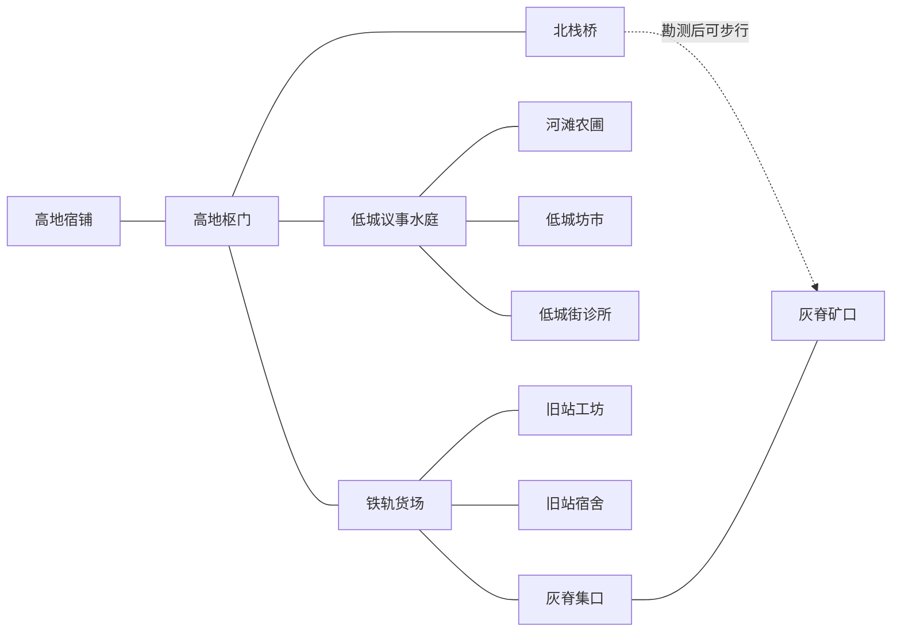

# 诸城之门

三座分开生活的城区重新通了货运。玩家接手高地枢门的调度板，从一台班车、两份货和一个名额开始。核心循环是查库存、选优先级、交货、花掉货物启动项目，再把成熟的线路交给班组。腾出的时间可以用来走访居民、协商下一班和处理新的城区需求。

## 首班怎么选

| 去向 | 首趟实际交付 | 项目立即花掉的物资 | 之后的影响 |
| --- | --- | --- | --- |
| 低城水庭 | 两份净水 | 一份净水用于节水公约 | 低城每 60 分钟消耗一份水，原先是 30 分钟 |
| 旧站工坊 | 两份维修零件 | 两份零件用于加固枢门 | 后续每 30 分钟补到两个名额，初始每轮只有一个 |

装货会预留名额并扣除待运仓的实物。交货后，物资才入目的地的公共库存。枢门的泵和零件仓有各自的产出周期，各地库存有上限。首班完成后可以调整优先级，或自己补运另一侧以解锁第二个项目。

## 交给居民之后

- 三名货运工共用一棵常驻行为树。工人先处理饮水、休息和手上的货，再根据优先级、可用名额、仓库余量和目的地库存装车。装货与交付由 Platform 结算，工人使用同一份运力。
- 沈芒、江遥、唐真使用 LLM 做关键决策和反思。沈芒有一项已配置的应急授权。班组接管且累计交付至少三次后，如果旧站优先且低城只剩两份水或更少，他可以把班组改成优先送水。普通工人读取这个共享调度决定。首版由已授权的行动改变工作安排。
- Director 在后台依据已提交的事件提出下一个阶段目标和取舍。God 可以据此新增地点、规则、人物或行为，Platform 校验并登记。Story 从公约、加固、交班、新规则和已有章节的实际完成情况继续写，并查看该存档的当前库存和调度。常规搬运只记账。世界包只有开场，没有预写的后续章节或终局。

## 试玩

在 `sim2 play` 的世界大厅选择《诸城之门》，或创建一个新存档。

```bash
sim2 init --world gate_cities --instance-id gate-demo
sim2 play --instance-id gate-demo
```

玩家的普通行动、等待和班组日常工作可以离线结算。启用已配置的文字模型后，可以与关键居民对话，或由后台运行世界演化。封面和高地枢门使用随包分发的静态插画。试玩原型已验证首班分岔、交班和首轮演化。多城区扩张及多轮演化的平衡需要更长的独立存档验证。

### 开场插画

内置 ImageGen 生成的插画以 WebP 格式存放在 [世界包](../../worlds/gate_cities/assets/freight-gate.webp)，用作启动器封面和高地枢门的场景图。

<details>
<summary>绘图提示词</summary>

Stylized concept illustration for the cover and opening scene of the original city simulation game Gate of Cities (诸城之门). Wide horizontal landscape. At blue dawn, a monumental weathered stone-and-bronze freight gate joins neighboring districts built on terraces around a steep river gorge. The gate's circular counterweights and one narrow working rail are clearly readable at the center, forming an iconic dark silhouette around a shaft of warm light. Below and left, a canal and cistern catch muted teal light beside crowded slate roofs. On the right, an old workshop terrace glows with a few amber windows. A single small cargo trolley with blue water canisters at the threshold gives scale. Painterly architectural environment concept art, natural stone, rain-worn metal, coherent perspective, desaturated jade, dark slate and copper, gentle rising mist, human and industrious mood. Maintain a readable gate inside the central landscape crop for a web game banner and compact world card. Clean edge-to-edge art. No text, lettering, logo, borders or interface.

</details>

## 建造经营版设计

建造经营版以独立世界包 `gate_cities_sandbox` 提供。在世界大厅点「诸城之门 · 建造经营版」，首页按钮为「接手高地工坊」。从命令行也可以创建新的试玩存档。

```bash
sim2 init --world gate_cities_sandbox --instance-id gate-building
sim2 play --instance-id gate-building
```

开场的勘测、许可、安装与配对都可从目标卡直接开始，角色会实际走到作业地点。配对后可在地图上看到门线。水庭的共管和公开竞争协议会改变维护资费，限行前有一个可协商的倒计时。

手动推进时，居民仍按行为树生活和工作，耗用的模型调用为零。要让关键居民开口协商，并让 Director、God、Story 接续发展，在网页的「世界与运行时」解锁管理，选择配置好的 `remote` 并点击「开始自动运行」。运行中的玩家行动由同一世界时钟结算。对单独的试验存档，也可在服务器未推进该存档时使用 `sim2 simulate --db <存档路径> --provider remote --minutes 90`。

玩家从一间小工坊起家。出门勘测地形和生意，回来制造门芯、架设施工点，亲自决定第一扇门连到哪里。开门后，居民用它上班、做生意和搬家。市场、工钱、依赖关系随之变化，玩家接下来要选建第二扇门、发展自己的工坊，还是参与城际协议。阶段可以结束，人物、家业和地图继续保留。

这里要守住一个玩法原则。每项规律都要让玩家能想出至少两种干预办法。例如旧站失去中转收入时，玩家可以入股它的工坊、补偿维护收入或发展替代门芯工艺。单独增加一种待运货物，很少能带来一项新选择。

### 地图与首批人口

开局设计目标是六十名具备个体记录的居民，其中五十六名走 BT，四名关键居民可用 LLM。首期四个片区的居民归属为高地十二人、低城二十二人、旧站十六人、灰脊十人。居所决定居民晚上去哪，工作点和物资流决定白天去哪里。以下地点使用同一张路线图，新增支路、封路和门线都能改变可达性。

| 片区 | 地点 | 玩家能做的事 | 居民为何来，改变后会发生什么 |
| --- | --- | --- | --- |
| 高地 | 高地枢门、井台与工位 | 取用或出售合法水源、修门、制造首批零件、设置三城通行条款 | 运工取货，修门工等委托。改线后这里可能成为公共换乘点，也可能只保留井台和小工坊 |
| 高地 | 高地宿铺 | 租床、招学徒、资助应急床位 | 夜班工和旅商有固定住处。床位与租金会影响谁能接高地的工作 |
| 高地 | 北栈桥与坡口 | 勘测、修步桥、加固成货路 | 开局只能经勘测确认安全的步道到矿口，重货走旧站。加固后，可把备用路线留给日常维护或应急通行 |
| 低城 | 低城议事水庭 | 取水、登记缺水户、商定配额和维护分摊、申请建门 | 居民取水，管理者按制度处理申请。稳定水源让作坊和新租户落地，水紧时配额争议浮现 |
| 低城 | 河滩农圃 | 灌溉、收货、租地、签收成订单 | 农户将水、工时和收成实际入账。灌溉短缺使下一批饭食变少，集中供水也会增加对一条路线的依赖 |
| 低城 | 低城坊市 | 买卖矿料与食物、出租铺位、发布加工订单 | 工人领另一份工作，商人选成本更低的买家。开门改变铺位占用、成交价和实际货种 |
| 低城 | 低城街诊所 | 提供用品、安排床位、送伤者、谈公共救助 | 伤者按可达性就医。多一条可通行的路会缩短伤者等待，诊所也可能因为过载提出扩建 |
| 旧站 | 旧站工坊 | 冶炼、制件、造门芯、谈合造或交出图纸 | 工匠把工时和料换成产品。低城抢走原料时，唐真可以提高收购价、培养学徒或改做维修 |
| 旧站 | 铁轨货场 | 预约货位、转运重货、建门端、改收费 | 商队核算真实手续费和等待。失去转运收入以后，货场仍可凭维修便利争取新订单 |
| 旧站 | 旧站宿舍 | 安置工人、邀学徒同住、接收迁居申请 | 职住距离改变接班率。拖欠工钱或床位长期不足，熟练工会主动找别处住 |
| 灰脊 | 灰脊矿口 | 勘测矿层、开采、开通安全出口 | 矿工带工具和体力入场。货路堵塞时会限产或转做清障，采出矿石仍要送到集口才能出售 |
| 灰脊 | 灰脊集口 | 买矿、租驮货位、建门端、接班和签集体供货协议 | 矿工交矿拿钱，外来者购买食物和借宿。直接通门后，矿户可以换买家，也能组织自己的供货合作社 |

主干常开，试配单程耗时为高地枢门到水庭 12 分钟、高地枢门到铁轨货场 18 分钟、铁轨货场到灰脊集口 28 分钟。高地枢门到北栈桥 10 分钟，勘测后的北栈桥步道到矿口 14 分钟，矿口到集口 6 分钟。水庭通农圃、坊市和诊所，铁轨货场通工坊和宿舍，高地枢门通宿铺，本地支路试配 3–6 分钟。玩家的首扇门在踏勘过且有许可的端点中选两处，首段开放高地枢门、低城坊市、铁轨货场和灰脊集口。



新地点登记时需要有一个可达入口、一项可以执行的活动、会使用它的人及所需的容量或来源。诊所需要床位和用品，铺位需要经营者与买家。地图公开、人员可达、活动可用、实际有人使用各自记账。

### 居民的需求、承诺与志向

借用马斯洛原文关于需求相对优先、可以同时部分满足的思路。游戏采用紧急生存与日常多目标两种决策情形。越过生存线就先找能达成的自救或救助，平时允许两个可行目标并存，人物性格、职业和对他人的承诺会改变排序。[Maslow，《A Theory of Human Motivation》，1943](https://psychclassics.yorku.ca/Maslow/motivation.htm)

| 需求或压力 | 状态从哪里来 | 城里有哪些满足方式 | 出现缺口时的后果 |
| --- | --- | --- | --- |
| 水分 | 水分属性，时间和体力劳动消耗 | 自带水、付费补水、按授权分水、向亲友请求、前往邻区取水 | 先降低工作能力，严重时中断工作并求助，耗尽时持续损失健康 |
| 饱食 | 饱食属性，时间和劳动消耗 | 自带食物、买饭、在农圃领工餐、公共救助 | 缺粮居民会改班或提前离开，严重时影响健康与搬运 |
| 休息 | 精力由工作消耗，登记床位决定恢复效率 | 短歇、回住所睡觉、租床、接受临时安置 | 不能做重活时改轻工或换班，长期无法休息会找更近住处 |
| 健康 | 受伤和严重短缺写入健康与伤情 | 自救、去诊所、请人护送、用床位静养 | 重伤时停止高负荷工作，失能者由同伴或制度任务接手 |
| 安全 | 已知路况、住所许可、食物与住房的可负担时长 | 查路告示、结伴、改道、短住、申请支援 | 居民会避开关闭的路线，工人可辞去长期无法赴约的岗位 |
| 生计 | 钱包、订单、工资拖欠、技能与有效岗位 | 接班、加工、摆摊、换雇主、学手艺 | 稳定收入消失会优先寻找工作，替代机会集中时会出现迁居 |
| 归属与责任 | 真实关系、共同经营、照料义务、欠下的承诺 | 共住、互助、履约、加入组织、协商改期 | 熟人可能互相提供食水或代班，重复失约会让合作失去支持 |
| 声望与成长 | 技能记录、可核验的履约、推荐、争议与长期项目进展 | 做出合格成品、授徒、接公共委托、开店、申请管理岗位 | 居民可获得不同工作和权限，革职或店铺倒闭也会产生新的职业选择 |

第一版把水分、饱食、精力与健康保存在人物身上。生计和安全从可达服务、资产与合同推导。归属、声望和志向从社会记录推导，玩家面板只展示当前最影响行动的原因。

开局调参以 0–100 计。水分或饱食低至 20，或出现严重伤情或眼前危险时，进入紧急状态。水分和饱食至少回到 45、脱离当前危险、精力可支持下一段路后才恢复日常安排。保护附近受伤的人可以成为紧急目标，前提是有可达地点、手段和返回安全点的余地。自救无可行路径时原地求助并保留具体阻碍。重抢同一份物资、空跑同一路线或重复发出同一求助都要受到失败原因和重试条件约束。

首轮试配每游戏分钟水分下降 0.05、饱食下降 0.035，劳动额外消耗，喝一份净水恢复 40、吃一份饭食恢复 55。先试 12 分钟短歇恢复 18 点精力，90 分钟床位休息恢复 55 点。健康记录伤情和严重短缺的后果，日常恢复和治疗需要实际时间、用品或床位。面板用“撑得住多久”“哪里有货”帮助玩家选择，水分和饱食告急时才占据显眼位置。

每人还要有一项长期志向、当前项目和少量有效承诺。矿工可以攒钱搬离危险工地，父母可以优先找能在白天回家的班次，工匠可能愿意接受少一些工资以换取学艺资格。承诺带当事人、内容、期限、履约证据和可见范围。性格定义为对收入、关系、稳定、技艺或自治的偏好。它影响有价值的选择，长期改变需要结算过的事件。黑板能给玩家解释“白砾改去旧站，因为家附近没有床铺，而且旧站给了带住宿的班次”。

### 普通居民的行为树

多人共用树的构造，使用各自的家、职业、私人物资、班次、熟人、承诺和志向绑定。矿工、农户、工匠、搬运工、摊主、照护者都拥有同一棵生活树的生存、社交和恢复分支，并拥有各自的工作子树。跨职业靠已有技能、岗位与训练成本判定。

| 条件 | 开始的行为链 | 失败后怎么接续 |
| --- | --- | --- |
| 自己遇险或急需食水 | 核对随身物资和安全点 → 用物品或抵达最近有权使用的服务 → 核对恢复 → 重排余下班次 | 换设施、请亲友代办或发出一次求助。收到缺货补货、道路恢复或回复时重新评估 |
| 附近需要救助且有余力 | 核实请求 → 预留用品或床位 → 赶到现场 → 交付或护送 → 记录实际帮助 | 用品不足时请求代办。可达性变化时释放目的床位并寻找下一处 |
| 有正在做的工作和已占用资源 | 继续当前有进展的步骤 → 实际交付 → 领取结算 → 决定回家或接下一班 | 紧急危险或许可丢失时停在安全边界。保留已完成工时、归还未使用预留，货物继续实际存在 |
| 合法承诺到期或班次开始 | 比较已承诺工作与安全、工资、往返时间 → 到岗 → 干活 → 验收领薪 | 向雇主报阻碍、请求代班或改期。持续拖欠时解除承诺，再评估新岗位 |
| 有尚未满足的亲友义务 | 选一个当前有用的互助动作，例如带饭、代班、护送或短住邀请 | 核对互助是否真的帮助对方。已完成的同一件事不能重复刷关系 |
| 生计不稳或长期志向有进展机会 | 查公开岗位和学徒位 → 比较实际收益、风险和住处 → 应聘、采购、训练或看房 | 申请被拒后只在空位、资格或工资有实质更新时重试 |
| 工作结束或暂时无新事 | 回家、到安全处短歇或在下个需要处理的时点醒来 | 保留当前堵塞原因和下一次有意义的唤醒时刻 |

紧急分支优先评估。平时以可达性、库存、许可和真实时限筛掉空选项，再比较恢复收益、承诺、性格和成功条件。两种工作差异很小时继续当前安排，减少来回改主意。两个门位或岗位出现争用时，由平台按预留顺序与公开的队列规则结算，居民按实际失败原因换方案。

### 关键居民、提拔与新居民

| 人物 | 短期责任与掌握的权力 | 长期目标与会改变立场的证据 |
| --- | --- | --- |
| 沈芒，高地调度员 | 守住安全通行和备用路，能在许可内改调度、提出临时限制 | 想让主干门能持续自营。连续缺维护费会寻求共管，单城垄断备用路则会推动新的公开通道 |
| 江遥，低城议事员 | 负责水与诊所的保底配额，能召集居民商议和提出合同 | 想让普通家庭买得起基本服务。维护责任公平时愿意联盟，紧急通行被反复卡住时会资助备选路线 |
| 唐真，旧站工头 | 掌握本地造门芯工艺，可提出订单、岗位与工坊合造条件 | 想让工人有收入，也保住本地工艺。若垄断收益下降，有机会改做维修和授徒，也可能选择降价抢客 |
| 苏缄，灰脊代表 | 汇总矿户供货承诺，能提出停供、预支和安全改造条款 | 想让矿户掌握自己的销路。出现可靠的第二买家才有条件要求更好的价格，家乡有安全保障时更愿意扩产 |
| 白砾，普通搬运工 | 拿工钱、履约，想在家附近安置住处，也愿意帮同班工友找工作 | 反复成功代班并获得同伴推荐后，可被邀请管理一个实际存在的班组。可接受、婉拒或提出要床位和工具 |

岗位资格和是否需要 LLM 分别记录。接班组、管铺位和被选为代表是游戏事件，先按权限流程获得岗位。需要独立商谈、组织工作或处理少见局势时，才有理由分配 LLM 名额。启动的设计条件是有空缺或真实的自治职责、候选人有该职位认可的履历、本人同意和有权者授权。班长候选的试配门槛是三个不同班次的实际代班结果、两名同班居民推荐和一次合法任命。普通代班只能调自己的班次，受任的班长才有同意代班和提议库存底线的权限。门芯工匠可以靠合格作品和同行推荐成为代表，落脚的新居民也可以通过资本、手艺或大家的信任获得职责。

提拔时使用原居民 ID，家、钱、技能、关系、承诺和已记住的事件保持连续。正在做的工作在安全边界切换控制方式，未完成意图按版本核对。失去职务、拒绝任命、长期离场或本阶段没有战略难题时可以把 LLM 名额让给别人，人物继续用 BT 生活。模型不可用时，关键 NPC 也按绑定的生活树求生和履行已签承诺。

新居民优先从邻区迁居或从外区生成有来处的移民。进入常住状态要有一条可走的路线、可用的临时床位、技能或抵达理由，以及真实的初期食水来源。档案可以记录其过去，当前资金、随身物和居住许可按已核验的迁入规则登记。God 可提出带目的的新人，现有居民获得新职责时优先沿用其履历。

关键 NPC 的模型回合优先响应签约、破约、授权变化、重大短缺、新门影响、选举和争议。一轮从可见处境、人物的长短期目标、相关合同与最近结果出发，提交一个已存在的行动或有条件的提议。反思记录可核对的经验，比如“临时调高运费后客户连续两次走了灰脊旧道”，下一次可以据此主动改条件。班组接到的结果应是实质可执行的排班、库存底线、许可范围或停工条件。班组听见命令后仍会核对安全、合同和自身需要。

### 动作目录与结算

动作定义世界怎么变化，行为树负责在合适的时机串起动作。亲身操作由玩家选，工人可承担执行，关键 NPC 能提出涉及授权的安排。每项动作必须能回应一条玩家看得到的条件，并有真实的输入去向、成功结果和失败后的出口。

| 动作 | 事先核对与付出 | 成功、失败与后续 |
| --- | --- | --- |
| 勘测端点或步道 | 抵达已知入口、有体力、消耗勘测工时 | 揭示坡度、站位、近邻与可通行载重。遇阻保留部分勘测记录，给出清障或绕行入口 |
| 徒步或合法通门 | 已知连接、可通行许可、费用和适用的运力 | 确认出发与到达；封路时显示阻碍、退未使用费或回到最近可达点 |
| 设置建门工程 | 协议批准、两个勘测端点、尚未占用的安装位 | 暂锁端点并生成有承包人和材料表的工程；过期松开站位和未交物资 |
| 安装与配对门端 | 设定一对端点，有一枚门芯、四份框架件与工时；两个端点各消耗两份框架件 | 端点安装分别有进度，配对结算消耗门芯并发布新路；反悔能拆回计划中可回收部分 |
| 检修、临时停门或恢复 | 操作权限、对应的料和工时；对在途人员预留退出方式 | 门况、可用班次和维护记录变化，维护不及时会消减容量，完成检修后可复开 |
| 修步桥与加固货路 | 勘测记录、许可、两份框架件与工时 | 步桥先开放人员和轻物通行，加固后才进重货。复用同一条已有支路，不生成凭空跳转 |
| 灌溉、采收、取水 | 有权限且已到场，农业用水入账，植物按时间生长 | 收成或饮水进入实际库存。旱情与缺工按实际劳动和投入减少产出 |
| 采矿、冶炼、加工与回收 | 工具、可用矿层或配方输入、容积、工时 | 起步配方为两份原矿和一份燃料出一份金属，两份金属出三份框架件，两份金属和一份矿层晶片出一枚门芯；燃料采购自农圃副产物。成品入对应库存，失败消耗按已完成进度记账 |
| 预留货位、装货与卸货 | 可装载地点、有效权限、有实际货、能预留空位 | 装货挪动实物，卸货才入目标账，交付失败时可返仓、改交或申请延期 |
| 发布报价、成交、撤单 | 所在市场、交易许可、余额、对方储位 | 钱货同时变更，公开账本记录价格；未成交退未用的预留，同一合同只能交付一次 |
| 应聘、接班、代班、结工资 | 岗位有效、技能与时段匹配、雇主有可预留工资 | 上岗绑定工作经济。完成有效工作才领薪，拖欠触发争议与改雇 |
| 饮食、短歇、睡觉与租床 | 食水实物、安全点或有效床位，租住预留费用和床位 | 恢复对应需求；无床时选短歇、临时安置或换居所 |
| 护送和诊治 | 病人可接触，有经授权的用品、床位和能到场的人 | 实际到达或恢复，诊所库存与床位占用变化，帮助记录可支撑未来关系 |
| 拜师、教习和完成训练 | 有师傅、空闲工位、材料及双方同意 | 实际完成认定项目增加熟练度或资格，有受限的新工种选择 |
| 打包搬家、借宿、开展店铺 | 可达住所或店位、租金、搬家时间、实际货物 | 原对象交接，改变居住地和日常路线；铺位只有存在经营者和物资才营业 |
| 提议、签订、履行和退出城际协议 | 当事人权限、条款、预算或资源承诺、生效时间 | 产生可执行通行权、容量保留或共同维护，履约和破约从实际使用判断，退出后已承运货物按条款处理 |
| 申请、推荐、任命和卸任 | 岗位空缺、候选人的证据、授权与本人响应 | 任命授予范围明确的权限，任务和资源由原人交接，调度资格变化可在城里查到 |

开局玩家领到一枚门芯和四份框架件，足够建一条直通门。首批端点安装试用每侧 40 游戏分钟，配对 10 分钟，通门 4 分钟。普通班试用 60 游戏分钟，一对门两端共用每班四份货位。空手出行单独核对人员许可，货位留给实物。开局供给试算以六十人每人每天两份净水和一份饭食为基线。两处水源满产每天合计 160 份，农圃和诊疗计划使用 30 份，净余约十份。农圃满产 72 份饭，余量约十二份。库存、产量、气候、劳动负荷和通行压力都可以单独调参，以实际领取和损耗复算。水和食物按公开储位保管，紧急库存只在规则明确的支援动作中支用。

货物先验后收，币只在钱包、铺面和公共账之间周转。开局工资由雇主预存，走货路有费用或时间。低城新增商户实际成交后才能交租和雇人。失去订单的旧站要另找经营收入才能维持工资和公共门。玩家看得见哪条价格、工资或持权条款使交易改道。

### 第一段可玩体验的三条解法

玩家勘测灰脊集口后，可以让第一条门直达低城坊市或旧站货场。也可以暂用北栈桥，把门芯留给后续。低城直通能把市场竞争和租铺提早带出来。旧站直通能加快造下一枚门芯，低城则可能争取应急通行保证。先加固栈桥需要两份框架件，玩家须补齐耗掉的组件，或以维护承诺向工坊赊材。

门开后的两次选择分别发生在交易和用工。旧站开始丢单后可改报价、转做维护、与灰脊独签供货，或提出三城共管。低城若确实有交易和岗位，工人会根据工资和租金分批迁居，当地供水、床位与诊所也会承压。城市冲突按实际可履行的政策表现。共同维护可以继续，市场仍可竞争。退出维护或限制通行需授权、可见通知和生效时间，实际关闭时居民改道与求助。谈判或冲突后的玩家有重开通道、补偿、重组协议和寻找新盟友等玩法。

首段验证有经济竞争、联盟与有限封锁的条件。双方要升级到城际交战，需有独立的资源、自治权和可审计的长期后果。后续阶段可以允许这种升级，先让居民和玩家经历独签断约、关门、避难与停争后的复通。每次升级都应给人一段尚能挽回的时机，玩家能从告示、交涉和物价变化看出发生了什么。

Director 读取本档正在发生的投入、短缺、搬迁与承诺，选择值得发展的阶段。God 按契约补出缺失的地点、制度、行为或迁来的人，该内容要能被合适的角色实际使用。Story 续写已经发生的变化与尚可选择的行动。结算前的计划、已登记的规则和实际采用的结果分别留下证据。政策不会因为一句对白就生效。

### 落地范围与验证

| 部分 | 对照现有框架 | 新版验收 |
| --- | --- | --- |
| 需求与日常 | 已有需求曲线、上下文门控、命名子树、条件和动作事务、BT 控制方式 | 把吃、喝、休息、安全和日常工作绑进一棵树，把住房、工作、亲友绑定给不同居民。断路前后居民改道，脱险后续上合法承诺 |
| 人物与授权 | 已有 God 实体提案、居民行为绑定、贸易与制度维护、角色上下文和 BT 退路 | 加入岗位与控制权切换的持久化流程。白砾从正常劳动积累资格，接任后保持身份，能组织班组。关闭模型后依然能生活 |
| 门网 | 已有路线、资源和行为版本，新增地点走平台校验 | 定义配对端点、共享运力和通行成本，两个动作同时争抢最后一个位置时只受理一个；中断、恢复和读档保留真实货物 |
| 城市与玩家 | 第一版已有货运、公约、加固和不同存档出现新内容的证据 | 同一开局至少能打通直达低城、直达旧站和先修栈桥三条路线。至少两档在真实成交、就业迁居或门权上明显分化 |
| 性能与成本 | BT 居民日常没有模型调用，当前调度器仍逐游戏分钟枚举居民 | 先实跑 60 和 120 名居民，记录每个游戏日模型调用、重复失败和每 tick 分位数。再用 1000 名做基准，按需安排唤醒、就近筛选目标并汇总低价值履历 |

模型预算从四个活跃名额起，试配八个上限。单独记自动决策、反思、明确的玩家对话和世界角色的请求数与输入输出 token。首轮试配每游戏日自动决策和反思合计至多 32 个会话，每个会话最多三次请求，紧急保留的份额包含在内。重复请求的合并键包含人物、触发事件和目标。耗尽预算时继续执行已接任务、BT 生活和时间结算，仍有效的争议在下个窗口继续。以上是配置试值，尚需在真实调用和人口基准中校准。

验收使用同一组起始状态和不同玩家行动。离线跑一周，查看各城有没有长期断水断粮、无解工作、空跑、迁居振荡或预留残留。用已配置的远程模型做多档复测，保留可检查的任命、合同、违约、迁居和选择结果。实际履行与可见后果发生后，才算环路完成。开发重点放在玩家前二十分钟亲手建门、干预政策，以及第一次回访时能在街上认出自己的选择。

## 经济审查与下一阶段设计

### 0.4 可玩闭环

进城后首屏先看当前经营目标、现金、框架件和已开门线。两端错装时，页面直接提供改接与拆回两种处理。改接复用灰脊现有端点，拆回未配对的端点返还两份框架件。旧档升级读取原有端点、安装位和门芯，按实际项目进度展示行动。

玩家可以先建门，也可以直接前往低城坊市投入两枚钱，接水庭的路石订单。工坊账付一枚钱向灰脊买两份矿料，货随实际运送入坊市仓。加工消耗两份矿料，付一枚工钱并从水庭已预留的资金收三枚货款。玩家可以自做，或授权坊市班组负责采购和加工。采购与工位各有一个预留名额，途中持有的已购原料可以续运。工坊每个结算批次最多分一枚钱，至少留两枚周转金。

两批路石可把坊市到水庭的路缩至两分钟，也可拿一批路石维护开放的低城门线。首页根据已交付、已分红和道路状态切换目标，账面显示累计货款与实际支付成本。关键结算进入纪事和 Agent 的上下文。首期工坊的单价和收购预算来自世界包，地区动态报价与更多经营资产仍见下文方案。

### 0.3 基线问题

试跑版本有可结算的库存、工资、租金、门费、公共维护与制造配方。普通交易主要使用固定价，各地账间只有少量回流通道。低城和旧站每份矿料都付一枚钱。竞争条款每趟向运货人收一枚钱，因此直接送这一份矿的货款恰好抵掉门费，尚未算工时和其他成本。低城仓收矿，当时没有消耗该仓矿料的生产或转售路径，库存达到 35 份便停止收货。建门后的成交量、地区购买力与可持续产能需要分别测量。

在已开门的 60 人低城存档上，关闭模型并继续 660 个游戏分钟。钱包、九个资金账户和动作中已预留的货币合计在四次采样中均为 402 枚。低城库存由 5 份矿升到 35 份收货上限。饭食由 22 份降到 7 份，中间采样为 6 份。零现金钱包从 9 个增至 11 个。这组账能核对短期货币去向，也暴露出低城供给和库存的瓶颈。

### 参考作品与取舍

| 作品 | 参考的机制 | 《诸城之门》的应用 |
| --- | --- | --- |
| Hay Day | 路边摊把商品、数量和币价做成一个易读的交易入口 | 商会摊位直接展示可成交批量、净收入、到货期和付款方。 [Supercell 货币与路边摊说明](https://support.supercell.com/hay-day/en/articles/coins-diamonds.html) |
| Factorio | 手动验证生产路线，随后由设备和配送网络重复执行 | 第一单让玩家亲手做，第二单起可委托班组并签补货合同。新瓶颈来自运力、资金、劳动力和回路维护。 [Factorio 官方玩法](https://www.factorio.com/game/content) |
| Anno 1800 | 居民需求、生产链、劳动力和贸易路线相互制约 | 每地先做一个区域优势，控制关键品类数量。住房、水和工资会改变一条线路可以雇到多少人。 [Ubisoft 官方介绍](https://www.ubisoft.com/en-us/game/anno/1800) |
| Victoria 3 | 地区市场和买卖单的变化影响产业收益 | 公开短缺天数、已承诺采购和可出售批量，市场联通后地区价差随实际到货缩小。 [Paradox 市场扩张开发日志](https://www.paradoxinteractive.com/games/victoria-3/news/dev-diary-37-market-expansion) |
| Against the Storm | 一个周期有阶段目标、压力和验收 | 一季结算完成到期合同、确定城市盟约与损益。下一季在原存档发出新的矛盾，继承道路、产权、人口、债务与信誉。 [Eremite Games 周期更新](https://eremitegames.com/cycles-reforged-update/) |

### 世界如何给商品定价

首期做矿料、燃料、框架件、食物和净水。各地分别有可售库存、实际消耗、在途货物和已锁款采购单。市场一班清算一次，用库存可用天数与有效买卖差计算指导价，基准价、保护价、每班涨跌上限均由配置给定。报价牌同时写明变价原因，例如「低城仓库存够两班，且有一车在途」。报价在约定窗口内锁定，过期重新确认。

订单成立先托管货款或商品，交付时按实际件数结转，库存不足时允许分批或撤单。预约运力、支付运费、实际收货和退款都有事件凭证。净收益为已收货款减采购、运费和耗材。缺水时先执行明确、已筹资的保底份额，其余走交易，公共预算记录谁为保底付钱。

### 钱如何变成持续经营能力

| 阶段 | 玩家决策 | 账面结果与风险 |
| --- | --- | --- |
| 第一份合同 | 现货快卖、签带预付款的采购单，或把货留给自家工坊 | 现货周转快。预付锁定销路也锁定产能。留货可能抬高成品利润，也占用现金和储位 |
| 投入 | 用利润开/租工位，或出资加入居民合作工坊 | 培训、维护和备料支出从独立工坊账扣。租赁退出灵活，持份可参与定价和接单政策 |
| 自持经营 | 约定补货价、最低现金和工资，用班组完成重复劳动 | 先付工资和生效费用，再留下一班的成本。利润和亏损归资产账，分红从可分配余额支付 |
| 扩张与调整 | 把收入投到另一城、增加门班或改签共同维护 | 运力提升能降低履约成本。价格下跌、客户违约和门线受限都可能改变回收期 |

首期融资只做预付采购和项目合伙。玩家、NPC、商会与市库可以出资，出资进入指定项目托管，按合同承担分工和风险。提款和分红必须有已结算的合同收入。资金紧张可以转卖工位、缩减班次、重谈供货或引进合伙人。玩家的选择会改变工坊雇工、城市税费和谁有议价权。

### 币的来源、回流与平衡检查

- 使用一个结算币单位，账户用整数最小单位记账。钱包、机构金库、项目账户和托管合计应与配置初始货币及明示的发行、回收一致。每笔记录付款方、收款方、金额和业务原因，依靠 Platform 事务完成，取消或重试需幂等。金库满额时多余余额进入登记账户或拒收，资源上限不能隐式抹去钱。
- 居民付给铺面，铺面支付工资和采购，市库用租金和门费购买公共服务。外来贸易、港口税、项目补助、货币发行需要各自的现金或明确来源。长期需要区分纸面财富、可闲置资金和当前可支付工资的流动性。
- 用同一初档分别跑自运、委托、合作工坊、公共投资和单路垄断。即使一条路停摆、居民迁出或出现歉收，也要有可行恢复策略。先做 7 日、再做 30 日的结算对账，每日记录食物购买力、各城欠薪/违约、现金周转、负毛利路线、利润集中、缺货率和维护资金断档。短时对账只说明该样本的钱没有散账，不能证明长期平衡。
- 初期手动模式保留完整的固定规则经营回路。自动演化使用玩家或自托管配置的模型与预算，开放导入世界包和分享可重放的存档证据。游戏时间加速、扩产和剧情进度均由本地世界状态与玩家决策驱动。

### 把演化做成可玩的差异

同样是低城缺金属，Director 依据履约比例、价格和库存判断下一季最值得解决的矛盾。唐真可以提出合伙冶炼，江遥可以提出扩充低城工位，玩家也可以支持灰脊矿户建立合作社。God 提交经验证的新地点、工位、行为或合约模板，关键 NPC 仍按自己的权限决定是否出钱、披露条款和承诺。生活班组在条件满足时搬运、加工和工作。Story 把实际发过的报价、同意的条款、账上的支付和最终迁居讲清楚。给每份世界演化展示「触发原因、谁采用、什么改变」三条可点击证据，让玩家也能复查哪一个选择引出了哪个城市。

## 0.5 街巷生活与两城采购

进入场景时，「街上遇见」读取在场居民当前执行的具体动作。它先展示少量居民，展开可查看同地的其他人物。城中近况从实时的库存、道路和营业状态生成摘要，并从公开纪事取最近几项变化。居民内部的例行行动流继续留在观察者界面。

普通居民的日常仍由行为树驱动，交谈也可以走便宜的本地路径。世界包在 `rules.resident_conversations` 下配置默认话题和实名人物的补充话题。每个话题由问题和按序匹配的台词组成，条件使用现有 DSL 的 `actor` 和 `world` 状态。玩家必须与对方同地并通过当前行动的交谈权限检查。问答写入同一段对话历史，不启动模型。玩家可问苗原的工位和晚饭，也可花两枚钱给班组搭长桌。工坊从现有公共饭食领取份额，班组吃饭后实际增加饱足与归属感。人物卡上的协助行为仍经普通行动入口预留费用和结算。

有了坊市短路，工坊可以同时收到两种出资有据的报价，每次只接受一份。水庭预付三枚，在坊市收货，三批石料能砌农圃引水渠。旧站预付四枚，加一枚招工津贴，成品要跨区送到铁轨货场。姚齐到坊市领取津贴后增加一个可并行使用的工位，交完三批可用石料铺装货道。后两批分别解冻三枚托管款，按时交齐奖一枚。两座城在签约时预留现金，玩家签约后可以让班组跑完整条链，也可以介入采购、生产和运输。

两种报价的金额、批数、时间、地点和公共工程由世界包配置。这一阶段的远程 Story 根据本档完成的工程产生下一步议题。验收节点会出现在当前场景的公开纪事里，也进入 Director 的世界观察窗口。多季是否可以连续产出并完成不同的新目标仍待验证。

## 0.6 玩法大纲与实施细则

玩家是经营工坊、在城邦之间做安排的人。核心循环是发现压力、决定筹资或筹货、分配稀缺资源、和受影响的人一起看到后果、决定是否把临时安排变成长期制度。开门、铺路与招工扩大这套循环的选择。每次议事可以结案，城邦生活继续。

我从正常入口只读核对了「旅人」续档。第 912 分钟，低城只剩两份公共饭食，旧站有二十六份饭和四枚薪金，低城有二十四枚薪金和二十九份净水。玩家已铺好坊市短路、签过公开竞争议约。此前一段时间主要在等待工坊和领取分红。0.6 先在这份真实存档副本上完成以下六项，验收同时覆盖另一份 Wolf 旧档。

### 1. 玩家一进来就有决定要做

把「低城断炊」设为短路开通后的首个议事场景。公粮低于阈值且本轮尚未开案时，优先显示可执行的行动。第一步在水庭决定怎么筹粮，第二步分配，第三步结案。每次部署都花两到三个游戏分钟。玩家有并行的工坊业务，可以在议事结束后继续经营。

- 筹粮有两种开法。向旧站买十份饭，把低城六枚薪金支付给旧站，且卖方至少保留十份饭。提前收割用四份净水与两份燃料换六份饭，并向农圃留下两份水。
- 分配阶段可以把六份放进水庭公粮，也可以留下四份请两班工人修路。十份能做两件事，六份只能优先选一项。办完任一项即可决定长期安排，手上有余粮仍可先做另一项。
- 验收从同一存档分别选贸易和抢收，实际出现不同选项组合。两个分支都应在 20 个游戏分钟内完成三次有后果的决策，玩家无需点等待才能进入下一步。

条件匹配参考《风暴之城》按聚落条件发放订单，以及用季节阶段形成不同压力的做法。我们的结案保留角色和地图，把压力与结果带到下一轮。 [订单生成开发日志](https://eremitegames.com/coral-forest-update/) · [阶段与地图开发日志](https://eremitegames.com/devlog-world-map-deeds-and-phases/)

### 2. 让有限的钱粮成为城市关系

两城各有自己的饭、薪金和库存底线。动作在开工时预留支出，结算后才增加收款方余额，不能同时签下两份抢同一笔库存的安排。筹到的饭进入本次议事专用储备，玩家明确决定何时进入公粮、何时预付工班。结案后，余粮在公粮有空位时逐份退回。开过议事后，低城先留足十份公粮，再走平时的对外饭车。

- 两城互济条款先完成一笔两枚钱换三份饭。以后只有低城缺饭、旧站可留足底粮且低城有钱，才按同价履行。
- 农圃条款先给三份井水。以后只有低城缺饭并有余水与燃料时，才用两份水和一份燃料补收四份饭。
- 可以保留上轮政策结案。改签互济或农圃后，旧条款停止履行。价格和上下限均由世界配置提供。
- 验收核对低城薪金减少、旧站薪金增加、库存限额、预留互斥、余粮归还。两条长期规则各自动履行一次后，分别在卖方留粮和本地能源约束下停止，防止一直透支。

《Eco》的劳动合同和可执行法规把报酬、物资与权利放进同一系统。这里借用这种联系，用两个有明确上限的条款先校对收支。 [《Eco》官方机制说明](https://www.play.eco/) · [开发商维护的法规资料](https://wiki.play.eco/en/Laws)

### 3. 让居民实际行动

低城居民有饥渴和休息需求，有余力才接修路班。每班扣两份预留饭，提高实际饱足与归属感。两个班次都结算后，应在地图新增坊市直通农圃的两分钟步道。委托、施工、竣工分别对应可观察的状态。居民忙于其他事时，玩家仍能继续下一项议事。

- Web 可以看施工人数、是否还有预留饭、走哪条新路，并在城中近况看到签约或竣工的记录。
- 验收至少观察一次常驻 BT 到坊市上工，完成两班，核对饭食和需要实际变化。重开同一档后，新路仍在且可正常走。另一条只放饭的路径保留旧路并增加公粮。

《环世界》把故事建立在实际角色遭遇上。角色的生活状态和可见行动应共同证明结果。 [Tynan Sylvester 的 GDC 演讲](https://www.gdcvault.com/play/1024232/-RimWorld-Contrarian-Ridiculous-and)

### 4. 让结案引向下一轮

一次结案后给城市三小时游戏时间消化政策。如果仍缺粮且初始资源允许，玩家可以重新筹粮并改签。长期变化仍由现有状态产生，已施工的道路、历史账和关系留存。持续见底的薪金、道路改变后出现的市场竞争等可以成为后续议题。

- Director 根据实际压力安排下一处值得解决的问题。God 在平台允许的范围内提交可执行的制度、行为或设施。Story 根据已结算的事实解释为什么事情发生、谁受影响，引用真实能执行的下一步。
- 本版把筹粮、拨粮、签约和竣工接进 Story／Director 的证据窗口，沿用现有提案校验。世界状态只能由平台修改。普通供饭和施工由 BT 与规则结算。
- 本版实测要求从同一原档产生两个不同结果，结案后至少有一次自动履行，且在缺粮复发时能进入下一轮。从两个不同的真实结算事件各跑一次用户配置的远程 Story，核对下一步能够指向现有行动或清楚标识待议事项。多季的全自动结构扩张沿用现有演化目标账本继续追踪。

Generative Agents 将观察、记忆、反思和规划拆开。本项目用真实结算记忆支撑关键角色的反思，并对普通班组保留确定性的调度。 [Park 等人的 UIST 论文](https://doi.org/10.1145/3586183.3606763)

### 5. 首屏按决策组织

把当前议事放在角色状态下面，先展示库存、资金和能点的选择，再展示街巷、场景图和次要经营。每个选项用一句话显示支出、所得和受影响的一方。结案后显示已生效条款与新路进度，并让工坊继续出现在可操作的位置。

- 保留当前位置、体力食水与背包入口。对无效选项写可操作的中文原因。紧凑事件流继续只推送有意义的变化。
- 390 像素手机与桌面都从实际入口续玩。无须先滚动找动作、进观察者界面或手动压住重复等待。完成一项后下一组选项就位。
- 性能用本机实际运行衡量，分别跟踪推进耗时、读取响应和每类模型调用数。居民等待和调度用已有 BT，结案后才根据关键事件唤醒模型。

《Factorio》把模拟性能按系统测量，闲置实体可以休眠。《风暴之城》让提醒可直达相关界面，订单类型在图标上可区分。 [Wube 性能开发日志](https://www.factorio.com/blog/post/fff-148) · [《风暴之城》交互更新](https://eremitegames.com/upgraded-living-update/)

### 6. 按真实存档与可反驳的指标验收

先接通议事桌和规则，再接通 NPC 施工和历史，最后验证恢复与因果差异。初始出价只是假设，按实际游玩反馈调。两条线各跑十几分钟的模拟不与长期余额测试混为一谈。

- 用「旅人」第 912 分钟与 Wolf 第 959 分钟的副本。验收保留原角色、背包、道路、合同和在途工作，并核对正常入口采用的实际世界包版本。
- 浏览器回放两组分支，记录首屏第一项、第一项完成时长、有效决策次数、有没有无意义的等待、两城现金与库存终态、道路是否新增。另测签约竞争、存档读回和政策不再具备履约条件的情况。
- 试玩感觉与数量证据都保留。工作坊利润、居民领取量和两城库存不能光看增加次数。若某一选择总是赢家，调整价格、库存下限或回报，然后复跑。诊断与模型使用证据留在本地开发产物。

《杀戮尖塔》的开发者同时看选择频率、结果和玩家反馈。本版同样用指标找出永远没人选或永远正确的选择，再靠实际试玩判断是否有趣。 [Mega Crit 的 GDC 平衡演讲](https://www.gdcvault.com/play/1025731)

### 7. 内容丰富度与闭环

一轮应包含几种不同动作，并在另一个系统留下后果。0.6 通过筹粮和调动资金、处理居民与工班的冲突、建设地图、签订可自动履行的条款、选择新路经营方式形成一段闭环。故事或对话可以点出矛盾，具体后果由已经通过平台结算的行动证明。

| 玩家做什么 | 具体改变 | 后续从哪里出现 |
| --- | --- | --- |
| 选城际采购或本地抢收 | 消耗不同资源，手头有十份或六份储备 | 两种储备允许不同的分配组合 |
| 先放饭或请工人施工 | 饭立即入公粮，或分两班变成可走的近路 | 居民可以领取饭，修好的路出现新的运营选择 |
| 签互济或农圃供饭 | 下一次缺粮时用真金或水与燃料结算 | 原料或钱不足则暂停，压力可能让下一次议事再出现 |
| 给新路设农圃早摊或工坊备料 | 预算和材料足够时，净水换饭或旧站矿料进入坊市 | 工坊和居民的日常行为消耗新的供给，地图与账目记录持续作用 |

近路运营选择在验收后才出现。早摊投两枚钱给低城薪金库，公粮偏低且水庭有余水时，用其中一份净水补三份饭。工坊备料投一枚工坊周转金给低城，由旧站以两份库存矿料支持坊市，且保留六份本地矿料。两条运营路互斥。玩家仍拥有原来的道路线、既有工坊订单和应急议事。在压力再次出现时，新一轮应依据新的资源与建筑状态提供可行选择，已完工的近路不会再次收施工饭。

内容多样性用可观察的变化验收。两条存档的决策、人物参与、可达地点和后续资源流至少在两项上不同。第一轮的成果至少触发一次有效的后续行为或制度结算。续档后该变化仍存在，而且在资源不足、满仓或权限缺失时能停下来解释原因。

正常入口使用 `sim2 play`。世界包以清单中的 `upgrade_from` 声明可接续的旧版本。启动时先备份已识别的原包存档，再加载玩法更新。大厅显示实际的存档包版本。服务器重启后，已有角色按原实例续领会话。

## 0.7 产业沙盒

### 实际体验与取舍

实档第 1093 分钟已经买到十份议事粮。此时进入游戏会直接看到分配选项，手上另有五枚钱。前几个版本的经营大多接着系统出的议题走，玩家虽能改变一段规则或路径，却少有自己可发起、可以边走边改变用途的长线项目。有意义的扩展要提供多种目标，同时让人能看见库存、资金流和地图变化。

「产业」是一个常驻画面。玩家自己决定先去哪片地开业，可以同时经营几处，也可以把一期产出全部留给建设或生活。已有议事可以暂放，存档保留它当时的状态。下表是最初三块地的经营差异。

| 产业 | 你做的决定 | 会持续留下的东西 |
| --- | --- | --- |
| 河滩炊坊 | 用一枚经营金、一份水和一份燃料做出三份饭，卖给水庭或旧站、自用或补进驿舍 | 真实饭食出入库。卖给水庭通常结算三枚，旧站库存低且有钱时以四枚收货。修具可把炉改成一炉五份、免燃料 |
| 旧站修具台 | 用两份矿和一枚经营金做出一件修具。也可同炉打两件 | 用一件改炉或补货门，用两件在农圃和旧站间铺七分钟辙道。也可在旧站结算货款 |
| 高地驿舍 | 租一张宿铺床位，决定用随身饭或炊坊产出来补柜台 | 附近居民有需求且付得起时才会投宿。他们从自己钱袋付一枚，拿到一份饭并恢复需要 |

三个地块用同一本经营账。开办费中的一枚付给所在地区，其余成为本钱。交割从已有的钱袋或城市金库扣款。原料、库存、进款、可开的行动及短缺约束在产业画面上可见。经营金可在安全地点存取。已开资产也出现在对应场景和地图节点。食物搬运、修具安装和路线通行都走正式的行为树和动作结算。手续的作用域沿用建造经营版的单玩家实例。

世界包的 `ui.holdings` 声明产业标签、地点、资产状态、指标和行为引用。客户端使用平台判定的动作可执行性与阻塞说明。产量、价格、储备边界、地图路径和普通住客行为均由现有的配置和 DSL 表达。开业与建筑成果加入 Story 和 Director 的证据窗口。

当前版的自由度在固定地块的经营组合、产出用途和线路建设。任意选址建造、更长的市场价格演化以及多季自动生成和履行新制度仍是验证与扩展范围。

## 0.7.2 城币核算与产业代管

城币按一枚等于一百分结算，旧账户沿用原值。调整优先落在被整枚币卡住的运费与代管工钱。下表按配置中的实际扣账核算，收益不折算赶路时间。

| 交易 | 单次到账 | 单次支出 | 实际余额变化 |
| --- | --- | --- | --- |
| 低城普通工班 | 1 枚 | 饭和水的市场价各 1 枚 | 一班工资只够买其中一项。公用配给还受库存和需求约束 |
| 公开竞争下运一份矿 | 1 枚 | 门费从 1 枚降到 25 分 | 跨门得 75 分毛差。四趟门费可支付一次 1 枚的维护 |
| 坊市路石一批 | 3 枚货款 | 两份矿料的采购款 1 枚，加工工资 1 枚 | 按采购、生产和销售完整核算后净 1 枚 |
| 玩家手做三份饭 | 水庭 3 枚，旧站 4 枚 | 每炉 1 枚，另耗用水和燃料 | 分别净入 2 枚和 3 枚。改炉后原有手做线路每炉五份 |
| 江遥代管一班六份饭 | 水庭 6 枚 | 原料 2 枚，整班工钱 50 分 | 净入 3 枚 50 分。工资占货款约 8.3%，占原料后毛利 12.5% |
| 旧站卖一件修具 | 3 枚 | 经营账 1 枚和实际扣两份矿 | 现金净入 2 枚。单买两份矿需 2 枚，修具台享有批量配给价 |
| 驿舍接待一位住客 | 1 枚 | 一份饭和一个在用接待位 | 按初始炊坊的炉内成本折合每份约 0.33 枚。柜台饭也可以另售，需比较客流、资金回转和床位价值 |

真实「旅人」档第 1458 分钟，60 名居民中 9 个钱包为零。低城薪金库为零，旧站薪金库还有四枚，低城水量十五份。供餐收入取决于买方已有资金、饮水储备和江遥的工作状态。代管资格在产业页启用或暂停。经营账先预留 2 枚 50 分，水庭预留六枚并保留五枚周转金，开工后才占用两份余水和所需燃料。买方不再缺粮时，预留全数退回。使用改造后的炉子免燃料。门费按现有维护规则积攒，两个维护周期之间的实际吞吐仍受路线和货源约束。

## 门下小镇的玩法方向

《佣兵小镇》把外出带货的人、镇里的卖家和会花钱的客人连成一个循环。诸城之门已经有这些角色和真实钱包，可以把他们做成彼此依赖的邻里。居民的采购、迁居和换工作能改变小镇在地图上的样子。玩家会认识一批人，记住哪笔货款让谁留下，哪条门线又让谁离开。[《佣兵小镇》开发者介绍](https://www.taptap.cn/app/542841)

玩家从一个有路可走、有两三种生意可选的街区开始。炊坊能做公粮、驿舍能接运货人、修具台能给车队备件。有人想拿长期供餐合同，有人希望鲜货拿去另一城卖。玩家可以亲自谈、雇人交割，也可以入股一个愿意分担风险的邻居。两条可走通的生意线都从同一张经营账开始，下一季可以发展出互济镇、转运镇或各自竞争的街区。城市关系出现联盟、加价、联合限运或改走旧路时，玩家能在货源、地图和邻居的去向上看见代价。

关系按当事人和经过保存。欠薪影响续约与推荐，公开救济能带来邻里声望但会挤占别处预算，师徒之间的任命能把一门手艺带到另一个街区。首次交货、续薪、离职、共担损失、收徒和迁居都可以留下关系证据。把这类关系写进实际的接班、借贷、准入和采购条件，人物卡按近期结算显示来历与能谈的事情。[《边缘世界》开发者商店页](https://store.steampowered.com/app/294100/RimWorld/) · [《矮人要塞》开发者功能介绍](https://bay12games.com/dwarves/features.html)

| 职责 | 拿到的事实 | 推动什么 |
| --- | --- | --- |
| NPC Agent | 自己的生存需求、实际钱包、熟人、可接工作和最近结算 | 谈报酬、选买家、接单、拒绝续约、反思合伙与迁居。普通班组沿 BT 做工作、休息和补给 |
| Story | 经过平台确认的交割、欠款、任命、约定与失约 | 接续这档世界的纪事，给相关人物提出有明确入口的一场谈话或抉择 |
| Director | 多个街区的账目、路权、人物矛盾，以及已经太久未解决的事情 | 选择当前最值得浮到玩家面前的矛盾及其节奏，将缺少玩法承接的信号送给 God |
| God | Director 的优先事项、现有设施、授权与可用资源 | 提议有来源和代价的新地块、居民、组织、议约、动作或交通。经平台校验登记后可被角色实际使用 |

第一条已运行的委托是河滩炊坊。它把授权、自动接单、交割和工资分别写入真实状态。Story 与 Director 收到相应的经营证据，普通供货无需新增模型回合。后续验收用相同开局跑两条路线，各完成至少两次阶段结案。两档要形成可见区别的产业、合作关系和通行方式。新增地点要可走可用，新关系要改掉至少一个可执行选择，生成议约要有实际履行记录。账面验证要求明确收入来源、留存、库存约束和支付方，角色继续经营时能看见当前的真实阻塞。
