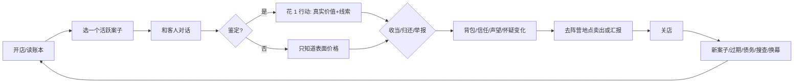

# 长夜当铺：一款 21 夜的三幕叙事经营游戏

Status: **SEED + LIVING WORLD IMPLEMENTED**
Last updated: 2026-11-22

## 0. 一句话：二十一夜只是种子，不是全部

这个游戏不是“写完 21 个案子就结束”。21 个案子是**第一季的种子**；真正的循环是：

> Director 决定这一季要长什么 → God 把它长成一个可玩的新案子 → Story 把玩家已经做出的选择变成下一夜的压力 → 玩家再决定 → 世界继续分叉。

所以两个玩家不会看到同一组客人、同一组结局，甚至不会在同一个夜晚遇到同一件事。

## 1. 为什么现有游戏十分钟就结束

河湾镇和潮汐公社都不是“内容不够多”，而是**目标结构太扁**：

| 症状 | 根因 |
| --- | --- |
| 一条主线做完就结束 | 只有一个总目标、一个截止日、一个结局 |
| 玩家很快找到唯一解 | 资源种类少，行动之间没有互斥，最优路径是一条直线 |
| 第二遍没有新东西 | 没有角色路线、没有阵营选择、没有构筑差异 |
| 世界时间在跑，玩家没有节奏 | 计时器推动世界，但没有“今晚只能做几件事”的回合压力 |
| LLM 像装饰 | 对话不改变机制，机制也不需要对话 |

行业研究给出的共同答案不是“把一条内容做长”，而是：

1. **短循环可重复**：每次 30 秒到几分钟都有明确动作、反馈、奖励。
2. **中循环有选择**：20–40 分钟一个 session，包含一次有代价的取舍。
3. **长循环有成长**：多幕、多结局、多路线，第二遍要“不同”而不是“更长”。
4. **失败也是内容**：软失败、可恢复、把失败变成下一轮故事。
5. **LLM 只做它擅长的**：生成语气、动机、秘密、反应；规则、库存、价格、时间由 Platform 拥有。
6. **元进度解锁多样性，不解锁数值**：Slay the Spire 的 Ascension 是“每级多一条规则”，不是“永久加攻击力”。

参考：

- Raph Koster, *Game Design is Simple, Actually*：核心是“同一个动词面对许多不同局面”，不是同一个局面重复点击。
- Google Play, *Games that Retain*：短期教会核心循环，中期给目标与叙事，长期给变化与社交。
- Meta, *20–40 Minute Goldilocks Session*：一个 session 由多个 10–15 分钟的小循环串起来。
- *Slay the Spire*：三幕、每幕一个新约束、风险换奖励、元进度解锁“变化”。
- *Hades*：失败推进叙事，每次 run 都留下关系与故事，而不是回到零。
- *Cultist Simulator*：机制与叙事用同一套资源/计时器表达；理解系统本身就是游戏。
- *Potionomics*：交易、关系、议价互相供能，而不是三条互不相干的进度条。
- LLM NPC 研究：开放式对话提高沉浸与对话时长，但会带来不一致；最佳实践是**结构化目标 + 生成式表达**的混合，而不是纯聊天沙盒。

## 2. 设计支柱

1. **每一夜都是一次有代价的选择**：3 个行动，鉴定、收当、卖出、归还、举报都要花行动。
2. **每一件物品都是一段关系**：21 件物品对应 7 位客人、3 条人物弧、3 个阵营。
3. **钱是硬的，线索是软的**：还债、升级、收当都抢同一袋金币；线索决定结局。
4. **LLM 是城市的心跳**：客人会撒谎、试探、记仇、改变说法；Platform 只认已结算的事实。
5. **失败不是读档，是另一种结局**：被查封、烧账、同谋、找到姑妈，都是可讲述的收束。
6. **第二遍玩的是不同的自己**：三种出身、三条阵营路线、六种结局、21 个案子中可以错过一半。

## 3. 游戏概念

> 雾港城，闭港审计前的二十一夜。
> 你继承了姑妈留下的“一盏灯当铺”。她在一个雨夜消失，只留下一本缺页账本和一句口信：
> “别把钥匙交给收藏家。”
>
> 七位客人会带着各自的东西回来。每件东西都能换钱，也都连着一个人。
> 港务局要秩序，灰袍修会要 mercy，收藏家要秘密。
> 三笔债会在一周、两周、三周后到期。
> 二十一夜之后，审计官会推开你的门。

玩家不是英雄，是**债务与记忆的中间人**。每一次收当，都是在决定“这件东西对谁更重要”。

## 4. 循环

### 4.1 微循环（30 秒–2 分钟）

```
看案子 → 和客人说话 → 决定是否鉴定 → 收当 / 归还 / 举报
```

- 说话不花行动，但会改变你对客人和物品的判断。
- 鉴定花 1 行动，揭示真实价值与一条线索。
- 收当花 1 行动和当金，物品进入背包。
- 归还不花当金，换信任与阵营声望。
- 举报不花当金，换港务局声望并降低怀疑。

### 4.2 中循环（15–25 分钟，一个夜晚）

```
3 个行动 → 处理 1–2 个案子 → 去阵营地点卖出或汇报 → 关店 → 债务/怀疑/过期结算
```

每夜开始会开一个新案子，旧案子最多留两夜。关店后：

- 新案子出现；
- 过期案子消失，客人信任下降；
- 第 7/14/21 夜结算债务；
- 怀疑度触发搜查；
- 第 8/15 夜进入下一幕。

### 4.3 长循环（2.5–4 小时，一轮）

```
第一幕：欠账（第 1–7 夜） → 第二幕：三方（第 8–14 夜） → 第三幕：钥匙（第 15–21 夜） → 审计结局
```

- 第一幕教“当”的代价：钱、信任、怀疑。
- 第二幕逼“站队”：港务局、修会、收藏家三选一。
- 第三幕问“钥匙给谁”：找到姑妈、守住当铺、烧掉账本、成为同谋，或者被查封。



## 5. 三幕与 21 夜

| 幕 | 夜 | 新机制 | 债务 | 剧情钩子 |
| --- | --- | --- | --- | --- |
| 一：欠账 | 1–7 | 鉴定、收当、归还 | 第 7 夜 60 金币 | 七位客人第一次出现；姑妈的账本缺页 |
| 二：三方 | 8–14 | 阵营契约、搜查、赎回 | 第 14 夜 90 金币 | 港务局、修会、收藏家各自开价 |
| 三：钥匙 | 15–21 | 铜钥匙、姑妈账本、海门 | 第 21 夜 140 金币 | 无名客带来钥匙；审计前最后一次选择 |

每幕只引入一个**真正改变决策**的新机制，避免一次性倒出所有系统。

## 6. 七个客人，二十一个案子

| 客人 | 身份 | 三条弧 | 主要阵营 |
| --- | --- | --- | --- |
| 苏晚 | 裁缝 | 银顶针 → 婚礼戒指 → 海玻璃 | 灰袍修会 |
| 顾沉 | 码头工 | 船长罗盘 → 铜制义肢 → 潮汐怀表 | 港务局 |
| 白鹭 | 修会医士 | 药瓶 → 潮汐钟 → 黑檀梳 | 灰袍修会 |
| 罗七 | 走私掮客 | 玻璃眼 → 走私货单 → 鸦羽面具 | 收藏家 |
| 沈先生 | 失势书吏 | 缺页账本 → 赌债借据 → 空白当票 | 港务局 |
| 阿雾 | 守塔人之女 | 海图残页 → 灯油样本 → 封蜡信 | 独立/修会 |
| 无名客 | 蒙面收藏家 | 银船模型 → 旧怀表 → 铜钥匙 | 收藏家 |

每个案子有六种出口：

1. **收当**：付当金，物品进背包，等客人赎回。
2. **归还**：不收当金，换信任与修会声望。
3. **低价卖出**：立刻换钱，怀疑小幅上升。
4. **鉴定后高价卖出**：需要先花 1 行动鉴定，利润更高，阵营声望更多。
5. **赎回**：客人回来赎当，收本金和利息，信任上升。
6. **举报**：把人和东西交给港务局，换声望、降怀疑、掉信任。

> 21 个案子不需要全做。行动、债务和线索会逼你放弃一部分；错过的案子会变成结局里的代价。

## 7. 经济

| 项目 | 数值 |
| --- | --- |
| 初始金币 | 40（出身可微调） |
| 三次债务 | 60 / 90 / 140，总计 290 |
| 单案当金 | 10–30 |
| 低价卖出 | 18–48 |
| 鉴定后高价卖出 | 30–78 |
| 赎回 | 当金 + 5–12 利息 |
| 每夜行动 | 3；账本升级后 4/5 |
| 升级 | 账本 40/80、鉴定台 60、暗格 35/70 |
| 短工 | 1 行动换 6 金币（防破产保底） |
| 搜查 | 怀疑 ≥60% 触发一次，暗格减少损失 |

设计意图：

- 收当 + 高价卖出是“快钱”，但需要 3 个行动（鉴定、收当、卖出），一夜只能做一单。
- 收当 + 赎回是“慢钱”，利润低但信任高，适合走修会/守店路线。
- 归还和举报是“不赚钱”的路线，但分别买修会/港务局的结局。
- 升级和还债抢钱；玩家不可能全部拉满。

## 8. 怀疑与阵营

### 怀疑

- 低价/高价卖出加怀疑；举报、归还、贿赂降低怀疑。
- 60% 触发一次搜查：
  - 无暗格：损失 25 金币；
  - 一级暗格：损失 10 金币；
  - 二级暗格：不受损失。
- 100% 直接查封结局。
- 贿赂：30 金币，-25% 怀疑，每夜一次。

### 阵营契约（第 10 夜开放，三选一）

| 阵营 | 契约效果 | 结局倾向 |
| --- | --- | --- |
| 港务局 | 怀疑 -20%，港务声望 +15% | 守店、秩序结局 |
| 灰袍修会 | 修会声望 +20%，线索 +1 | 烧账、救人结局 |
| 收藏家 | 金币 +50，收藏家声望 +20%，怀疑 +10% | 同谋、财富结局 |

契约不是“选好人/坏人”，而是选**你愿意欠谁的人情**。

## 9. 结局

| 结局 | 条件 | 情绪 |
| --- | --- | --- |
| 查封 | 未还清债务，或怀疑 100% | 失败，但世界继续 |
| 找到姑妈 | 还清债务、10 条线索、持钥匙、打开海门 | 真相与离开 |
| 守灯人 | 还清债务、7 条线索、持钥匙、修会声望 ≥40% | 留下，重新点灯 |
| 同谋 | 还清债务、收藏家声望 ≥60% | 富有，但失去名字 |
| 焚账 | 还清债务、读过账本、钥匙已不在手里 | 牺牲当铺，保住客人 |
| 离开雾港 | 还清债务，但没有走上面任何一条 | 平静的失败者 |

结局是只读的收束卡，不会停世界；玩家可以继续看 Story 生成的后续，或开新档。

## 10. LLM 的角色与边界

LLM 做四件事：

1. **客人的语气与动机**：七个人有不同说话方式、秘密、底线。
2. **对玩家行为的反应**：归还、举报、高价卖出、契约都会改变下一次对话。
3. **城市的流言**：港务局、修会、收藏家对同一件事有不同版本。
4. **Story 的下一拍**：把已验证的案子结果变成下一夜的压力。

LLM 不做四件事：

- 不转移物品、金币、债务；
- 不改变价格、库存、时间；
- 不替玩家说话；
- 不凭空发明“钥匙在哪”“姑妈还活着”这类硬事实。

这符合混合式 LLM NPC 的研究结论：结构化目标 + 生成式表达，比纯聊天沙盒更可靠，也比纯脚本更有生命力。

## 11. 会话节奏

| 会话 | 内容 | 时长 |
| --- | --- | --- |
| 第一次 | 第 1–3 夜：学会说、鉴定、收当、归还；第一笔当金 | 15–25 分钟 |
| 第二次 | 第 4–7 夜：第一次过期、第一次搜查、第一笔债 | 20–30 分钟 |
| 第三次 | 第 8–10 夜：三方登场、阵营契约 | 20–30 分钟 |
| 第四次 | 第 11–14 夜：赎回、第二笔债、钥匙的传闻 | 20–30 分钟 |
| 第五次 | 第 15–18 夜：无名客、姑妈账本、海门 | 20–30 分钟 |
| 第六次 | 第 19–21 夜：最后三单、最后一笔债、结局 | 20–30 分钟 |

每夜结束有“今夜账目”小结：收入、支出、信任变化、新案子、债务倒计时。玩家可以在任何时候关店，但行动不会攒到下一夜。

## 12. 验证计划

- 世界包校验：21 个案子、126 条交易报价、21 条鉴定、6 个结局、7 位客人。
- 经济闭环：每件物品有来源和去向；金币只在玩家、债务、升级、交易之间转移。
- 行动经济：每夜 3 个行动；账本升级后 4/5；关店重置；过期案子不能结算。
- 债务：第 7/14/21 夜结算；未还触发违约；还清解锁好结局。
- 怀疑：60% 搜查、暗格减损、100% 查封。
- 结局：六种条件互斥且可复现。
- LLM：用真实 `remote` provider 和至少两位客人对话，验证第一人称、秘密、底线、不越权。
- 浏览器：桌面与移动端各走一遍首夜、第一笔债、第一次搜查、结局卡。

## 13. 与旧游戏的区别

| 旧游戏 | 长夜当铺 |
| --- | --- |
| 一个总目标 | 三幕、三笔债、六结局 |
| 行动不互斥 | 3 行动/夜，鉴定/收当/卖出/归还互斥 |
| 钱只是分数 | 钱要同时还债、升级、收当 |
| 关系是数值 | 关系决定客人是否赎回、是否给你线索 |
| LLM 是对话皮肤 | LLM 是案子意义与城市反应的来源 |
| 失败=重来 | 失败=另一种结局，下一轮玩不同路线 |
| 10 分钟通关 | 21 夜 × 3–5 行动，典型 2.5–4 小时 |

## 14. 活世界：种子 + 生长（已实现）

### 14.1 角色分工

| 角色 | 做什么 | 不做什么 |
| --- | --- | --- |
| Director | 每 2 天读世界状态，选一个 growth cell（social / verb / place / rule / resource），写 season_plan | 不直接写案子、不改库存 |
| God | 按 season_plan 用 `dyn_case_1..5` 槽位创建一个活案子：新物品实体、新客人、收当/归还/卖出行为 | 不铸造金币、不复制已有物品、不写死结局 |
| Story | 监听 `case.resolved`、`debt.*`、`act.*`、`season.started`，把已验证事实变成下一拍 | 不转移物品、金币、债务 |
| Player | 决定收当、归还、卖出、举报、鉴定、还债、阵营契约 | 不能跳过 Platform 的校验 |

### 14.2 一个活案子如何长出来

1. God 创建 `entity_type=item` 的物品（名字会进入物品栏）。
2. God 创建一位新客人（`controller=bt`，默认在柜台前等候）。
3. God 创建三个玩家行为：
   - `dyn_pawn_N`：花 20 金币收当；
   - `dyn_return_N`：不收当金，原物归还；
   - `dyn_sell_N`：`deferred=true`，玩家收当后才出现，带一个 Travel 节点去阵营地点卖出。
4. 玩家做出选择，`dyn_case_N` 从 0 变成 1/3，事件写入 `case.pawned_dynamic` / `case.sold_dynamic`。
5. Story 读到 `case.resolved`，提出下一条 beat；Director 下一次计划会参考这个结果。
6. 21 夜审计只是**章节结局**：`begin_next_season` 保留当铺、库存、升级、关系、线索和已生成的案子，只重置夜晚、债务和行动；世界继续。

### 14.3 为什么每个玩家不一样

- God 读的是**这个玩家**最近结算的案子、阵营声望、怀疑、线索和库存，而不是一个固定剧本。
- 新案子的客人、物品、价格、阵营压力都由当前状态长出来。
- Story 只引用已验证事实，所以同一套规则会产生不同的下一拍。
- 玩家可以错过案子；错过的案子会改变信任、怀疑和结局，而不是“读档重来”。

### 14.4 远程证据

`scripts/verify_night_pawnshop_growth.py --provider remote` 的最近一次完整循环：

- Director 选择 `social`，写出 `plan:1:social`。
- God 创建一个物品实体、一位新客人、`dyn_pawn_1` / `dyn_return_1` / `dyn_sell_1` 三个行为。
- 玩家收当：`dyn_case_1=1`，背包出现新物品，金币 -20。
- 玩家卖出：`dyn_case_1=3`，金币 +40，阵营声望上升。
- Story 提出一条 `propose_story_beat`。

这不是脚本注入的结果；God/Story 的调用由真实 `remote` provider 完成。

## 15. DSL 提升

活世界暴露了旧 DSL 的几个硬限制，本轮已补：

| 能力 | 之前 | 现在 |
| --- | --- | --- |
| 动态属性引用 | 只能写死 `world.case_1` | `world[context.case_slot]` 在条件/动作里解析为实际属性 |
| 动态物品引用 | 只能写死 `actor.inventory.brass_key` | `actor.inventory[context.item_id]` |
| 条件参数上下文 | 只有少数白名单键 | Action/Behavior 的所有标量参数进入 `context.*` |
| 设置属性 | 只能 `delta`，靠 min/max 夹 | 新增 `world_property_set`，支持 `context.value` |
| 未来行为 | 注册时必须“现在可执行” | `deferred: true` 允许登记、条件满足后才出现在行动列表 |
| 复杂 God 会话 | 固定 12 次工具调用 | 契约可声明 `max_tool_calls` |
| 语义完成条件 | 只能按实体/行为名 | 新增 `required_content.behaviors_using_action`，要求某种 Action 的行为存在 |
| 可见物品名 | God 写中文名，库存键是实体 id | 注册/执行时模糊规范化到实体 id |
| 物品标签 | 只读 `rules.item_labels` | 动态 `entity_type=item` 的 name/uses 进入物品栏 |
| 事件唤醒 | `public_event` 只 append，不唤醒 | `public_event` 和目录事件走 `publish(wake=configured)` |

详细说明见 [`living-world-dsl.md`](living-world-dsl.md)。

## 16. 后续（不在本轮范围）

- 跨周目“当铺档案”：记录已见客人、已见结局、已见物品，解锁新的开场白与客人变体。
- 每日种子：同一组案子顺序，社区比拼还债与线索。
- 更高难度“审计加急”：债务提前、行动减少、搜查阈值降低。
- 客人自主行动：客人会在城里活动、互相串供，而不只是等在柜台前。
- 动态价格表：让 God 创建的案子可以按阵营声望改价，而不是固定 20/30–50。
