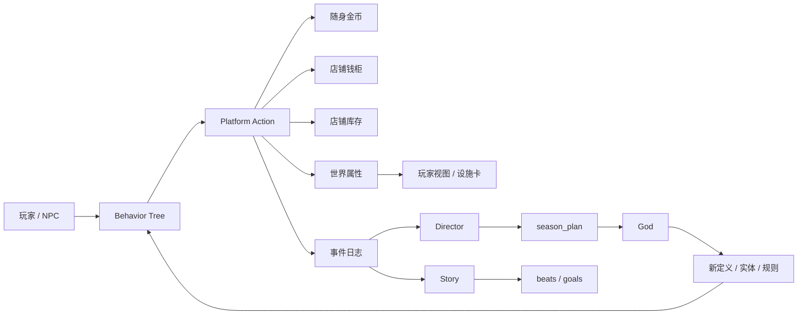

# 设计: 河湾镇 · 七日桥市

> 类型: 新世界设计
> 来源: 本地需求（无 Jira 工单）
> 需求结论: 交付一个以金币循环为核心的五店小镇世界，玩家在七天内把采集、买卖、制作、服务和桥市礼箱串成一条可重复的日常经济链。
> 架构结论: 复用现有 Platform、Action、Behavior Tree、Evolution 和 Web 投影，只新增世界配置、角色提示词与聚焦测试，不修改 Platform、SQLite schema 或 Web 客户端。
> 交付范围: `worlds/riverbend_market/`、`tests/test_riverbend_market.py`、本设计文档。
> 首要风险: 金币账本被提案绕过，或店铺库存/钱柜在低库存时形成死锁。
> 创建时间: 2026-11-21
> 更新时间: 2026-11-21
> 代码位置: `worlds/riverbend_market/`、`tests/test_riverbend_market.py`

## 需求

本世界交付一个比潮门更偏“经营”的公共危机：断桥把河湾镇挡在商路之外一年，七天后今年第一支商队会来到渡口验货。玩家带着少量金币进镇，要在铁匠铺、食铺、医馆、旅店和集市之间把金币转起来，让至少四家店备好货，并装出一个桥市礼箱。

目标体验：

- **金币有来源也有去处**：采集卖钱，买工具、热饭、床位、治疗和香料，钱再回到店铺钱柜。
- **五家店互相咬合**：铁匠给工具，食铺给饭，医馆保命，旅店给时间，集市给成品出口和礼箱验货。
- **七天有硬截止，失败是软失败**：商队可以留下、只停一夜或绕道；绕道后玩家仍能靠短工和采集继续经营。
- **NPC 也在过日子**：店主领收入、买饭、补货、制作；工人采集、卖货、吃饭、住店。
  背景 NPC 用 `bt_priority` 把采集和交易排在移动前；移动目标选项排除当前地点，
  没有紧迫需求时控制器不会默认选择纯移动，避免“每分钟原地到达”的空转。
- **物品闭环**：每件物品都有来源和用途。香料既能装进桥市礼箱，也能在食铺和炖菜
  做成香炖菜；香炖菜可以吃掉，也能卖给阿芹换九枚金币。工具在深采中反复使用，
  购买报价会拒绝第二把没有用途的重复工具。`rules.item_uses` 把用途写进角色物品栏。
- **居民自己的判断**：玩家视图的 `item_uses` 和观察者时间线里的 `decision.reason`
  让 NPC 的当前打算可见；首页“镇上的打算”只展示 LLM 决策，不展示 BT 背景空转。
- **God / Story / Director 不抢方向盘**：确定性时钟保证桥市高潮；三个角色只负责叙事、结构和新增可玩内容。

验收标准：

- 玩家从石桥镇口进入，能看到五家店、桥市倒计时、繁荣度和备货店铺数。
- 第一笔采集→卖出→买工具/吃饭的循环成立，金币在玩家钱袋和店铺钱柜之间守恒。
- 五家店都能通过卖货达到声望线，至少四家能触发 `shop.ready`。
- 礼箱需要铁锭、药剂、炖菜、麦酒、香料和十枚金币，不能在缺项时完成。
- 桥市成功、只停一夜、绕道三种结局都能触发，且失败后玩家仍能继续行动。
- Story beat 只能使用已验证事件，并能给 NPC 一个当前可执行的后续行为。
- Director 能按共享增长账本写出 `season_plan`，并给 God 创建 `god_structural` 任务。

不做：

- 不新增货币、汇率或拍卖行。
- 不做实时战斗、天气模拟或独立经济引擎。
- 不修改 Platform、SQLite schema 或通用 Web 客户端。
- 不做第二个桥市周期的自动重置；第一季结算后进入持续经营沙盒，下一季倒计时由后续内容扩展。

## 架构设计

经济状态由 Platform 和 SQLite 持有；世界包只声明价格、库存、声望、规则和行为。玩家和 NPC 提交 Intent，Platform 负责扣款、加库存、移动和事件。



状态所有权：

| 状态 | 所有者 | 存储 | 读取方 |
|---|---|---|---|
| 随身金币、工具、食材 | Agent | SQLite agent JSON | Action、UI、AgentView |
| 店铺钱柜 | 世界属性 | `world_properties` | Action 前置条件、设施卡 |
| 店铺库存 | Resource 实体 | SQLite entity | 资源投影、设施卡、Story/God |
| 声望、繁荣、桥市状态 | 世界属性 | `world_properties` | 规则、目标、UI |
| 桥市幕次 | 确定性分钟效果 | `world_properties` | 规则、Story 唤醒 |
| 叙事 beat / 目标 | Story | `story_state`、Agent | UI、Story、God |
| 增长计划 | Director | `season_plan` | Story、God |
| 新内容 | God | definitions / entities / rules | 所有角色 |

## 详细设计

### 核心循环

```text
采集原料 → 卖给需要的店 → 获得金币
   ↑                          ↓
制作成品 ← 买工具、热饭、床位、治疗
   ↓
交订单 / 涨声望 → 店铺备货 → 桥市礼箱 → 商队验货
```

日常节奏：

- 白天采集、跑店、制作、交订单。
- 晚上吃饭、喝酒、住店或帮工。
- 每天清晨店铺补货、钱柜补金币、自然资源再生。
- 第七天前把五家店中至少四家推到声望线，并装好礼箱。

### 五家店

| 店铺 | 老板 | 收购 | 售价 / 服务 | 备货线 |
|---|---|---|---|---|
| 铁匠铺 | 周铁山 | 铁矿石 3、煤 3 | 铁镐/药锄/鱼竿 10 | `smithy_rep >= 0.4` |
| 食铺 | 阿芹 | 麦子 2、河鱼 2 | 热饭 4、炖菜 7、麦酒 3 | `tavern_rep >= 0.4` |
| 医馆 | 白芷 | 草药 3 | 药剂 9、治疗 6 | `clinic_rep >= 0.4` |
| 旅店 | 老陶 | 柴火 2、麦酒 3 | 床位 5 | `inn_rep >= 0.4` |
| 集市 | 金算盘 | 铁锭 6、药剂 6、炖菜 6、麦酒 2 | 香料 6、礼箱验货 | `market_rep >= 0.4` |

声望去重：

- 卖出一份货：该店声望 +0.08，小镇繁荣 +0.01。
- 买入一份货/服务：该店声望 +0.02，小镇繁荣 +0.005。
- 声望达到 0.4 时，分钟效果把 `*_ready` 置为 1，`fair_ready` 加 1。
- 五家店的订单目标统一为 5 次卖出：5 × 0.08 = 0.40，正好与备货线对齐；订单完成和店铺备货不再错位。
- 集市收购麦酒只给 2 枚金币，低于食铺零售价 3，避免“买酒再卖集市”的无限套利。

### 金币账本

- `coin` 是随身物品，不是世界资源。
- 每家店有独立钱柜：`smithy_till`、`tavern_till`、`clinic_till`、`inn_till`、`market_till`。
- 卖货动作先检查钱柜够不够，再扣货、加库存、从钱柜扣金币给玩家。
- 买货动作先扣玩家金币，再加钱柜、减库存、交付物品或服务。
- 每日 06:00 补货：五家钱柜分别 +6/+5/+5/+4/+8，救济金 +3，店铺库存 +2。
- 店主每天可以从自己的钱柜领取 3 枚金币的日常收入；只有对应角色能领，金币从钱柜转到个人钱袋，不铸造。
- 没钱时的保底：食铺帮工换金币和热饭，旅店帮工换金币，集市短工从救济金换 2 枚金币。救济金每日 +3，上限 30。
- 没有动作能凭空增加金币，除了每日补货和救济金这两条有上限的世界规则。

### 通用 Action 目录

重复的“一个物品一棵 BT”已经收敛为数据目录：

- `action_catalogs.trade_offers`：19 条报价，玩家在店铺里选“卖铁矿石给铁匠铺（3 金币）”或“买铁镐（10 金币）”。
- `action_catalogs.gather`：9 个采集节点，按 `surface/deep` 分层；普通采集和深采各一棵 BT。
- 每条采集用 `resource_id` 显式绑定资源；包校验会拒绝未知资源、地点与资源地点不一致、`resource_withdrawal` 指向别的资源、缺少产出物品或未在 `item_labels` 声明的产出。
- `action_catalogs.consume`：热饭、炖菜、麦酒、药剂四种随身物品。
- `craft` 用 `recipe_id` 选择配方，配方仍由 `recipes.yaml` 定义。

Platform 通过通用 `catalog_action` 效果执行目录条目：先校验位置/`requires`/成本，再用现有效果管线应用库存、钱柜、声望和事件。玩家界面只显示当前地点、当前库存足够且条件满足的条目；采空的资源节点不会继续出现在采集下拉框里。选择值使用稳定 ID，标签保持人类可读。`requires` 的条件路径在建包时校验：未知命名空间、未声明状态/需求/世界属性、未声明物品都会被拒绝，避免拼写错误静默变成 false。

### 首小时、回访与收集层

- `rules.onboarding[].complete_when` 为每步声明完成契约。当前五步分别是：`trade.sold`
  （第一枚金币）、拥有铁镐、水分恢复、`fair_ready >= 4`、`fair_crate >= 1`。玩家视图
  返回 3 步未完成清单和已完成数量；完成步骤显示勾选。
- `rules.relationship_effects["dialogue.completed"]` 让交谈产生 `trust` 关系；角色侧栏
  显示信任条和最近一次关系描述，说明“这次互动会被记住”。
- `setting.ui.countdown` 把 `days_to_fair` 投影成场景顶部的“商队抵达 7 天”主视觉；
  平台不写死桥市字段。
- `setting.ui.celebrations` 按事件类型驱动金币、盖章、礼花和章节卡；`player_only`
  避免 NPC 交易也弹出玩家的钱袋庆祝。
- `setting.ui.recap_label` / `recap_event_types` 控制“昨夜河湾”回访摘要；
  `setting.ui.one_thing_label` 控制“今天只做一件事”的上手卡。
- 角色栏“账本”把 `facilities`、`recipes`、`goals` 组织成店铺/配方/桥市收集视图；
  `setting.ui.ledger_label` 提供世界自己的账本名。
- 结局面板和章节庆祝卡支持 Web Share API；不支持时复制章节文字。

### 七天桥市

| 幕 | 触发 | 世界变化 |
|---|---|---|
| 第一幕 开市 | 第 1 天 | 桥市公告、第一张订单、工具还买不起 |
| 第二幕 缺货 | `days_to_fair <= 5` | 原料压力上升，店铺开始缺货 |
| 第三幕 抬价 | `days_to_fair <= 3` | 商队可能提前，玩家要决定先保哪家店 |
| 第四幕 桥市前夜 | `days_to_fair <= 1` | 礼箱可组装，最后一班补货 |
| 结算 | `days_to_fair <= 0` | 商队验货，进入成功/只停一夜/绕道 |

礼箱 `assemble_fair_crate`：

- 地点：集市。
- 前置：`fair_act >= 4`、`market_rep >= 0.4`、`inn_ready >= 1`、礼箱未完成。
- 消耗：铁锭 1、药剂 1、炖菜 1、麦酒 1、香料 1、金币 10。
- 效果：`fair_crate=1`、集市钱柜 +10、集市声望 +0.04、繁荣 +0.10。

结算条件：

- **成功**：礼箱完成、`fair_ready >= 4`、`town_prosperity >= 0.6`。
- **只停一夜**：礼箱完成、`fair_ready >= 2`、`town_prosperity >= 0.4`，但不满足成功条件。
- **绕道**：礼箱缺失，或 `fair_ready < 2`，或繁荣 < 0.4。
- 失败后 `fair_stage=4`，繁荣 -0.15；玩家仍可短工、采集、买卖，世界继续运行。

### God / Story / Director

不新增第四个“Story Director”角色。现有三个角色已经覆盖三种职责；新增角色会重复上下文、增加 LLM 调用，并需要改代码。所谓“叙事导演”，由**按幕唤醒 Story + 配置化 beat 阶梯**实现。

| 角色 | 核心问题 | 写什么 | 不写什么 | 节奏 |
|---|---|---|---|---|
| Director | 世界下一步该长哪一块？ | `season_plan`、目标 cell、基线、过期时间 | 具体内容、金币、库存、剧情 | 启动立即 + 每 6 小时 |
| Story | 这件事对谁有意义，下一步做什么？ | beat、audience goal、fact、世界进度 | 数值、库存、关系、移动 | 幕事件、交易、缺货、里程碑 |
| God | 缺了哪块可玩内容？ | 新定义、实体、规则、关系、地点、Action/BT | 金币、免费物资、纯叙事假事件 | 结构计划、资源压力、桥市失败、停滞 |

#### Director：结构导演

配置：

```yaml
director:
  cadence: 6h
  window: 1d
  kickoff: true
  context_properties: [fair_act, days_to_fair, fair_ready, town_prosperity]
  targets: [verb, social, rule, place]
  policy: llm          # 没配模型时自动回落 deterministic
  max_cell_units: 0
limits:
  max_ready_god_tasks: 2
```

- Director 读取 `world_growth_ledger`，选择覆盖最少的 cell，写入 `season_plan`。
- 每次计划只要求 God 增加**一单位**可玩增长；`god_structural` 契约限制最多 3 个提案。
- 目标 cell 的含义：
  - `verb`：新的赚钱方式（代运、预售、夜班）。
  - `social`：店铺之间的联盟、竞争或供货关系。
  - `rule`：会改变桥市结果的一条规则。
  - `place`：带路线和一个可执行行为的新地点。
- Director 不拥有桥市倒计时；七天的幕次由确定性分钟效果控制，避免 LLM 把高潮拖没。
- `kickoff: true` 让 Director 在第一次世界 tick 就写出 `season_plan`，不用等 2 天；之后每 6 小时检查一次，计划窗口 1 天。
- 计划 reason 带上 `fair_act`、`days_to_fair`、`fair_ready`、`town_prosperity`；Story 和 God 读取同一个 `season_plan`。
- 测试覆盖 kickoff：第一次 `platform.step()` 后必须有 active plan，并已创建 `god_structural` 任务。

#### Story：叙事导演

Story 只做三件事：

1. 把已验证事件变成下一幕的处境。
2. 给某个 NPC 一个当前就能执行的目标。
3. 推进世界进度，让桥市筹备有公共叙事。

唤醒点：

- `trade.sold`（同店铺 3 笔，6 小时冷却）
- `shop.ready`
- `fair.act_two`、`fair.act_three`、`fair.eve`
- `clinic.stock.low`
- `fair.ready`、`fair.success`、`fair.quiet`、`fair.failed`
- `civilization.milestone`
- `town.decline`、`town.boom`

配置化 beat：

| Beat | 触发 | 受众 | 后续 |
|---|---|---|---|
| 第一枚金币 | `trade.sold` | 全局章节 | 把收入变成工具、热饭或下一批货 |
| 一家店备好了 | `shop.ready` | 全局章节 | 去下一家还没备好的店 |
| 有家店的库存见底 | `resource.safety_low` | 全局章节 | 先补最缺的那家店 |
| 医馆的药材不够了 | `clinic.stock.low` | 白芷 | 采草药 |
| 商队前夜 | `fair.eve` | 阿石 | 进北山深巷补矿 |
| 桥市重开 / 只停一夜 / 商队绕道 | 对应结算事件 | 全局章节 | 下一轮目标 |

规则：

- 只使用已验证事件里的事实；不自己加数字、交付、移动或公开讲话。
- 每个 NPC beat 的后续行为必须在受众当前可执行目录里；不可执行会被 Platform 拒绝。
- 重复的同一事实不会反复生成 beat。
- 全局 beat 支持 `ttl_minutes`/`one_shot`：`first_coin`/`shop_ready` 超过 12 小时后会过期或完成，不会永久 active 并阻塞后续 Story 会话。
- Story 可以调用 `record_world_progress` 推进公共进度：
  - `market_revival`：金币在五家店之间流动。
  - `town_trust`：治疗、住店、帮工、备货。
  - `bridge_fair`：礼箱、备货、桥市结果。
- 进度完成发 `civilization.milestone`，再唤醒 Story/God，形成“经济事件 → 公共进度 → 新叙事 → 新目标”的闭环。

#### God：世界作者

God 只做“一单位可玩增长”，不做平衡补丁：

允许：

- 新订单类型：代运、预售、加急。
- 新服务：夜市、寄存、学徒帮工。
- 新配方：熏鱼、药膳、旅行干粮。
- 新顾客/商人：巡回货郎、过路药商。
- 新规则：雨天需求、集市抽成、商会互助。
- 新地点：必须带路线，并绑定一个采集或交易行为。

禁止：

- 新货币。
- 直接加金币、免费物资。
- 改价格绕过钱柜。
- 删除店铺或让店永久关门。
- 只写叙事事件、不产生可玩变化。
- 重复已有实体/定义。

God 的唤醒：

- `god_structural`：Director 的结构计划。
- `resource.safety_low`（两家不同资源）：补货或保存方式。
- `fair.failed`：重建项目或便宜供应商。
- `civilization.milestone`：承接公共进度。
- `world.stagnation`：长时间没有新可执行选择。
- God 提案的规则如果写成 `effect: {type: signal, signal: ..., wake: [...]}`，Platform 会在校验前把 `event_type`/`wake` 提升到规则顶层；没有顶层事件名的 signal 规则会被拒绝。

#### 协作约束

- Platform 写世界状态；Director 写计划；Story 写叙事；God 写内容。
- Story 不能提前声称 God 还没创建的结构、地点或商品。
- God 必须读 `active_story_threads`，不重复 Story 已经承诺的内容。
- Director 计划会过期；God 任务有上限；Story beat 有冷却。
- 所有提案过 Platform 校验，失败回传原因，不静默改状态。

### 配置映射

| 文件 | 内容 |
|---|---|
| `manifest.yaml` | `world_id: riverbend_market`、文件清单、起始时间 |
| `setting.yaml` | 四项桥市指标、事件分类、结果标签、日历 |
| `world_state.yaml` | 七天倒计时、五店声望/钱柜/库存、繁荣、救济金、初始事实 |
| `locations.yaml` | 10 个地点、6 个自然节点、5 个店铺库存 |
| `objects.yaml` | 五家店设施卡、桥市告示板 |
| `agents.yaml` | 5 个店主 + 3 个工人，含初始行为树与库存 |
| `player_template.yaml` | 4 个出身、初始金币、全部玩家行为 |
| `actions.yaml` | 19 个 Action：通用买卖、采集、深采、使用、制作、服务、帮工、礼箱、店主收入 |
| `behavior_trees.yaml` | 23 棵行为树：通用买卖/采集/使用/制作 + 店铺工作与恢复 |
| `recipes.yaml` | 9 个配方：铁锭、三种工具、热饭、炖菜、香炖菜、麦酒、药剂 |
| `rules.yaml` | 属性、需求、分钟效果、资源再生、桥市结算、声望、进度、目标、`action_catalogs` 报价/采集/消耗目录 |
| `story.yaml` | 桥市开场、8 个 beat、3 个结局 |
| `evolution.yaml` | Director、Story/God 唤醒、停滞策略、结构契约 |
| `prompts/world.yaml` | 金币账本与 God 约束 |
| `prompts/agent.yaml` | Story/God 的世界专属角色提示词 |

### 验证方式

聚焦测试 `tests/test_riverbend_market.py`，14 项全部通过：

1. 世界包完整：10 地点、8 NPC、19 Action、23 行为树、9 配方、11 资源、20 条交易报价、9 个采集节点、5 种消耗品。

旧存档升级只更新配置和定义，不重置世界状态（先停止服务）：

```bash
python scripts/upgrade_instance.py --world worlds/riverbend_market --instance-id riverbend_market_p6wh
```

脚本会保留实体、角色、库存、世界属性、记忆、关系、剧情状态和运行时规则，
只补入新的配方、交易报价、物品用途和界面文案。
2. 采集→卖矿→买镐→打铁锭：金币、钱柜、库存、声望和输入消耗都正确。
3. 集市麦酒交易不铸造金币：玩家 +2，钱柜 -2。
4. 礼箱需要五种成品和十枚金币，完成后能触发桥市成功结局。
5. 桥市失败后仍能用集市短工恢复现金流。
6. 礼箱 + 2 家店 + 0.45 繁荣触发“只停一夜”结局。
7. Story 只能提交与来源事件匹配的 beat；医馆 beat 绑定 `clinic.stock.low`，并分配给白芷。
8. Director kickoff 在第一次 tick 写出计划，并创建 `god_structural` 任务。
9. 玩家视图显示四项桥市指标、五家店设施卡、六个筹备目标和首个上手提示。
10. 长行动返回 `total_minutes` 和真实 `progress`；刷新或断线后进度条不会从剩余分钟重新开始。
11. 水分低时“喝水”排在可见行动前六项，不会被商店和制作选项挤出行动列表。
12. 身上有铁矿石、煤和草药时，通用“制作”会列出铁锭/药剂配方，而不是每个配方一棵 BT。
13. 通用“买卖/采集/使用”能从 catalog 选择可见条目，并保持金币/库存守恒。
14. 全局 Story beat 超过 12 小时后会过期/完成，不会永久阻塞同一 beat。

远程 Provider 验证（`sim2 simulate --provider remote --minutes 90`，新实例）：

- 通用目录 + Director kickoff 后的 30 分钟远程运行：10 次 Agent 决策、19 次 LLM 调用、0 个 LLM 错误、0 个被拒绝的回合。
- 期间 Director 创建 1 个计划（目标 `social`），God 完成 1 次结构会话并创建 `jin → zhou` 的供货关系；NPC 完成 3 次制作、2 次采集、2 笔旅店交易。
- 更早的 45/90 分钟运行也验证过 Story beat；本次 30 分钟没有触发新的 Story 会话，因为不同店铺的成交阈值还没到。
- 这些结果来自 `--provider remote`，不是确定性 Provider。

未执行全量测试和基准测试；按当前约定只跑改动相关测试。

## 影响评估

- **新增**：`worlds/riverbend_market/`、`tests/test_riverbend_market.py`、本设计文档。
- **不变**：Platform、SQLite schema、通用 Web 客户端、现有世界包。
- **兼容性**：新世界通过 `worlds.world_path("riverbend_market")` 被 CLI 和 Web 世界列表发现；`manifest.order: 0` 让它排在现有世界之前。
- **风险与缓解**：
  - 钱柜/库存死锁：每日补货、救济金、集市短工和店主收入四条兜底。
  - 金币套利：集市麦酒收购价 2 低于食铺售价 3；其余成品收购价低于店铺零售价。
  - LLM 绕过账本：God 提示词和 `god_structural` 契约明确禁止铸造金币、免费物资和死地点；所有提案仍由 Platform 校验。
  - Story 编造事实：只允许已验证事件，NPC 后续行为必须当前可执行；不可执行会被拒绝。
  - 角色抢方向盘：确定性时钟拥有桥市幕次；Director 只写计划；God 只加内容；Story 只写叙事。
- **回滚**：删除 `worlds/riverbend_market/`、`tests/test_riverbend_market.py` 和本设计文档即可；不涉及数据迁移。
- **后续**：第二季自动重置、断桥修复项目、商队新订单、第六家店，均由 God/Director 在持续经营沙盒中扩展。
