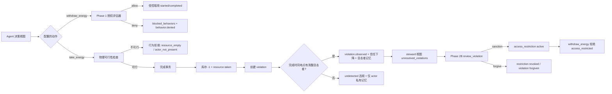
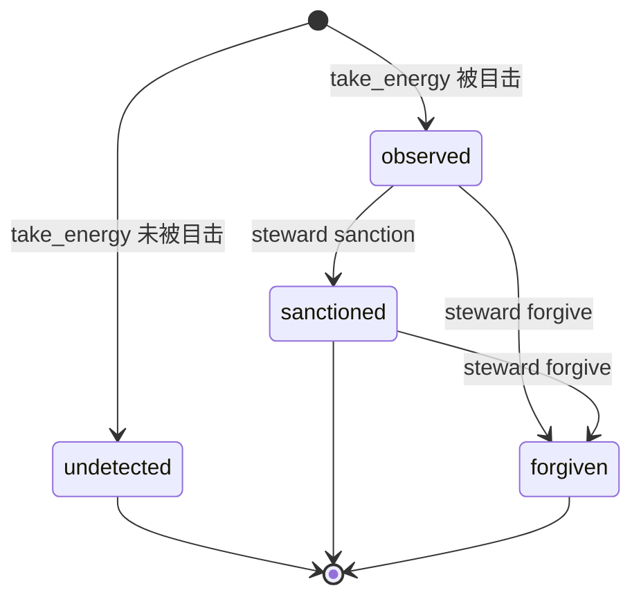

# 设计: Social Authority Loop Phase 2 — Contested Resource Actions

> 类型: 需求设计  
> 来源: 本地需求（2026-11-18 Phase 2 设计讨论）  
> 需求文档: `docs/design/social-authority-loop-phase1.md`（Phase 1 控制契约）；`docs/design/social-authority-loop-phase1-report.md`（Phase 1 证据）  
> 需求结论: 交付一个可确定性验收的偷取纵切：软约束不拦截行为，Platform 记录资源转移、违规事实、目击、信任后果和可撤销制裁；Phase 1 的授权取用路径保持不变。  
> 架构结论: 在授权评估器之外增加独立的 `take_energy` 资源取用路径；该路径不经过授权门槛，由 Platform 在完成事务中判定可行性、目击和后果；违规记录与授权记录分表，事件分族。  
> 交付范围: Phase 2A 确定性运行时、Phase 2B 可撤销制裁、Phase 2C 远程 LLM 观测；probe world、Platform、SQLite、AgentView、Prompt、测试与验证脚本。  
> 首要风险: 偷取成为支配策略，使授权路径和制度变成装饰；通过目击、信任下降、可撤销访问限制和资源稀缺维持权衡。  
> 创建时间: 2026-11-18  
> 更新时间: 2026-11-18  
> 代码位置: `src/sim2/`, `worlds/social_authority_probe/`, `tests/`, `scripts/`

## 需求

本需求交付一个可确定性验收的偷取纵切：Tomas 在未获授权时拿走共享能源，Platform 记录资源转移、违规事实、目击、信任变化和可撤销制裁；Phase 1 的授权取用路径保持不变。

Phase 1 证明的是“授权可以改变合法行为集合”。Phase 2 证明的是“软约束不阻止行为，但行为有代价”。两者是并列的控制组，不是替换关系。

### 业务目标

世界需要张力。张力不来自“NPC 能点更多按钮”，而来自“多条可行路径、真实代价、信息不完整、不可逆后果”。因此：

- 物理、逻辑、能力和信息上的不可能仍然会从选项中移除。
- 法律、制度、规范、信任、身份和关系不直接移除选项，而是变成风险、代价和后果。
- 同一个资源可以有多条取用路径：受控取用、未授权取用、偷取、强行夺取、欺骗。Phase 2 只实现“未授权偷取”这一条。
- NPC 的第一驱动是生存，但生存不是硬编码的词典序第一优先级。角色可以为了职责、忠诚、荣誉、复仇、信仰或身份冒生存风险。Platform 不替角色决定值不值得。

### 用户场景

1. Mira 是 `energy_reserve` 的 steward，拥有合法审批权，但不拥有对资源身体的绝对控制。
2. Tomas 需要能源修复 relay。他可以选择：
   - 提交 `request_access`，等待 Mira 批准；
   - 在 Mira 不在时执行 `take_energy`，拿走一份能源；
   - 等待、修理其他部件或放弃。
3. Mira 在 `relay_station` 时，Tomas 的 `take_energy` 仍然可以执行，但完成时会被目击。
4. Mira 在 `relay_yard` 时，Tomas 的 `take_energy` 不会被目击，违规记录进入 `undetected` 状态。
5. 被目击时，Mira 获得违规事实、信任下降和目击记忆；她可以在 Phase 2B 选择制裁或宽恕。
6. 被制裁时，Tomas 的委托取用被拒绝为 `access_restricted`；Mira 宽恕后限制撤销。
7. 无论是否被目击，Tomas 自己都保留这次行为的私有记忆。

### 当前限制

- Phase 1 的 probe world 只有一个资源动作 `withdraw_energy`，看起来像“授权是所有资源行为的总入口”。
- 没有“未授权取用”动作，因此无法观察 NPC 在合法与违规之间的选择。
- 没有目击模型，因此违规没有社会后果。
- 没有违规记录，因此无法审计“谁在何时拿了什么”。
- 没有可撤销制裁，因此制度只能批准或拒绝，不能追责和恢复。
- 没有全局审计与 NPC 感知的分离，因此“未被发现”无法表达。

### 交付范围

| 范围 | 内容 |
| --- | --- |
| Phase 2A | 场景化资源、`take_energy`、确定性目击、`violation` 记录、`resource.taken` / `violation.observed` 事件、信任与目击记忆 |
| Phase 2B | `review_violation`、`access_restriction`、`access_restricted` 拒绝原因、制裁与宽恕的可逆闭环 |
| Phase 2C | 合法路径与偷取路径同时可见的远程 LLM 观测探针 |
| 世界内容 | `relay_yard`、`travel_to`、`patrol_relay`、`take_energy` |
| 存储 | `violation`、`access_restriction` 两张新表 |
| 视图与提示词 | `contested_actions`、`violations`、风险与目击投影 |
| 测试 | Phase 2A PA-01..PA-12、Phase 2B PB-01..PB-07、Phase 2C 观测报告 |

### 明确不做

- 攻击、强行夺取、战斗、伤害、死亡。
- 欺骗、证词、信念、证据、揭穿。
- 潜行、视线、遮挡、开锁技能。
- 通用物权法、审判、刑罚政策。
- 由违规事实自动推动制度演化。
- 永久死亡和生存死亡的完整模型。
- 多 Agent 资源竞争、预留、排队和并发审批。
- 未被发现违规的后续调查与发现机制。
- 把“违规”做成绕过 Platform 的旁路。

### 质量要求

- Phase 2A 的 PA-01..PA-12 全部确定性通过，不依赖模型。
- Phase 2B 的 PB-01..PB-07 全部确定性通过。
- Phase 1 的 SA-01..SA-18 保持通过；`withdraw_energy` 的授权语义不变。
- 一次 `take_energy` 只产生一次库存扣减、一条 `resource.taken`、一条 `violation`。
- 同一 `intent_id` 重试返回原结果，不产生第二次副作用。
- 完成事务失败时，库存、`resource.taken`、`violation`、`violation.observed`、信任变化和目击记忆全部回滚；行为进入 failed 终态，actor 不再处于 executing。
- 未被目击的违规不出现在 steward 或目击者视图中；它只出现在全局审计和 actor 私有视图中。
- 1000 Agent 非 LLM p95 不超过 250 ms；超出时先解释再签字。
- Phase 2C 报告有效探针数、合法请求率、偷取率、目击率和后果后选择变化率；不以 100% 为门槛。

## 架构设计

采用双路径架构：`withdraw_energy` 保持 Phase 1 的授权门；`take_energy` 走独立的可行性、目击和后果路径。Platform 仍是唯一状态变更入口。

### 系统边界

| 组件 | 职责 | 所有者 | 接口 |
| --- | --- | --- | --- |
| `withdraw_energy` | 受控取用；需要 stewardship 或 active delegation | Phase 1 授权评估器 | `authorization_decision(agent, action, action_context, world)` |
| `take_energy` | 未授权取用；不经过授权门槛 | Phase 2 contested action service | `resource_take` effect + completion transaction |
| `violation` | 违规生命周期记录，保留历史 | SQLite `violation` 表 | `violation_id`、`status`、`witnesses` |
| `access_restriction` | 可撤销的访问限制，是制裁后果，不是事前授权 | SQLite `access_restriction` 表 | `restriction_id`、`status` |
| AgentView | 暴露两条路径、风险、目击和违规投影 | `AgentViewCompiler` | `executable_behaviors`、`blocked_behaviors`、`contested_actions`、`violations` |
| EventService | 提交资源、违规、信任事件 | Platform | `resource.taken`、`violation.observed`、`violation.sanctioned`、`violation.forgiven` |
| Prompt | 把风险与后果呈现给模型，不做道德说教 | `prompting/sections_character.py` | `<contested_actions>`、`<violations>` |

### 数据与状态所有权

- SQLite 是唯一事实来源。`violation` 和 `access_restriction` 都由 Platform 写入。
- Agent 只提交 Intent；Agent 不能直接修改库存、违规状态或限制状态。
- 事件日志是全局审计层，不是 NPC 感知层。`resource.taken` 进入全局审计；`violation.observed` 才进入目击者的可见投影。
- `undetected` 违规在 Phase 2 只对 actor 可见；steward 和目击者看不到。
- 信任变化通过现有 `relationship` 表写入，不新增关系类型表。

### 架构图



### 双路径模型

| 维度 | `withdraw_energy` | `take_energy` |
| --- | --- | --- |
| 行为性质 | 受控、公开、可审计的取用 | 未授权、隐蔽的取用 |
| 授权 | 必需 | 不检查 |
| 物理条件 | 在场、有库存 | 在场、有库存 |
| 目击 | 公开动作，默认可见 | 完成时同地点有清醒 Agent 才被目击 |
| 事件族 | `resource.withdrawal.*` | `resource.taken` / `violation.*` |
| 失败 | 授权拒绝或库存不足 | 库存不足或 actor 不在场 |
| 后果 | 库存变化、授权链 | 库存变化、违规、信任、制裁 |

## 详细设计

核心实现决策是：`take_energy` 是 `withdraw_energy` 的兄弟动作，不是同一条动作的“无授权分支”。`take_energy` 不调用授权评估器获取许可；Platform 在完成事务中判定资源、目击和后果。这样 Phase 1 的授权证明不被削弱，Phase 2 的软违规有独立证据。

### 1. 硬约束与软约束

Phase 2 采用以下边界：

| 约束 | 处理 |
| --- | --- |
| actor 不存在、已死亡、已 incapacitated | 拒绝；这是无效尝试 |
| actor 不在资源所在地 | 拒绝；`actor_not_present` |
| 资源不存在 | 拒绝；`resource_missing` |
| 库存不足 | 拒绝；`resource_empty` |
| 没有授权 | 不拒绝 `take_energy`；记录为违规事实 |
| 有目击者 | 不拒绝；记录 `violation.observed`、信任下降和目击记忆 |
| steward 制裁 | Phase 2B 拒绝 `withdraw_energy` 的委托路径；`access_restricted` |

“没有授权”不是 Platform 的硬门；“没有库存”才是。

### 2. 世界内容：场景化资源与机会窗口

`worlds/social_authority_probe` 增加：

- `relay_yard`：与 `relay_station` 相连的第二个地点。
- `travel_to`：通用移动 Action，供 `patrol_relay` 使用。
- `patrol_relay`：Mira 的巡逻行为，先到 `relay_yard`，再回 `relay_station`，制造 Tomas 的无人目击窗口。
- `take_energy`：Tomas 的未授权取用行为；不加入 `fallback_behavior_ids`，避免自动偷取。
- `take_energy` 的 `resource_take` effect 声明 `scope: energy_withdrawal`，供 Phase 2B 的限制使用。

`take_energy` 只授予 Tomas。Mira 使用 `withdraw_energy`（stewardship）或 `review_violation`。这是世界内容的选择，不是 Platform 的角色硬编码。

```yaml
# travel_to
- id: travel_to
  parameters: {location_id: string}
  preconditions: [route.known, actor.mobile, destination.reachable]
  requires_destination: true
  duration: {minutes: 1}
  effects: [{type: location_set, location_id: context.location_id}]
  success: {condition: actor.state.location_id == context.destination_id, result: arrived}
  failure: {condition: actor.incapacitated, result: failed}

# patrol_relay
- id: patrol_relay
  agent_label: Patrol Relay
  entry_conditions: [actor.alive]
  nodes:
  - {type: action, action_id: travel_to, parameters: {location_id: relay_yard}}
  - {type: action, action_id: travel_to, parameters: {location_id: relay_station}}
```

### 3. 数据模型

#### `violation`

```sql
CREATE TABLE violation (
  violation_id TEXT PRIMARY KEY,
  intent_id TEXT NOT NULL UNIQUE,
  actor_id TEXT NOT NULL,
  target_id TEXT NOT NULL,
  scope TEXT NOT NULL,
  amount REAL NOT NULL,
  mode TEXT NOT NULL,
  legitimacy TEXT NOT NULL,
  status TEXT NOT NULL,
  witnesses_json TEXT NOT NULL,
  created_minute INTEGER NOT NULL,
  resolved_minute INTEGER,
  resolved_by TEXT,
  data_json TEXT NOT NULL
);
CREATE INDEX violation_status_idx ON violation(status, created_minute);
```

字段语义：

- `legitimacy` 在 Phase 2A 固定为 `unauthorized`；`take_energy` 被定义为未授权取用，不用于 steward 的合法取用。
- `status` 为 `undetected | observed | sanctioned | forgiven`。
- `witnesses_json` 是完成时同地点清醒 Agent 的稳定 id 列表，按 id 排序。
- `intent_id` 唯一，保证同一行为意图只产生一条违规。

#### `access_restriction`

```sql
CREATE TABLE access_restriction (
  restriction_id TEXT PRIMARY KEY,
  actor_id TEXT NOT NULL,
  target_id TEXT NOT NULL,
  scope TEXT NOT NULL,
  status TEXT NOT NULL,
  violation_id TEXT,
  created_by TEXT NOT NULL,
  created_minute INTEGER NOT NULL,
  revoked_by TEXT,
  revoked_minute INTEGER,
  data_json TEXT NOT NULL
);
CREATE UNIQUE INDEX access_restriction_active_tuple
  ON access_restriction(actor_id, target_id, scope) WHERE status='active';
CREATE INDEX access_restriction_status_idx ON access_restriction(status, actor_id);
```

- 同一 `(actor, target, scope)` 最多一条 active restriction。
- 制裁时若已有 active restriction，复用该记录，不创建第二条。
- 宽恕时把 active restriction 置为 `revoked`，保留历史。

### 4. `take_energy` 主流程

`take_energy` 是一个 1 分钟的 Action，由 `resource_take` effect 在完成时执行。

```yaml
- id: take_energy
  duration: {minutes: 1}
  preconditions: [actor.alive]
  effects:
  - type: resource_take
    resource_id: energy_reserve
    amount: 1
    scope: energy_withdrawal
    mode: covert
  success: {condition: actor.alive, result: energy_taken}
  failure: {condition: actor.incapacitated, result: take_failed}
```

完成事务按以下顺序执行：

1. 读取资源；不存在返回 `resource_missing`，库存不足返回 `resource_empty`。
2. 记录 `before`，扣减 `amount`，得到 `after`。
3. 写入 `resource.taken`。
4. 创建 `violation`，状态由目击集合决定。
5. 有目击者时写入 `violation.observed`，对每个目击者写入信任下降和目击记忆。
6. 提交。

`take_energy` 在 admission 阶段不扣库存、不创建违规。admission 只提交行为启动。

### 5. 目击与违规记录

Phase 2A 采用确定性目击模型：

```text
witnesses = 完成时与 actor 同 location 的所有清醒 Agent，排除 actor 自己，按 id 排序
```

- `witnesses` 非空：`status=observed`，写入 `violation.observed`，对每个目击者执行 `relationship_delta(trust, -0.25)`，并写入类型为 `violation` 的目击记忆。
- `witnesses` 为空：`status=undetected`，不写 `violation.observed`，不写信任变化，不写目击记忆；actor 写入一条私有 `violation` 记忆。

信任下降幅度由 `rules.yaml` 配置：

```yaml
contested_actions:
  witness_trust_delta: -0.25
  witness_memory_confidence: 0.9
```

Phase 2A 不实现潜行、视线、遮挡、距离和概率。目击是二值的，完成时确定。

### 6. 可见性：全局审计与 NPC 感知

| 视图 | 能看到什么 |
| --- | --- |
| 全局事件日志 | `resource.taken`、`violation.observed`、`relationship.changed`、`violation.sanctioned`、`violation.forgiven` |
| actor | 自己所有违规，包括 `undetected`；字段 `violation_id`、`target`、`amount`、`status`、`minute` |
| 目击者 | 自己目击的 `observed` 违规；字段 `violation_id`、`actor`、`target`、`amount`、`minute` |
| steward | 自己 target 上的 `observed` 且未解决的违规；字段 `violation_id`、`actor`、`target`、`amount`、`witnesses`、`minute` |
| 其他 Agent | 看不到任何违规 |

`undetected` 违规不会进入 steward 或目击者视图。它存在于全局审计和 actor 私有视图中，供后续发现机制使用；Phase 2 不实现发现。

### 7. 事件契约

| 事件 | 必需字段 |
| --- | --- |
| `resource.taken` | `intent_id`, `actor`, `target`, `scope`, `amount`, `before`, `after`, `mode`, `witnesses`, `violation_id`, `minute` |
| `violation.observed` | `violation_id`, `actor`, `target`, `scope`, `witnesses`, `minute` |
| `resource.take.failed` | `intent_id`, `actor`, `target`, `reason`, `minute` |
| `violation.sanctioned` | `violation_id`, `actor`, `steward`, `restriction_id`, `scope`, `minute` |
| `violation.forgiven` | `violation_id`, `actor`, `steward`, `restriction_id`, `scope`, `minute` |

语义：

- `resource.taken` 是资源事实，不是授权事实；它不产生 `access.approved`，也不产生 `delegation`。
- `violation.observed` 是公开检测事实，只在有目击者时产生。
- `resource.take.failed` 只在完成失败时产生；admission 失败只记录行为拒绝。
- `violation.sanctioned` 和 `violation.forgiven` 是成功制度决策，不是 `behavior.denied`。
- 违规、授权、取用的事件族分离：偷取永远不写 `resource.withdrawal.*`。

因果链：

```text
take_energy intent
  -> resource.taken
  -> violation
  -> violation.observed (仅目击)
  -> relationship.changed (仅目击)
  -> violation.sanctioned / violation.forgiven (Phase 2B)
  -> access_restriction
  -> access_restricted (Phase 2B)
```

### 8. 事务边界与幂等

```text
take admission:
  behavior start + behavior.started
  COMMIT

take completion:
  resource decrement
  + resource.taken
  + violation
  + violation.observed (if witnessed)
  + relationship.changed (if witnessed)
  + witness memory (if witnessed)
  COMMIT

take failure:
  behavior failed + resource.take.failed
  COMMIT

review:
  violation status
  + access_restriction
  + violation.sanctioned / violation.forgiven
  COMMIT
```

- 完成事务任何一步失败，库存、`resource.taken`、`violation`、`violation.observed`、信任和目击记忆全部回滚；行为进入 failed 终态。
- 同一 `intent_id` 重试返回存储结果，不重复扣减、不重复违规。
- 同一 `violation_id` 的 review 重试返回原结果；不同 intent 的第二次 review 返回 `violation_already_resolved`。
- 制裁时已有 active restriction 的同一 tuple 复用该记录，不产生第二条。

### 9. 错误码

| 场景 | `failed_check` |
| --- | --- |
| actor 不在资源所在地 | `actor_not_present` |
| 资源不存在 | `resource_missing` |
| 库存不足 | `resource_empty` |
| 违规不存在 | `violation_not_found` |
| 违规未被目击 | `violation_not_observed` |
| 违规已解决 | `violation_already_resolved` |
| 审批/制裁者不是 target 的 steward | `missing_stewardship` |
| 有 active restriction 的委托取用 | `access_restricted` |

所有行为结果只使用 `failed_check` 作为 canonical 错误字段；`message` 只承载人类可读文本。

### 10. AgentView 与 Prompt

`take_energy` 进入 `executable_behaviors`，不进入 `blocked_behaviors`。它的 eligibility 为 `gated: false`，只受物理条件约束。

行为条目增加：

```yaml
risk:
  observers: [Mira]
  detection: observed | unobserved
  consequence: A violation is recorded; witnesses lose trust.
```

决策视图增加：

```yaml
my_violations: [...]
witnessed_violations: [...]
unresolved_violations: [...]
```

提示词增加：

```text
<contested_actions>
  choice: Take Energy
  observers: Mira
  detection: observed
  consequence: A violation is recorded; witnesses lose trust.
</contested_actions>

<violations>
  my_violation: ...
  witnessed_violation: ...
  unresolved_violation: ...
</violations>
```

提示词只陈述事实和风险，不写“偷窃是错的”。角色的 traits、beliefs、needs 和 drives 决定选择；Platform 不做道德说教。

### 11. Phase 2B：可撤销制裁

Mira 获得 `review_violation` 行为，参数为 `violation_id`、`decision`（`sanction | forgive`）、`reason`。该行为是 instant administrative behavior，复用 Phase 1 的 instant 提交路径。

授权模式为 `violation_review`：

1. 违规不存在：`violation_not_found`。
2. 违规不是 `observed`：`undetected` 返回 `violation_not_observed`；`sanctioned`/`forgiven` 返回 `violation_already_resolved`。
3. 违规 target 不属于 actor 的 stewardship：`missing_stewardship`。
4. 允许。

制裁：

- 若已有 active restriction，复用。
- 否则创建 `access_restriction`，scope 来自违规记录。
- 违规状态置为 `sanctioned`。
- 写入 `violation.sanctioned`。

宽恕：

- 把 active restriction 置为 `revoked`。
- 违规状态置为 `forgiven`。
- 写入 `violation.forgiven`。

`withdraw_energy` 的资源授权顺序在 Phase 2B 变为：

```text
if actor has stewardship over target:
    allow
elif actor has active restriction for (target, scope):
    deny access_restricted
elif actor has active delegation for (target, scope):
    allow
elif actor has revoked delegation for (target, scope):
    deny delegation_revoked
else:
    deny missing_delegation
```

限制是事后后果，不是事前授权。它可被 steward 宽恕，不是永久硬墙。steward 自己的 stewardship 不受限制影响。

`access_restricted` 的 `attemptable` 为 `false`。解除方式是 steward 的 `forgive`，不是 actor 再次提交 `withdraw_energy`。这样 Agent 不会把“被限制”误读成“再试一次就能过”。

### 12. 状态机



Phase 2A 只创建 `undetected` 和 `observed`。`undetected -> observed` 的后续发现机制属于 Phase 3，不在本契约内。

### 13. 验收矩阵 2A

| ID | 断言 | 证据 |
| --- | --- | --- |
| PA-01 | Tomas 同时看到 `withdraw_energy`（blocked）和 `take_energy`（executable）；`take_energy` 的 eligibility 为 `gated: false` | 决策视图；无授权原因 |
| PA-02 | Mira 在 `relay_yard` 时，Tomas 偷取成功：库存 10→9；`resource.taken` 的 `witnesses` 为空；`violation` 为 `undetected`；无 `violation.observed` | 事件、violation 表、库存 |
| PA-03 | Mira 在 `relay_station` 时，Tomas 偷取成功但被目击：库存 9→8；`violation.observed` 存在；目击者列表包含 Mira；Mira 对 Tomas 的 trust 下降；Mira 获得目击记忆 | 事件、relationship、memory |
| PA-04 | `undetected` 违规出现在全局审计和 Tomas 私有视图，不出现在 Mira 的 `unresolved_violations` 或 `witnessed_violations` | 三个视图的差异 |
| PA-05 | `take_energy` 不调用授权评估器：无 `behavior.denied`、无 `missing_delegation`；`withdraw_energy` 仍然因无授权而 blocked | 事件与 eligibility |
| PA-06 | 偷取后 Phase 1 的合法链仍然可用：拒绝 → 申请 → 批准 → 取用 → 完成 | Phase 1 事件链 |
| PA-07 | 同一 `take_energy` intent 重试只产生一次扣减、一条 `resource.taken`、一条 `violation` | 计数 |
| PA-08 | 库存不足时 `take_energy` 失败为 `resource_empty`；无扣减、无 `resource.taken`、无 violation | 失败结果与表计数 |
| PA-09 | 完成事务注入失败时，库存、`resource.taken`、violation、`violation.observed`、信任和目击记忆全部回滚；行为 failed；actor 不再 executing | 失败前后快照 |
| PA-10 | 事件字段完整，顺序为 `behavior.started` < `resource.taken` < `violation.observed` < `relationship.changed` < `behavior.completed` | 事件日志 |
| PA-11 | `take_energy` 的 preview 无副作用，显示当前 observers/detection；冻结快照下 submit 的目击结论与 preview 一致 | 状态快照与 preview 结果 |
| PA-12 | 负空间：偷取不产生 `resource.withdrawal.*`、`access.approved`、delegation、`behavior.denied`、攻击/战斗事件或 Story/God/Director 任务 | 事件日志 |

### 14. 验收矩阵 2B

| ID | 断言 | 证据 |
| --- | --- | --- |
| PB-01 | 目击违规后，Mira `sanction`：违规变 `sanctioned`，active restriction 存在，Tomas 的委托取用拒绝为 `access_restricted` | violation、restriction、denial |
| PB-02 | Mira `forgive`：restriction 变 `revoked`，违规变 `forgiven`，Tomas 的委托取用恢复 | restriction、withdraw 结果 |
| PB-03 | 非 steward review 被拒绝为 `missing_stewardship` | `failed_check` |
| PB-04 | `undetected` review 返回 `violation_not_observed`；已解决 review 返回 `violation_already_resolved` | `failed_check` |
| PB-05 | 制裁/宽恕事务注入失败时，违规状态、restriction 和事件全部回滚 | 失败前后快照 |
| PB-06 | 没有 restriction 时，Phase 1 的授权链和 SA-01..SA-18 不变 | Phase 1 测试 |
| PB-07 | restriction 不阻止 steward 自己的 stewardship；只阻止委托路径 | 带 restriction 的 steward 取用 |

### 15. 测试环境与负空间

- 世界实体仍只有 `mira`、`tomas`、`energy_reserve`，新增 `relay_yard`。
- 初始库存 10；偷取量 1。
- `withdraw_energy` 对两人可见；`take_energy` 只授予 Tomas。
- `approve_withdrawal`、`reject_withdrawal`、`review_violation` 对所有 Agent 可见；权限判断不被 visible capability 提前过滤。
- Story、God、Director 消费者全部关闭；`evolution_task` 为空。
- 确定性测试可以直接把 Mira 放到 `relay_yard`；LLM 探针使用 `patrol_relay`。
- 目击在完成时计算；preview 与 submit 等价性测试期间冻结世界，不移动角色。
- 负空间：偷取不产生资源 reserved、不产生 delegation、不产生 `access.approved`、不产生 `resource.withdrawal.*`。

### 16. Phase 2C 远程 LLM 观测探针

探针是观测，不是 Runtime gate。

- 运行 3–5 次。
- 两种条件：Mira 在 `relay_station`；Mira 在 `relay_yard`。
- 两种前置：Tomas 已有 denial memory；Tomas 没有 denial memory。
- 记录：合法请求率、偷取率、等待/其他率、被目击偷取率、制裁后的选择变化率。
- 有效探针前置：
  1. `take_energy` 在 Tomas 的可执行列表中。
  2. `withdraw_energy` 在 Tomas 的 blocked 列表中。
  3. Mira 的 review 行为在可执行或可见列表中。
  4. 目击状态与探针条件一致。
- 无效探针标记为 `invalid_probe`，不计入 Agent 失败。
- 报告写明“自动事件路由未证明”。

### 17. 实现计划

| 里程碑 | 工作 | 退出条件 |
| --- | --- | --- |
| M0 | 冻结本文档；扩展 probe world：`relay_yard`、`travel_to`、`patrol_relay`、`take_energy` | 世界校验通过；两条路径可见 |
| M1 | 新增 `violation`、`access_restriction` 表与 repository | 生命周期与唯一索引测试通过 |
| M2 | 实现 `resource_take` effect、`resource.taken`、`resource.take.failed` | 完成事务与失败回滚通过 |
| M3 | 实现目击、`violation`、`violation.observed`、信任与目击记忆 | PA-02、PA-03、PA-04 通过 |
| M4 | 实现 `contested_actions` / `violations` 视图与 Prompt；preview | PA-01、PA-11 通过 |
| M5 | 实现 PA-01..PA-12 确定性测试 | 2A 全绿 |
| M6 | 实现 Phase 2B `review_violation`、restriction、`access_restricted` | PB-01..PB-07 全绿 |
| M7 | 实现 Phase 2C 探针并运行 3–5 次 | 报告有效探针与比率 |
| M8 | 全量测试、benchmark、文档、提交 | 全套通过；p95 记录 |

### 18. Definition of Done

Phase 2 完成必须同时满足：

1. PA-01..PA-12 确定性通过。
2. PB-01..PB-07 确定性通过。
3. Phase 1 的 SA-01..SA-18 保持通过。
4. 负空间在 2A 和 2B 每个检查点干净。
5. Phase 2C 以独立报告给出有效探针和比率，不要求 100%。
6. 全量测试通过；1000 Agent p95 记录且不超过 250 ms。
7. 报告明确列出 PROVEN、NOT_PROVEN、FAILED。
8. `withdraw_energy` 的 Phase 1 契约没有被改写。

## 影响评估

本设计是新增能力，不替换 Phase 1。最高风险是偷取成为支配策略，使授权路径和制度变成装饰。

### 影响对象

| 影响对象 | 当前状态 | 目标状态 | 处理结论 |
| --- | --- | --- | --- |
| `withdraw_energy` | Phase 1 受控取用 | 保持不变 | 兼容 |
| Phase 1 授权评估器 | `missing_delegation` / `delegation_revoked` | Phase 2B 增加 `access_restricted`，仅在存在 restriction 时出现 | 向后兼容 |
| `delegation` | 一等记录 | 保持不变 | 兼容 |
| `violation` | 不存在 | 新增表 | 新增，不迁移旧数据 |
| `access_restriction` | 不存在 | 新增表 | 新增，不迁移旧数据 |
| `resource.taken` | 不存在 | 新增事件族 | 新增 |
| `resource.withdrawal.*` | Phase 1 | 偷取永不使用 | 保持不变 |
| AgentView | Phase 1 字段 | 增加 `contested_actions`、`violations` | 向后兼容 |
| Prompt | Phase 1 段落 | 增加 `<contested_actions>`、`<violations>` | 向后兼容 |
| 现有世界 | 无 Phase 2 内容 | 不受影响 | 保持不变 |
| 1000 Agent benchmark | p95 182 ms | 目标不超过 250 ms | 需回归 |

### 风险与规避

| 风险 | 规避 |
| --- | --- |
| 偷取成为支配策略 | 目击概率、信任下降、可撤销 restriction、资源稀缺和合法路径的未来收益共同定价 |
| 后果链过重 | 2A 只做记录、信任、记忆；2B 才做制裁 |
| 事件族混淆 | 偷取只写 `resource.taken` / `violation.*`；Phase 1 只写 `resource.withdrawal.*`；PA-12 负空间断言 |
| 软约束变成硬墙 | `take_energy` 不经过授权；2B restriction 可被宽恕，且只影响委托路径 |
| Prompt 道德说教 | 只呈现 observers、detection、consequence 和角色自己的 beliefs；不写“偷窃是错的” |
| 没有死亡导致生存无压力 | Phase 2 先建立社会性代价（信任、限制、未来机会）；死亡属于 Phase 3 |
| steward 全知 | `undetected` 违规不进入 steward/目击者视图；全局审计与 NPC 感知分离 |
| 模型追求新奇而偷取 | 2C 观测，不设 100% 门槛；用后果和世界内容调优，不在契约里强制 |
| 一次性开放过多软约束 | Phase 2 只做偷取；攻击、欺骗、战斗明确排除 |

### 发布、回滚与数据迁移

- 发布顺序：先 2A（表、effect、目击、视图、测试），再 2B（review、restriction、`access_restricted`），最后 2C 观测。
- 数据迁移：新增表使用 `CREATE TABLE IF NOT EXISTS`；不重写现有 `delegation`、`access_request`、`relationship` 数据。
- 回滚：删除 Phase 2 世界内容、effect、视图段落和脚本即可；新表是加法，Phase 1 不依赖它们。若 `access_restricted` 导致 Phase 1 回归，回滚 2B 的评估器分支，保留 2A 的违规记录。
- 回滚触发条件：SA-01..SA-18 任一失败；`take_energy` 完成事务出现部分提交；1000 Agent p95 超过 250 ms 且无解释。
- 证据回填位置：`docs/design/social-authority-loop-phase2-report.md`。
- 关闭条件：PA-01..PA-12、PB-01..PB-07、SA-01..SA-18 全绿；全量测试通过；benchmark 记录；2C 报告完成；负空间干净。

### NOT_PROVEN

Phase 2 完成后，以下仍然是 `NOT_PROVEN`：

- 攻击、强行夺取、战斗、伤害、死亡。
- 欺骗、证词、信念、证据、揭穿。
- 潜行、视线、遮挡、开锁。
- 未被发现违规的后续调查与发现。
- 通用物权法、审判、刑罚政策。
- 由违规事实自动推动制度演化。
- 永久死亡与完整生存压力。
- 多 Agent 资源竞争、预留、排队和并发制裁。
- 远程 LLM 必然选择合法或偷取中的某一条路径。
- 自动事件路由和定向唤醒。
- 复杂信息不对称；Phase 2A 的目击是确定性的，不是基于信念的估计。
