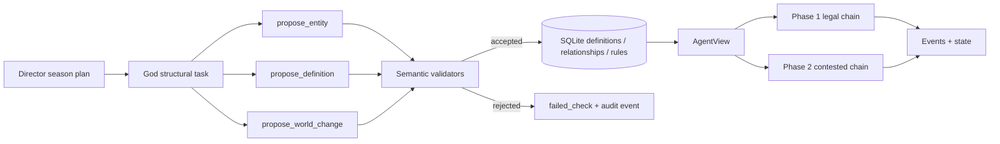

# 设计: Social Authority Loop Phase 3 — Dynamic Social Mechanism Instantiation

> 类型: 需求设计  
> 来源: 本地需求（God/Director 动态实例化 Phase 1/2 内容）  
> 需求文档: `docs/design/social-authority-loop-phase1.md`、`docs/design/social-authority-loop-phase2.md`  
> 需求结论: 交付一个确定性验收：空世界中的 God 通过现有 DSL 提案创建第二个资源、steward、授权规则、受控取用、偷取、违规处理和 Director 压力；两条链在零 Platform 社会机制代码改动下闭环。  
> 架构结论: 不新增社会机制原语；复用 Phase 1/2 原语、`propose_definition`、`propose_world_change`、`propose_entity`、`assign_to` 和 Director 的 season plan 能力；新增的只是语义校验和 DSL gap ledger。  
> 交付范围: Phase 3A 确定性实例化、Phase 3B LLM God 观测、Phase 3C DSL gap ledger 与 Phase 4 决策证据。  
> 首要风险: DSL 表达力不足，God 生成的内容看起来正确但运行时语义缺失；用 gap ledger 和语义校验提前暴露。  
> 创建时间: 2026-11-18  
> 更新时间: 2026-11-18  
> 代码位置: `src/sim2/`, `worlds/dynamic_social_probe/`, `tests/`, `scripts/`

> 迁移说明（2026-11-19）: 本文记录的验收矩阵仍然有效；具体定义 ID 已按能力模型迁移为
> `fill_resource`、`withdraw_resource`、`take_resource` 和 `review_violation`，目标通过
> `resource_id` 绑定。阶段数量、授权规则、违法链和 Story 唤醒契约未改变。

## 需求

本需求交付一个确定性验收：空世界中的 God 通过现有 DSL 提案创建第二个资源、steward、授权规则、受控取用、偷取、违规处理和 Director 压力；两条链在零 Platform 社会机制代码改动下闭环。

Phase 1 和 Phase 2 证明了原语。Phase 3 证明这些原语可以被 God/Director 组合成新内容，而不是只能存在于手写 probe world 中。

### 业务目标

- 证明世界确实是“配置 + 动态推进”，不是“手写 probe world + 固定内容”。
- 证明 God 可以用 DSL 创建新资源、新 steward、新授权规则、新受控取用、新偷取行为和新违规处理行为。
- 证明 Director 可以用 season plan 和稀缺目标制造增长需求；巡逻和机会窗口由世界内容或测试 harness 控制，不新增 Director 代码。
- 证明合法链和违规链在新内容上都能闭环。
- 产出 DSL gap ledger，用证据决定是否需要 Phase 4 的 Mechanism DSL。

### 用户场景

1. `dynamic_social_probe` 初始只有 Mira、Tomas、`relay_station`、`relay_yard` 和基础移动行为。
2. 没有 `water_reserve`，没有 water 的 steward，没有 water 的授权规则，没有 `withdraw_water` 或 `take_water`。
3. Director 在 season plan 中把 `resource` 结构单元列为目标，制造新资源的增长需求。
4. God 通过 proposal 创建：
   - `water_plant` 地点和 `water_reserve` 资源；
   - `mira -> water_reserve` 的 stewardship 关系；
   - `withdraw_water` 的 Action 和 BT；
   - `water_reserve_stewardship` 授权规则；
   - `take_water` 的 Action 和 BT；
   - `review_water_violation` 的 Action 和 BT；
   - `water_violation_authority` 授权规则。
5. Tomas 对 `withdraw_water` 被拒绝，走 request → approve → withdraw 的合法链。
6. Tomas 在 Mira 离开时偷取，产生 `undetected` 违规；在 Mira 在场时偷取，产生 `observed` 违规。
7. Mira 通过 `review_water_violation` 制裁或宽恕；Tomas 的委托取用被 `access_restricted` 拒绝或恢复。
8. 全流程只使用 proposal 和 Phase 1/2 运行时，不改 Platform 社会机制代码。

### 当前限制

- Phase 1/2 的 probe world 是手写配置；尚未证明 God 能生成同样的内容。
- `assign_to` 已能把新 BT 解锁给 Agent，但没有一个端到端测试证明它和授权/偷取链一起工作。
- `resource_withdrawal`、`resource_take`、`authorization` 规则和 `violation_review` 模式的语义校验不完整；God 可以提出结构正确但运行时缺字段的 proposal。
- Director 的 season plan 只选择 growth cell，不创建定义；尚未证明它能驱动 God 创建新资源内容。
- 没有 DSL gap ledger，因此无法判断 Phase 4 是否必要。

### 交付范围

| 范围 | 内容 |
| --- | --- |
| Phase 3A | 空世界、确定性 God proposal 序列、合法链、违规链、Director season plan、非法 proposal 拒绝、零 Platform 代码改动证据 |
| Phase 3B | LLM God 观测：God 在空世界中生成资源/规则/行为，Platform 校验，确定性 harness 运行两条链 |
| Phase 3C | DSL gap ledger：记录每个无法表达或需要额外代码的 proposal，按类型统计，给出 Phase 4 决策 |
| 世界 | `worlds/dynamic_social_probe` |
| 校验 | `resource_withdrawal` / `resource_take` / `authorization` / `violation_review` 的语义校验 |
| 测试 | DA-01..DA-10、Phase 1/2 回归 |
| 脚本 | `scripts/verify_dynamic_social_content.py` |

### 明确不做

- 新增 Phase 1/2 之外的运行时原语。
- Mechanism DSL 的实现；Phase 4 是否启动由 Phase 3C 决定。
- 攻击、战斗、死亡、欺骗、潜行。
- 自动事件路由和定向唤醒。
- 由 God 直接写 Python、SQL 或任意脚本。
- 运行时建表、改表或绕过 schema。
- LLM God 生成内容的正确率门槛。
- 多 Agent 并发审批、资源预留和竞争。

### 质量要求

- DA-01..DA-10 全部确定性通过。
- 合法链和违规链在 `dynamic_social_probe` 上闭环，且只使用 proposal 和 Phase 1/2 运行时。
- 非法 proposal 全部被拒绝，失败结果只使用 `failed_check`。
- Proposal 重试幂等，失败不留下部分定义、关系、规则或实体。
- Phase 1 的 SA-01..SA-18 和 Phase 2 的 PA/PB 测试保持通过。
- 全量测试通过；1000 Agent p95 不超过 250 ms。
- Phase 3C 的 gap ledger 覆盖每个失败或被绕过的 proposal，并给出确定结论：小修、Phase 4 或拒绝。

## 架构设计

采用“现有 DSL 组合 + 语义校验”的架构。Phase 3 不新增社会机制运行时；God 通过现有 proposal 路径写入定义、关系和实体，Director 通过 season plan 提供增长目标，Platform 用 Phase 1/2 运行时执行。

### 系统边界

| 组件 | 职责 | 所有者 | 接口 |
| --- | --- | --- | --- |
| God content runtime | 接收并提交 definition/entity/world-change proposal | `definition_runtime.py`、`entity_proposals.py`、`world_changes.py` | `propose_definition`、`propose_entity`、`propose_world_change` |
| Director | 选择 growth cell、写 season plan、派发 `god_structural` 任务 | `director.py` | `tick(minute)` |
| Semantic validators | 校验 authorization/resource/violation 规则和 effect 的必需字段与目标 | `definition_validation.py`、`world_change_validation.py`、`world/rules.py` | `failed_check` + errors |
| Phase 1 runtime | access request、delegation、two-phase withdrawal | `platform/authorization.py`、`platform/activity.py` | 现有事件与事务 |
| Phase 2 runtime | resource take、violation、witness、restriction | `platform/contested.py`、`platform/activity.py` | 现有事件与事务 |
| AgentView | 把新定义投影成 options、risk、violations | `agent_view/compiler.py` | `executable_behaviors`、`blocked_behaviors`、`contested_actions`、`violations` |

### 数据与状态所有权

- SQLite 是唯一定义和状态来源。God proposal 通过校验后写入 `action_def`、`bt_def`、`entity`、`relationship`、`metadata.rules`。
- `assign_to` 解锁新 BT 到 Agent 的 `unlocked_bt_ids`；Agent 不需要重启或重新导入世界。
- Director 只写 `season_plan` 和 `god_structural` 任务，不写定义。
- Phase 3A 的确定性 harness 直接提交 proposal；Phase 3B 的 LLM God 使用同一 proposal 工具。
- 没有任何测试专用写入路径。

### 架构图



### 设计原则

- Phase 3 只验证“内容可生成”，不验证“机制可生成”。
- God 生成的内容必须能被现有 Phase 1/2 运行时直接执行。
- 任何无法用现有 DSL 表达的 proposal 都进入 gap ledger，不通过在测试里硬编码绕过。
- DSL 的封闭词汇表保持不变；Phase 3 只补语义校验，不新增社会机制原语。
- Phase 4 是否启动由 Phase 3C 的证据决定，而不是由本设计预设。

## 详细设计

核心实现决策是：`dynamic_social_probe` 只提供基础移动和空资源环境；God 用现有 proposal 创建全部社会内容；测试只通过 proposal 服务写入，不直接改定义表。

### 1. 空世界 `dynamic_social_probe`

| 内容 | 初始状态 |
| --- | --- |
| Agent | `mira`、`tomas` |
| 地点 | `relay_station`、`relay_yard` |
| 基础 Action | `travel_to` |
| 基础 BT | `travel` |
| 资源 | 无 |
| 社会关系 | 无 |
| 授权规则 | 无 |
| 偷取/违规内容 | 无 |
| Director | `evolution.yaml` 配置 `director.cadence_minutes` 和 `targets: [resource]` |

`mira` 和 `tomas` 的 `initial_bt_ids` 只包含基础移动行为。`mira` 初始没有 stewardship；`tomas` 初始没有 `take_water`。

### 2. 确定性 God proposal 序列

测试以 `actor_id="god"` 调用现有服务，顺序固定：

1. `propose_entity`：`water_plant` 地点。
2. `propose_entity`：`water_reserve` 资源，位于 `water_plant`，初始量 10。
3. `propose_world_change` relationship：`mira -> water_reserve`，`type=stewardship`。
4. `propose_definition` action：`withdraw_water`，effect `resource_withdrawal`，target `water_reserve`，scope `water_withdrawal`。
5. `propose_definition` behavior：`withdraw_water`，`assign_to=[mira, tomas]`，entry `actor.alive`，node 调用 action。
6. `propose_world_change` rule：`water_reserve_stewardship`，`type=authorization`，`mode=resource_access`，target `water_reserve`，scope `water_withdrawal`，behavior_ids `[withdraw_water]`。
7. `propose_definition` action：`take_water`，effect `resource_take`，target `water_reserve`，scope `water_withdrawal`。
8. `propose_definition` behavior：`take_water`，`assign_to=[tomas]`。
9. `propose_definition` action：`review_water_violation`，空 effects，duration 0。
10. `propose_definition` behavior：`review_water_violation`，`authorization_operation=review_violation`，`assign_to=[mira]`。
11. `propose_world_change` rule：`water_violation_authority`，`type=authorization`，`mode=violation_review`，behavior_ids `[review_water_violation]`。
12. Director：`tick` 到一个 cadence 边界，生成 `season_plan`，target cell 为 `resource`。

第 12 步的 season plan 是 Phase 3 的“需求侧”：Director 告诉 God 世界缺资源内容；God 的 proposal 满足这个目标。Director 不创建定义，也不移动 Agent。

### 3. 语义校验

Phase 3 增加以下校验；它们只验证现有原语的字段与目标，不新增机制：

| 校验 | 规则 | 失败码 |
| --- | --- | --- |
| authorization rule | `target` 必须存在且为 resource；`scope` 非空；`behavior_ids` 必须已注册；mode 必须受支持 | `rule.authorization_target` / `rule.scope` / `rule.behavior` |
| `resource_withdrawal` | `resource_id` 必须存在且为 resource；`amount > 0`；`scope` 非空 | `effect.resource` / `effect.amount` / `effect.scope` |
| `resource_take` | 同上；`mode` 必须为 `covert` | `effect.resource` / `effect.amount` / `effect.scope` / `effect.mode` |
| behavior with `authorization_operation` | operation 必须在 `request_access`、`approve_withdrawal`、`reject_withdrawal`、`revoke_delegation`、`review_violation` 中；`review_violation` 必须有 `violation_id`/`decision` 参数或可自动解析 | `behavior.authorization_operation` |
| behavior assignee | `assign_to` 必须解析到至少一个已存在的 Agent | `assign_to` |
| violation_review rule | behavior 已注册；mode 为 `violation_review` | `rule.behavior` / `rule.mode` |

校验失败返回 `failed_check`，不写任何定义、关系或规则。

### 4. 合法链

```text
Tomas withdraw_water
  -> behavior.denied missing_delegation
  -> request_access (generic)
  -> access.requested
  -> Mira approve_withdrawal
  -> access.approved + delegation
  -> withdraw_water started
  -> resource.withdrawal.completed
  -> Mira revoke_delegation
  -> withdraw_water denied delegation_revoked
```

验收点：

- 新资源、新 steward、新授权规则、新 BT 都由 proposal 创建。
- `withdraw_water` 的拒绝原因、申请、批准、取用、撤销与 Phase 1 语义一致。
- 没有 `water_reserve`、`water_plant`、`mira`、`tomas` 的 Platform 分支。

### 5. 违规链

```text
Tomas take_water
  -> resource.taken
  -> violation (undetected 或 observed)
  -> Mira review_water_violation sanction
  -> violation.sanctioned + access_restriction
  -> withdraw_water denied access_restricted
  -> Mira forgive
  -> violation.forgiven + restriction revoked
  -> withdraw_water allowed
```

验收点：

- `take_water` 不经过授权评估器。
- 目击集合由完成时同地点清醒 Agent 决定。
- `undetected` 违规只出现在全局审计和 Tomas 私有视图。
- 制裁只影响委托路径，不影响 Mira 自己的 stewardship。
- 宽恕恢复委托取用。

### 6. Director 驱动

`evolution.yaml` 配置：

```yaml
director:
  cadence_minutes: 5
  window_minutes: 60
  targets: [resource]
```

测试推进到 minute 5，Director 生成 `season_plan`，target cell 为 `resource`。God proposal 创建 `water_reserve` 后，growth ledger 的 `resource` cell 增长，Director 在下一个 cadence 将 plan 标记为 `completed`。

Director 不在 Phase 3 创建定义、移动 Agent 或生成巡逻；机会窗口由 `patrol_water` 内容或测试 harness 控制。LLM God 探针可以使用 Director 的 plan 作为任务理由。

### 7. 验收矩阵 3A

| ID | 断言 | 证据 |
| --- | --- | --- |
| DA-01 | 空世界没有 `water_reserve`、`withdraw_water`、`take_water`、stewardship 或授权规则 | 视图与定义表 |
| DA-02 | God proposal 全部 accepted；`definition.registered` / `entity.created` / `world.change.*` 存在；`withdraw_water` 对 Tomas blocked，对 Mira allowed；`take_water` 对 Tomas executable | 事件与视图 |
| DA-03 | 合法链在 `withdraw_water` 上闭环：拒绝、申请、批准、取用、完成、撤销、再拒绝 | Phase 1 事件链 |
| DA-04 | 违规链闭环：未目击 `undetected`；目击 `observed`；制裁 `access_restricted`；宽恕恢复 | Phase 2 事件链 |
| DA-05 | Director season plan 在 God 创建资源后完成；不需要 Director 代码改动 | season plan 状态 |
| DA-06 | 非法 proposal 被拒绝：缺少 resource、错误 target、空 scope、无 assignee、非法 operation、错误 mode；无部分写入 | `failed_check` 与表计数 |
| DA-07 | Platform 源码不包含 `energy_reserve`、`take_energy`、`water_reserve`、`water_plant`、`withdraw_water`、`take_water`、`review_water_violation` 的硬编码分支；Platform 只识别 `resource_withdrawal`、`resource_take`、`authorization`、`violation_review` 等原语 | 源码 grep 测试 |
| DA-08 | Phase 1 SA-01..SA-18 和 Phase 2 PA/PB 保持通过 | 回归测试 |
| DA-09 | 负空间：没有攻击/战斗/欺骗事件；没有自动 Story/Director 任务；God proposal 是唯一内容来源 | 事件日志 |
| DA-10 | Proposal 重试幂等；失败 proposal 不留下定义、关系、规则或实体 | 计数与快照 |

### 8. 测试环境

- 世界：`worlds/dynamic_social_probe`，只有 Mira、Tomas、两个地点、`travel_to` 和基础巡逻。
- 初始库存：无 `water_reserve`。
- Director cadence：5 分钟。
- God proposal 通过 `platform.submit_definition`、`platform.submit_entity_proposal`、`platform.submit_world_change` 提交；测试不直接写表。
- 合法链和违规链的 Agent 行动通过 `BehaviorIntent` 提交。
- 年龄/incapacitation 等基础规则沿用 probe 配置。
- Phase 3A 不调用 LLM；Phase 3B 才调用远程 provider。

### 9. Phase 3B：LLM God 观测

- 运行 3–5 次。
- 输入：空世界、Director season plan、`propose_definition` / `propose_entity` / `propose_world_change` 工具。
- 输出：God proposal 集合。
- Platform 校验后，确定性 harness 运行合法链和违规链。
- 报告：
  - 有效 proposal 集合数；
  - 被拒绝的 proposal 数及 `failed_check`；
  - 两条链成功数；
  - 需要新原语的 proposal 数；
  - 无效探针原因。
- 不以 LLM God 100% 成功为门槛；Phase 3A 才是 gate。

### 10. Phase 3C：DSL gap ledger

每个失败或被绕过的 proposal 记录：

```yaml
gap_id: gap_001
requested_content: "new appeal workflow after rejection"
missing_primitive: "workflow state machine"
current_workaround: "none"
requires_new_runtime_semantics: true
frequency: 3
phase4_candidate: true
```

分类：

| 类型 | 结论 |
| --- | --- |
| 内容赋值（assign/relationship/entity） | 小修现有 proposal，不启动 Phase 4 |
| 语义校验（缺字段、错目标） | 补 validator，不启动 Phase 4 |
| 新策略组合（配额、巡逻、制裁） | 用现有 DSL 表达，不启动 Phase 4 |
| 新生命周期/事务/事件语义 | Phase 4 候选 |
| 任意计算/脚本 | 拒绝，不进入 Phase 4 |

Phase 4 启动条件：

1. 至少三类不同的新生命周期/事务/事件需求无法用现有 DSL 表达；或
2. 同一类新机制在三个以上世界内容请求中重复出现；或
3. God 的合法 proposal 率因表达力（不是校验）低于 50%，且 gap ledger 指向同一层缺失。

不满足以上条件时，Phase 3C 的结论是“补 validator/内容赋值”，不启动 Phase 4。

### 11. 实现计划

| 里程碑 | 工作 | 退出条件 |
| --- | --- | --- |
| M0 | 创建 `worlds/dynamic_social_probe` 与基础移动内容 | 世界校验通过；空视图正确 |
| M1 | 补 authorization/resource/violation 语义校验 | DA-06 通过 |
| M2 | 写确定性 God proposal 序列 | DA-02、DA-07 通过 |
| M3 | 运行合法链与违规链 | DA-03、DA-04 通过 |
| M4 | 接入 Director season plan | DA-05 通过 |
| M5 | DA-01..DA-10 测试 | 3A 全绿 |
| M6 | LLM God 探针 | 3B 报告 |
| M7 | Gap ledger 与 Phase 4 决策 | 3C 报告 |
| M8 | 全量测试、benchmark、文档、提交 | 全套通过 |

### 12. Definition of Done

1. DA-01..DA-10 确定性通过。
2. Phase 1 SA-01..SA-18 和 Phase 2 PA/PB 保持通过。
3. 合法链和违规链在新资源上闭环。
4. 非法 proposal 全部被拒绝且无部分写入。
5. Platform 源码没有新内容 ID 的硬编码分支。
6. 全量测试通过；1000 Agent p95 记录且不超过 250 ms。
7. Phase 3B 报告有效探针和链成功率。
8. Phase 3C gap ledger 给出确定结论：小修、Phase 4 或拒绝。
9. 报告明确列出 PROVEN、NOT_PROVEN、FAILED。

## 影响评估

本设计是内容生成验证，不新增社会机制原语。最高风险是 DSL 表达力不足，导致 God 生成的内容看起来正确但运行时语义缺失。

### 影响对象

| 影响对象 | 当前状态 | 目标状态 | 处理结论 |
| --- | --- | --- | --- |
| Phase 1/2 运行时 | 已实现 | 保持不变 | 兼容 |
| `propose_definition` | 可注册 action/BT/capability/recipe | 增加 resource/violation 语义校验 | 向后兼容 |
| `propose_world_change` | rule/relationship/route/faction/property/event | 增加 authorization rule 语义校验 | 向后兼容 |
| `propose_entity` | 可创建 agent/location/resource/object | 不修改 | 兼容 |
| `assign_to` | 已能解锁 BT | 不修改 | 兼容 |
| Director | season plan | 不修改 | 兼容 |
| 新世界 | 不存在 | `dynamic_social_probe` | 新增 |
| 源码 | 无新内容 ID | 仍无硬编码分支 | 保持不变 |
| 测试 | Phase 1/2 | 增加 DA-01..DA-10 | 新增 |
| benchmark | p95 182 ms | 目标不超过 250 ms | 需回归 |

### 风险与规避

| 风险 | 规避 |
| --- | --- |
| DSL 无法表达新机制 | Gap ledger 记录；Phase 4 决策；不在 Phase 3 硬编码绕过 |
| God 生成结构正确但语义错误 | 语义 validator；失败 proposal 零写入；DA-06 |
| `assign_to` 解锁失败 | 现有 `_unlock_behavior` + DA-02 视图断言 |
| 新内容 ID 泄漏到 Platform | DA-07 源码 grep 测试 |
| Director 只创建 plan 不创建内容 | Phase 3 只证明 demand/供应闭环；内容由 God proposal 创建 |
| LLM God 生成率低 | 3B 观测，不是 gate；3A 确定性 payload 才是 gate |
| 测试绕过 proposal 直接写表 | 测试 helper 只调用 Platform proposal 服务；代码审查 |
| Proposal 部分写入 | 现有事务 + DA-10 失败快照 |
| 性能回归 | benchmark；新定义只在 probe world |
| Gap ledger 主观 | 固定分类、触发条件和计数 |

### 发布、回滚与数据迁移

- 发布顺序：世界内容 → 语义校验 → 确定性 proposal → 两条链 → Director → tests → LLM probe。
- 数据迁移：新世界是独立包；现有 probe 和实例不改。
- 回滚：删除 `dynamic_social_probe`、DA 测试和校验增量；Phase 1/2 不受影响。
- 回滚触发条件：Phase 1/2 回归失败；proposal 出现部分写入；DA-07 发现硬编码；p95 超过 250 ms 且无解释。
- 证据回填位置：`docs/design/social-authority-loop-phase3-report.md`。
- 关闭条件：DA-01..DA-10 全绿；Phase 1/2 回归通过；全量测试和 benchmark 记录；3B/3C 报告完成。

### NOT_PROVEN

Phase 3 完成后，以下仍然是 `NOT_PROVEN`：

- Mechanism DSL 和通用 workflow 运行时。
- God 生成任意新生命周期/事务/事件的能力。
- 攻击、战斗、死亡、欺骗、潜行。
- 自动事件路由和定向唤醒。
- LLM God 必然生成有效内容。
- 多 Agent 并发审批、资源预留和竞争。
- 由新内容自动推动 Story/Director 制度演化。
