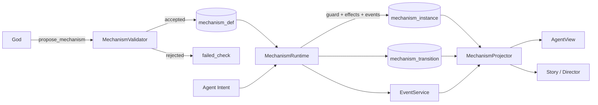

# 设计: Social Authority Loop Phase 4 — Mechanism DSL

> 类型: 需求设计  
> 来源: 本地需求（Phase 3C gap ledger 触发的通用机制 DSL）  
> 需求文档: `docs/design/social-authority-loop-phase3.md`；`docs/design/social-authority-loop-phase1.md`；`docs/design/social-authority-loop-phase2.md`  
> 需求结论: 在 Phase 3C 触发条件满足时，交付一个声明式、可校验、可审计的 Mechanism DSL，让 God 用状态机、授权、资源事务、违规策略和事件契约定义新社会机制，不写代码。  
> 架构结论: 采用有界声明式机制解释器；机制定义存入 SQLite；通用 `MechanismRuntime` 解释状态、守卫、效果、事件、可见性和事务；禁止任意代码、SQL 和运行时建表。  
> 交付范围: Phase 4A 用机制定义重述 Phase 1/2、Phase 4B 新机制、Phase 4C LLM God 观测；机制定义、运行时、校验、视图、测试与验证脚本。  
> 首要风险: 机制 DSL 的复杂度和验证面爆炸；用有界词汇、参考机制、双重运行比较和 feature flag 控制。  
> 创建时间: 2026-11-18  
> 更新时间: 2026-11-18  
> 代码位置: `src/sim2/`, `worlds/`, `tests/`, `scripts/`

## 需求

本需求在 Phase 3C 触发条件满足时，交付一个声明式、可校验、可审计的 Mechanism DSL，让 God 用状态机、授权、资源事务、违规策略和事件契约定义新社会机制，不写代码。

Phase 1/2 把社会机制做成了原生运行时。Phase 3 证明现有 DSL 可以组合这些原语。Phase 4 解决 Phase 3C 暴露的结构性缺口：God 需要定义新的生命周期、事务阶段、事件契约和可见性，而不是只实例化已有机制。

Mechanism DSL 不是图灵完备脚本语言。它是有界、声明式、可验证的机制定义语言。God 定义“机制的形状”，Platform 解释执行；God 不写 Python、SQL 或任意代码。

### 业务目标

- 让 God 能在运行时定义新的社会机制，而不是每次新增机制都改 Platform 代码。
- 让新机制具备与 Phase 1/2 相同的事务原子性、幂等、可见性和审计。
- 让 Story/Director 能引用机制状态，但不直接改机制状态。
- 让机制定义可版本化、可回滚、可迁移。
- 让 Agent 只能通过 Intent 参与机制，不能直接写状态。

### 用户场景

1. God 发现当前制度只有“批准/拒绝”，需要“拒绝后可申诉”的机制。
2. God 用 Mechanism DSL 定义 `permit_appeal`：
   - `denied` → `appeal_pending` → `appeal_approved` / `appeal_rejected`；
   - 申诉由第二 steward 审批；
   - 通过后生成临时 permit，过期后失效；
   - 每次转换写事件、可见性和审计。
3. Platform 校验定义，写入 SQLite。
4. Agent 通过 `request_behavior` 进入机制；Platform 执行转换。
5. Director 可以把 `appeal_pending` 作为压力/剧情目标；Story 可以叙述；两者都不能直接改状态。
6. God 可以定义第二个机制 `fine` 或 `queue`，不需要新代码。

### 当前限制

- Phase 1/2 的机制生命周期是代码定义的；God 不能新增“申诉”“罚款”“排队”“临时许可”等机制。
- `propose_definition` 只能注册 action/BT/capability/recipe；不能注册状态机、事务阶段或事件契约。
- `propose_world_change` 只能改 rule/relationship/route/faction/property/event；不能定义新生命周期。
- 每个新机制都需要新增表、事件、评估器和测试。
- 没有通用机制定义、实例、转换日志和可见性投影。

### 交付范围

| 范围 | 内容 |
| --- | --- |
| Phase 4A | 用 Mechanism DSL 重述 Phase 1 的 access/delegation 和 Phase 2 的 take/violation/sanction；与原生实现并行运行并比较状态/事件 |
| Phase 4B | God 定义一个新机制 `permit_appeal`，端到端运行，不改 Platform 代码 |
| Phase 4C | LLM God 观测：God 从任务生成机制定义，Platform 校验，确定性 harness 运行 |
| 存储 | `mechanism_def`、`mechanism_instance`、`mechanism_transition` |
| 运行时 | `MechanismRuntime`：start、preview、transition、complete、fail、migrate |
| 校验 | `MechanismValidator`：schema、状态可达性、guard/effect/event/visibility、限制 |
| 视图 | `MechanismProjector`：按 viewer 过滤状态、转换和事件 |
| 测试 | MA-01..MA-13 |
| 脚本 | `scripts/verify_mechanism_dsl.py` |

### 明确不做

- 图灵完备脚本、任意 Python/SQL、运行时建表或改表。
- 攻击、战斗、死亡、欺骗、潜行。
- 自动事件路由和定向唤醒。
- 多 Agent 并发写同一机制实例；只支持显式 `lock_key` 串行。
- 完整自然语言到机制定义的确定性正确性。
- 由机制定义自动生成 Story/God 任务。
- 替代 Phase 1/2 原生实现；Mechanism DSL 与原生实现并存，由 feature flag 选择。

### 质量要求

- MA-01..MA-13 全部确定性通过。
- Phase 1/2 原生实现的 SA/PA/PB 测试保持通过。
- 机制定义激活后不可变；新版本是新记录；实例固定版本。
- 机制转换事务原子提交；失败回滚，无部分状态。
- 同一 `(instance, transition, intent_id)` 只产生一次副作用。
- 可见性按 viewer 过滤；全局审计与 Agent 视图分离。
- 机制定义不能执行任意代码；所有 guard/effect/event 都在封闭词汇表内。
- 1000 Agent 非 LLM p95 不超过 250 ms。
- Phase 4C 报告有效定义数、校验失败原因、机制运行成功率；不以 100% 为门槛。

## 架构设计

采用“声明式机制定义 + 通用解释器”的架构。God 定义机制形状，Platform 校验并解释执行；机制状态、转换和事件都存入 SQLite，Agent 只提交 Intent。

### 系统边界

| 组件 | 职责 | 所有者 | 接口 |
| --- | --- | --- | --- |
| `MechanismValidator` | 校验 schema、状态可达性、guard/effect/event/visibility、限制 | Platform | `validate(definition) -> errors` |
| `MechanismRuntime` | 启动实例、预览、执行转换、完成/失败、迁移 | Platform | `start`、`preview`、`transition`、`complete`、`fail`、`migrate` |
| `MechanismProjector` | 按 viewer 过滤机制状态、可用转换和事件 | AgentView | `project(instance, viewer)` |
| `mechanism_def` | 机制定义、版本、状态、限制 | SQLite | `mechanism_id + version` |
| `mechanism_instance` | 每个实体/角色的机制状态 | SQLite | `instance_id`、`mechanism_id`、`version`、`state` |
| `mechanism_transition` | 转换审计、幂等键、事件引用 | SQLite | `(instance_id, transition_id, intent_id)` |
| Guard/Effect 解释器 | 复用条件 DSL 和封闭 effect 词汇 | Platform | `ConditionEngine`、`EffectPipeline` |
| EventContract | 声明事件类型、必需字段、因果链接 | Platform | `event_type`、`required_fields` |

### 数据与状态所有权

- SQLite 是机制定义、实例、转换和事件的唯一事实来源。
- God 只能通过 `propose_mechanism` 写定义；不能直接写实例。
- Agent 只能通过 Intent/BT 触发 transition；不能直接改 state。
- `MechanismRuntime` 是唯一转换执行者；它在声明的事务边界内写状态和事件。
- `MechanismProjector` 是只读投影；它不写状态。
- 全局审计层保存所有转换；Agent 视图按 `visibility` 过滤。

### 架构图



### 设计原则

- 机制定义是有界的：状态数、转换数、effect 数、事件数、实例数都有上限。
- 机制定义是内容，`MechanismRuntime` 是原语；God 定义机制形状，不能新增 effect/guard/event 词汇。
- 机制定义是声明式的：没有循环、递归、任意代码、SQL 或运行时建表。
- 机制定义是版本化的：active 版本不可变；新版本是新记录；实例固定版本。
- 机制转换是原子的：一个 `commit_group` 内的状态、效果、事件同一事务提交。
- 机制可见性是声明的：public、private、witness、steward、role；不是由代码临时决定。
- 机制审计是全局的：每次转换写 `mechanism_transition` 和事件；Agent 只看到可见部分。

## 详细设计

核心实现决策是：Mechanism DSL 只描述“状态、转换、守卫、效果、事件、可见性和事务边界”，不描述任意计算。所有执行由 Platform 的封闭解释器完成。

### 1. 机制定义 schema

```yaml
mechanism_id: permit_appeal
version: 1
status: active
description: A rejected access request may be appealed to a second steward.
owner: god
scope: resource_access

states:
  initial: denied
  values: [denied, appeal_pending, appeal_approved, appeal_rejected, permit_active, permit_expired]

transitions:
- id: open_appeal
  from: denied
  action: appeal_request
  to: appeal_pending
  guard: actor.id == instance.subject
  effects:
  - type: event_emit
    event: appeal.opened
  events: [appeal.opened]
  visibility: [public, steward]
  commit_group: appeal_open
  idempotency_key: intent_id

- id: decide_appeal
  from: appeal_pending
  action: appeal_decide
  to: appeal_approved
  guard: actor.is_steward(instance.target) and actor.id != instance.subject
  effects:
  - type: permit_grant
    scope: instance.scope
    expires_minutes: 60
  events: [appeal.approved, permit.granted]
  visibility: [public, steward, subject]
  commit_group: appeal_decide
  idempotency_key: intent_id

authorization:
  mode: request_decision
  target: instance.target
  scope: instance.scope
  checks: [self_approval_forbidden, missing_stewardship, request_not_pending]

resource_transaction:
  phases:
  - name: start
    commit: [instance.state, event]
  - name: complete
    commit: [resource.decrement, event]
  - name: fail
    commit: [instance.state, event]

violation_policy:
  witness: same_location_alive
  visibility: [private, witness, steward]
  sanctions:
  - type: access_restriction
    scope: instance.scope
    reversible: true

event_contracts:
  appeal.opened:
    required: [instance_id, subject, target, scope, minute]
  appeal.approved:
    required: [instance_id, subject, target, scope, approver, minute]
  permit.granted:
    required: [instance_id, subject, target, scope, expires_minute, minute]

limits:
  max_instances: 1000
  max_transitions_per_minute: 20
  max_effects_per_transition: 8
```

### 2. 通用运行时

`MechanismRuntime` 提供：

- `start(mechanism_id, actor, context)`：创建实例，状态为 `initial`；校验唯一 active 实例键。
- `preview(instance, action, context)`：返回 guard 结果、可用转换、可见效果；无副作用。
- `transition(instance, action, context)`：校验 guard，执行 effects，写状态和事件，写 transition 审计。
- `complete(instance, phase)` / `fail(instance, reason)`：执行声明的完成/失败提交组。
- `migrate(instance, target_version)`：只执行声明的迁移转换；没有声明则拒绝。
- `project(instance, viewer)`：按 visibility 返回状态和可用转换。

Guard 复用 `ConditionEngine`；effect 复用 `EffectPipeline` 和一组封闭的机制 effect：

| effect | 语义 |
| --- | --- |
| `state_set` | 设置实例状态 |
| `instance_create` | 创建子实例 |
| `event_emit` | 写声明事件 |
| `relationship_delta` | 改信任/关系 |
| `resource_transfer` | 声明式资源转移 |
| `restriction_set` | 创建/撤销访问限制 |
| `permit_grant` | 创建带过期时间的许可 |
| `timer_set` | 声明到期转换 |

所有 effect 都在 `commit_group` 内执行；失败回滚整组。

### 3. 事务与幂等

```text
transition:
  read instance + definition
  evaluate guard
  apply effects
  write instance state
  write events
  write mechanism_transition
  COMMIT
```

- `mechanism_transition` 的唯一键是 `(instance_id, transition_id, intent_id)`。
- 同一键重试返回原结果，不重复 effect/event。
- `commit_group` 内任何写入失败，整组回滚；实例保持原状态。
- 并发由 `lock_key` 串行；同一实例同时只允许一个转换。
- 跨实例操作必须声明 `commit_group`，否则拆成多个转换。

### 4. 可见性

`visibility` 支持：

- `public`：所有 Agent。
- `private`：实例 subject。
- `witness`：实例 witnesses。
- `steward`：target 的 steward。
- `role:<name>`：指定角色。

`MechanismProjector` 只投影 viewer 可见的状态、转换和事件。全局审计表保留全部转换；AgentView 不暴露不可见字段。

### 5. 版本与迁移

- `mechanism_def` 以 `(mechanism_id, version)` 为主键。
- active 版本不可变；修改必须创建新版本。
- `mechanism_instance` 固定 `definition_version`。
- 迁移必须声明 `migrate_from` / `migrate_to` 转换；没有声明则拒绝。
- 旧版本实例可以继续运行，或由显式迁移转换到新版本；不允许隐式升级。

### 6. 校验

`MechanismValidator` 校验：

- schema：必需字段、类型、枚举。
- 状态：initial 存在；所有 transition 的 from/to 存在；所有状态可达。
- 转换：action 唯一；idempotency_key 合法；commit_group 非空。
- guard：路径在条件 DSL 内；不引用未知字段。
- effect：在封闭 effect 词汇内；字段完整；资源/目标存在。
- event：在 `event_contracts` 内；required fields 完整。
- visibility：合法值；不能引用不存在的 viewer 类型。
- limits：状态/转换/effect/事件/实例数在上限内。
- 安全：没有 `python`、`sql`、`script`、`eval`、`exec`、`import`、文件或网络字段。

失败返回 `failed_check` 和 errors，不写定义。

### 7. Phase 4A：用机制定义重述 Phase 1/2

Phase 4A 用 Mechanism DSL 定义：

- `access_delegation`：pending → approved/rejected；delegation 创建/撤销；two-phase withdrawal。
- `contested_take`：resource.taken；violation undetected/observed；witness/trust/memory。
- `violation_review`：observed → sanctioned/forgiven；restriction 创建/撤销。

测试把同一组 SA/PA/PB 场景跑在机制运行时上，比较：

- 事件类型和必需字段；
- 状态快照；
- 库存/关系/限制；
- 失败回滚；
- 幂等。

原生 Phase 1/2 保留；机制版本作为参考实现，不替换原生版本。两者差异必须解释，不能静默通过。

### 8. Phase 4B：新机制 `permit_appeal`

`permit_appeal` 是 Phase 4B 的冻结新机制：

```text
denied
  -> appeal_pending   (subject 提交申诉)
  -> appeal_approved  (第二 steward 批准)
  -> permit_active    (生成 60 分钟临时许可)
  -> permit_expired   (到期)
  -> appeal_rejected  (第二 steward 拒绝)
```

约束：

- 申诉人必须是原请求 subject。
- 审批人必须是 target 的 steward，且不能是申诉人。
- 同一 request 只能有一个 active appeal。
- 临时许可只授权声明的 scope，过期后失效。
- 审批/拒绝/过期都写事件和 transition 审计。
- 不需要改 Platform 代码；全部由机制定义和通用运行时完成。

### 9. Phase 4C：LLM God 观测

- 运行 3–5 次。
- 输入：当前世界、机制任务、`propose_mechanism` 工具、机制 schema。
- God 生成机制定义；Platform 校验；确定性 harness 运行机制。
- 报告：有效定义数、校验失败原因、机制运行成功率、需要新 effect/guard 的次数。
- 不以 LLM God 100% 成功为门槛；Phase 4A/4B 是 gate。

### 10. 验收矩阵

| ID | 断言 | 证据 |
| --- | --- | --- |
| MA-01 | 机制定义 schema、状态可达性、guard/effect/event/visibility 校验 | validator 测试 |
| MA-02 | Phase 1 access/delegation 作为机制定义通过等价测试 | 事件/状态比较 |
| MA-03 | Phase 2 take/violation/sanction 作为机制定义通过等价测试 | 事件/状态比较 |
| MA-04 | `permit_appeal` 端到端运行，不改 Platform 代码 | 事件/状态/许可 |
| MA-05 | 非法定义被拒绝：未知状态、不可达状态、未知 effect、缺事件字段、非法 visibility、超限 | `failed_check` |
| MA-06 | 转换/完成/失败事务注入失败时全部回滚 | 快照 |
| MA-07 | 可见性按 viewer 过滤；全局审计完整 | 多视图断言 |
| MA-08 | 同一 `(instance, transition, intent_id)` 只产生一次副作用 | 计数 |
| MA-09 | 版本化与显式迁移；active 定义不可变 | 版本/迁移测试 |
| MA-10 | 没有任意代码/SQL/运行时建表；限制生效 | 源码/定义扫描 |
| MA-11 | 1000 Agent p95 不超过 250 ms | benchmark |
| MA-12 | Phase 1/2 原生 SA/PA/PB 保持通过 | 回归 |
| MA-13 | LLM God 报告有效定义和失败原因 | 4C 报告 |

### 11. 实现计划

| 里程碑 | 工作 | 退出条件 |
| --- | --- | --- |
| M0 | 冻结 schema、effect/guard/event 词汇、限制 | 文档与 schema 一致 |
| M1 | 新增 `mechanism_def` / `mechanism_instance` / `mechanism_transition` 表与 repository | 版本/幂等测试 |
| M2 | 实现 `MechanismValidator` | MA-01、MA-05 |
| M3 | 实现 `MechanismRuntime` start/preview/transition/complete/fail | MA-06、MA-08 |
| M4 | 实现 `MechanismProjector` 与 Prompt 投影 | MA-07 |
| M5 | 实现 Phase 4A 参考机制 | MA-02、MA-03 |
| M6 | 实现 `permit_appeal` | MA-04 |
| M7 | 版本/迁移 | MA-09 |
| M8 | LLM God 探针 | MA-13 |
| M9 | 全量测试、benchmark、文档、提交 | MA-11、MA-12 |

### 12. Definition of Done

1. MA-01..MA-13 确定性通过。
2. Phase 1/2 原生 SA/PA/PB 保持通过。
3. Phase 4A 的参考机制与原生实现的事件/状态差异全部解释。
4. `permit_appeal` 端到端运行，无 Platform 内容硬编码。
5. 机制定义不能执行任意代码；限制生效。
6. 全量测试通过；1000 Agent p95 记录且不超过 250 ms。
7. Phase 4C 报告有效定义和失败原因。
8. 报告明确列出 PROVEN、NOT_PROVEN、FAILED。

## 影响评估

本设计是架构级扩展，不是 Phase 1/2 的修补。最高风险是机制 DSL 的复杂度和验证面爆炸，导致“能定义但不可证明”。

### 影响对象

| 影响对象 | 当前状态 | 目标状态 | 处理结论 |
| --- | --- | --- | --- |
| Phase 1/2 原生运行时 | 已实现 | 保留，作为参考和回退 | 兼容 |
| Definition/WorldChange DSL | action/BT/rule/entity | 增加 mechanism 定义 | 新增，不影响旧定义 |
| SQLite | 现有表 | 增加三张机制表 | 新增 |
| AgentView | behavior/violation 投影 | 增加 mechanism 状态和可用转换 | 向后兼容 |
| Prompt | 现有段落 | 增加 mechanism 段落 | 向后兼容 |
| EventService | 现有事件 | 机制事件由 EventContract 校验 | 新增 |
| Story/Director | 读取世界状态 | 可读取机制状态，不直接写 | 兼容 |
| 测试 | Phase 1/2 | 增加 MA-01..MA-13 | 新增 |
| benchmark | p95 182 ms | 目标不超过 250 ms | 需回归 |

### 风险与规避

| 风险 | 规避 |
| --- | --- |
| 机制 DSL 过于复杂 | 有界词汇、限制、只做 2-3 个参考机制 |
| 验证面爆炸 | 严格 schema、可达性、effect/event/visibility 校验 |
| 确定性问题 | 禁止任意代码/循环/递归；固定解释顺序 |
| 性能回归 | benchmark；机制实例按需加载；限制转换数 |
| 版本/迁移复杂 | active 定义不可变；实例固定版本；显式迁移 |
| 与原生实现分叉 | 4A 双重运行比较；差异必须解释 |
| LLM God 生成无效定义 | 4C 观测，不是 gate；错误进入报告 |
| 机制定义成为隐藏代码 | 禁止 python/sql/script；封闭 effect 词汇 |
| 运行时建表/改 schema | 禁止；只写三张机制表 |
| Story/Director 越权 | 只读机制状态；写操作走 Intent |

### 发布、回滚与数据迁移

- 发布顺序：schema → validator → runtime → projector → 4A 参考机制 → 4B 新机制 → 4C 观测。
- 数据迁移：新表是加法；Phase 1/2 数据不重写；机制实例只写新表。
- 回滚：feature flag 关闭 Mechanism DSL；Phase 1/2 原生实现继续运行；三张机制表保留但不读。
- 回滚触发条件：Phase 1/2 回归失败；机制转换出现部分提交；MA-07 可见性泄漏；p95 超过 250 ms 且无解释；发现任意代码执行路径。
- 证据回填位置：`docs/design/social-authority-loop-phase4-report.md`。
- 关闭条件：MA-01..MA-13 全绿；Phase 1/2 回归通过；全量测试和 benchmark 记录；4C 报告完成；无任意代码路径。

### NOT_PROVEN

Phase 4 完成后，以下仍然是 `NOT_PROVEN`：

- 图灵完备脚本和任意计算。
- 攻击、战斗、死亡、欺骗、潜行。
- 自动事件路由和定向唤醒。
- 多 Agent 并发写同一机制实例。
- 完整自然语言到机制定义的确定性正确性。
- 由机制定义自动生成 Story/God 任务。
- 任意社会机制都能用 Mechanism DSL 表达。
