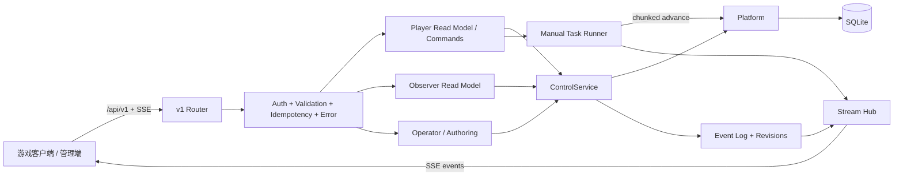

# 设计: Web API v1 契约与实时化重构

> 类型: 需求设计
> 来源: 内部架构重构（无外部工单）
> 需求文档: 本次对话中的 Web/API 重构需求；现状证据来自 `src/sim2/api/http.py`、`src/sim2/api/service.py`、`src/sim2/api/runtime_supervisor.py`、`src/sim2/web/app.js` 与 `tests/test_web_client.py`
> 需求结论: 将未版本化、Handler 直连投影的 Web API 重构为 `/api/v1` 契约层、声明式路由、统一 SSE 和可恢复长任务，游戏与管理客户端一次性 cutover。
> 架构结论: 保留标准库 HTTP server 和 Platform 状态机，在两者之间增加 v1 Router、Pydantic 契约、Auth/Error 中间件、Read Model、Stream Hub 与 Manual Task Runner。
> 交付范围: `src/sim2/api/`、`src/sim2/web/`、`tests/test_web_client.py`、相关设计文档；不改变 Platform、世界包和 SQLite schema。
> 首要风险: 一次性硬切 v1 会同时影响游戏客户端、管理端和测试；用契约快照、Auth 矩阵和浏览器回归控制风险。
> 创建时间: 2026-11-21
> 更新时间: 2026-11-21
> 代码位置: `src/sim2/api/http.py`, `src/sim2/api/service.py`, `src/sim2/api/runtime_supervisor.py`, `src/sim2/web/app.js`, `src/sim2/web/admin.js`, `tests/test_web_client.py`

## 需求

本次重构交付一个可版本化、可验证、可实时推送的 Web API v1，并让游戏客户端与管理端只通过 v1 契约访问世界。Platform、世界包和 SQLite 状态机保持现状；本次重构不改变游戏规则、不迁移存档、不替换标准库 HTTP server。

当前限制已经形成结构性成本：

- `src/sim2/api/http.py` 为 1158 行，`do_GET` 使用 20 余个 `path == "/..."` 分支，POST 另有 `_OPERATOR_POSTS` 与 `_PLAYER_POSTS` 两张表。
- `src/sim2/api/service.py` 为 867 行，`build_player_view` 直接拼装屏幕形状 dict，响应没有版本号、Pydantic 模型或 JSON Schema。
- `src/sim2/web/app.js` 为 3349 行，API 调用、状态、DOM 渲染、音频和场景插画在同一个 IIFE 中。
- `/events/stream` 已实现 SSE，但游戏客户端仍每 15 秒轮询 `/player/view`、`/runtime` 与 feed，实时通道没有被使用。
- `player_wait` 同步执行最多 480 个 step，`ControlHTTPServer.service_call` 与 `RuntimeSupervisor.advance_manual` 在整段等待期间持有全局锁。真实浏览器走查记录到一次 `/player/wait` 持续约 59 秒，客户端关闭后服务端出现 BrokenPipe；该请求期间其他 HTTP 请求被串行阻塞。
- 鉴权、玩家归属校验和幂等键解析分散在 Handler 分支中；新增端点需要人工重复这些检查。
- 非法 query 参数（例如 `limit=abc`）会进入通用异常分支并返回 500，缺少统一的 400/422 错误契约。

业务目标是让后续世界、设施、Story/God 面板和观察者能力继续增长时，新增能力只修改一个 route 声明、一个契约模型和一个客户端模块，而不是同时改 HTTP、Service、JS 和测试四处。功能要求如下：

| 要求 | 判定标准 |
|---|---|
| 版本化入口 | 所有世界、玩家、观察者、Operator 与 Authoring 读写端点只存在于 `/api/v1` 下；旧路径删除，不保留别名 |
| 契约化响应 | 每个端点有 Pydantic 请求/响应模型；删除或重命名字段会让 contract test 失败 |
| 声明式鉴权 | 每条 route 声明所需角色；player 路由绑定 `player_id`；authoring、snapshot、audit、runtime 只允许 operator |
| 统一错误 | 所有错误返回 `{status, code, message, failed_check, request_id}`；非法输入返回 400/422，权限不足返回 403，无世界返回 409 |
| 实时读模型 | 游戏客户端通过 `/api/v1/stream` 接收 `player.view.changed`、`task.progress`、`runtime.changed` 等事件；行动完成后 1 秒内触发视图刷新 |
| 可恢复长任务 | `/player/{id}/wait` 在 2 秒内返回 202 与 `task_id`；推进由后台任务分块执行，任何单次锁持有不超过 2 秒 |
| 前端可维护 | 游戏端拆为 API、状态、流、渲染、音频、场景模块；`app.js` 只保留启动与路由 |
| 质量门禁 | 现有 1479 项测试通过；新增契约/Auth/SSE/Task 测试通过；1000 agents / 5 runs 的 p95 不高于 220 ms |

范围外事项：不引入 FastAPI、uvicorn、GraphQL、ORM 或消息队列；不重写 Platform 的事务、规则、Agent 或世界配置；不改变 SQLite schema；不保留旧 API 的长期双栈。

## 架构设计

采用“模块化单体 + 契约优先”的 Web 边界。浏览器只与 v1 Router 交互；Router 完成鉴权、输入校验、幂等与错误封装后调用应用服务；应用服务从 Platform 读取或写入状态；Stream Hub 从同一事件日志和 revision 生成推送；Manual Task Runner 在后台分块推进手动时间。Platform 仍是唯一状态所有者。



| 组件 | 职责 | 状态所有者 | 对外契约 |
|---|---|---|---|
| `api/v1/routes.py` | 声明 method、path、角色、请求模型、响应模型与 handler | 无 | 路由表 |
| `api/v1/contracts.py` | Pydantic v2 DTO、错误信封、流事件、任务模型 | 无 | JSON Schema / `schema_version` |
| `api/v1/middleware.py` | 会话、角色、玩家归属、幂等、请求 ID、异常映射 | 会话表 | `ErrorV1` |
| `api/v1/player.py` | 玩家命令与 `PlayerViewV1` 读模型 | Platform | `/player/{id}/*` |
| `api/v1/observer.py` | 公开 timeline、map、dialogue、decisions | Platform 事件日志 | `/observer/*` |
| `api/v1/operator.py` | 实例、运行时、快照、审计、simulate/decide | `ControlHTTPServer` / `RuntimeSupervisor` | `/operator/*` |
| `api/v1/stream.py` | 订阅事件、revision 去重、SSE 心跳与断线续传 | Stream Hub | `/stream` |
| `api/v1/tasks.py` | 手动推进任务、进度、取消、结果缓存 | Task Runner | `/player/{id}/wait` |
| `web/api.js` | 唯一 fetch/EventSource 入口，解析错误信封 | 无 | 浏览器内部模块 |
| `web/state.js` | 客户端状态与 revision 合并 | 浏览器 | 浏览器内部模块 |

信任边界保持在本地回环：observer session 只读公开投影；player session 绑定单一 `player_id`；operator token 才能切换实例、控制运行时、导出快照和进入 Authoring。SSE 连接在握手时完成同样的角色校验。

## 详细设计

### 1. 路由与硬切

采用 `/api/v1` 前缀和声明式路由表。路由声明同时包含 method、path template、角色、请求模型、响应模型、是否要求幂等键和 handler。`do_GET`/`do_POST` 只负责解析 URL、读取 body、调用路由表，不再包含业务分支。

核心路由如下：

| 分组 | v1 路由 |
|---|---|
| 会话 | `POST /api/v1/session` |
| 世界 | `GET /api/v1/status`, `GET /api/v1/world`, `GET /api/v1/worlds`, `GET /api/v1/instances` |
| 实例 | `POST /api/v1/instances`, `POST /api/v1/instances/{instance_id}/activate` |
| 运行时 | `GET /api/v1/runtime`, `POST /api/v1/runtime/{start,pause,resume,stop,step}` |
| 玩家 | `GET /api/v1/player/entry`, `POST /api/v1/player/enter`, `GET /api/v1/player/{player_id}/view` |
| 玩家命令 | `POST /api/v1/player/{player_id}/actions`, `POST /api/v1/player/{player_id}/wait`, `POST /api/v1/player/{player_id}/dialogue` |
| 交易 | `GET /api/v1/player/{player_id}/trades`, `POST /api/v1/player/{player_id}/trades`, `POST /api/v1/trades/{offer_id}/{accept,counter,reject}` |
| 观察者 | `GET /api/v1/observer/summary`, `GET /api/v1/observer/timeline`, `GET /api/v1/map`, `GET /api/v1/observer/dialogue`, `GET /api/v1/observer/decisions`, `GET /api/v1/events/{event_id}/related` |
| 实时 | `GET /api/v1/stream?after={event_id}` |
| Operator | `GET /api/v1/operator/health`, `GET /api/v1/operator/metrics`, `GET /api/v1/operator/audit`, `GET /api/v1/operator/snapshots`, `GET /api/v1/operator/evolution/tasks`, `POST /api/v1/operator/snapshots`, `POST /api/v1/operator/snapshots/{snapshot_id}/restore`, `POST /api/v1/operator/decide`, `POST /api/v1/operator/simulate`, `POST /api/v1/operator/events` |
| Authoring | `GET /api/v1/authoring/schema`, `GET /api/v1/authoring/catalog`, `POST /api/v1/authoring/{open,create,build,compile,smoke,export,validate,describe,build-world}` |

旧路径在同一次提交中删除。`app.js`、`admin.js`、`tests/test_web_client.py` 和设计文档中的调用示例同步更新。CLI/TUI 直接调用 `ControlService`，不支持 HTTP 旧路径，因此不受 wire cutover 影响。

验证方式：路由表覆盖测试逐一请求每个 route，断言路径、方法、角色和响应模型；扫描 `src/sim2/web/` 与 `tests/`，确认不存在未加 `/api/v1` 的旧世界端点字符串。

### 2. Pydantic 契约

采用项目已有的 `pydantic>=2.0`，不新增依赖。`api/v1/contracts.py` 定义以下核心模型：

- `SessionV1`、`WorldInfoV1`、`InstanceV1`、`RuntimeV1`
- `PlayerEntryV1`、`PlayerViewV1`、`PlayerCharacterV1`、`PlayerLocationV1`、`FacilityV1`、`ActionV1`、`GoalV1`、`ChapterV1`
- `ObserverSummaryV1`、`TimelineV1`、`MapV1`、`DialogueV1`、`DecisionV1`
- `ManualTaskV1`、`TaskProgressV1`
- `StreamEventV1`、`ErrorV1`
- 请求模型：`SessionRequestV1`、`EnterPlayerRequestV1`、`ActionRequestV1`、`WaitRequestV1`、`DialogueRequestV1`、`TradeOfferRequestV1`、`RuntimeRequestV1`、`InstanceRequestV1`

所有响应模型设置 `model_config = ConfigDict(extra="forbid")`，顶层包含 `schema_version: Literal["v1"]`。动态领域数据（`world_properties`、`map`、`action.parameters`、Authoring payload）使用受约束的 `dict[str, Any]`，不把未知世界字段强行建模。

请求在 Handler 入口执行 `model_validate`；校验失败返回 422 与字段路径。响应在 `_write` 前执行 `model_dump(mode="json")`；内部实现可以继续使用 dict，但边界必须经过模型。`GET /api/v1/meta/contracts` 返回全部模型的 JSON Schema，供客户端调试和 contract test 使用。

验证方式：每个端点都有 response 模型快照；删除或重命名顶层字段、改变 `schema_version`、把必填字段改为可选都会使测试失败。请求模型覆盖缺字段、多余字段、错误类型和非法枚举。

### 3. 鉴权、幂等与错误

每条 route 声明 `role`（`public`、`observer`、`player`、`operator`）和 `player_bound`。中间件在调用 handler 前完成：

1. 解析 `x-sim2-session` 或 `Authorization: Bearer`。
2. 校验角色；player 路由要求 session 的 `player_id` 与路径一致。
3. 解析幂等键；命令型 POST 缺少幂等键时返回 400，读取型端点忽略幂等键。
4. 生成 `request_id`，写入响应头和结构化日志。
5. 映射异常：`ValueError`/Pydantic 校验为 400/422，`PermissionError` 为 403，`KeyError` 为 404，`NoActiveWorldError` 为 409，未捕获异常为 500 且不返回内部堆栈。

统一错误信封：

```json
{
  "status": "error",
  "code": "invalid_request",
  "message": "limit must be an integer",
  "failed_check": "limit",
  "request_id": "req_01..."
}
```

幂等存储以 `instance_id + session_id + route + key` 为键，保存状态码和响应体。重放同一键返回原响应，不重复执行。实例切换时清空该实例的幂等缓存。

验证方式：Auth 矩阵测试覆盖每个 route 的匿名、observer、错误 player、正确 player、operator 五种请求；幂等测试对同一 action 连续提交两次，断言只产生一个事件；错误测试断言非法 query 返回 400 而不是 500，且响应不含 `Traceback`。

### 4. 读模型与 revision

`PlayerViewV1` 由 `api/v1/player.py` 的纯函数从 `ControlService.player_view` 数据构建。`ControlService` 继续作为应用服务，不直接把屏幕形状 dict 返回给 HTTP。读模型加入：

- `schema_version: "v1"`
- `revision`: 世界状态 revision 与玩家可见事件 cursor 的组合值
- `last_event_id`: 当前视图包含的最新事件 ID
- `server_minute`: 服务端世界分钟

客户端保存 `revision` 与 `last_event_id`。收到 `player.view.changed` 且 `revision` 变化时才重新请求完整 `PlayerViewV1`；`feed.append` 只追加 feed，不重拉整个视图。

验证方式：连续执行 action、wait、dialogue，断言每次状态变化后 `revision` 单调递增；无状态变化时重复读取返回同一 `revision`；客户端测试断言同一 revision 不触发重复 fetch。

### 5. 统一 SSE

采用一个 `/api/v1/stream` 端点替代 `/events/stream`。连接握手时按 session 角色裁剪订阅：

- player：该玩家的 `player.view.changed`、`feed.append`、`task.progress`、`task.completed`、`dialogue.append`、`trade.changed`、`chapter.changed`
- observer：`world.tick`、`timeline.append`、`runtime.changed`、`dialogue.append`、`decision.append`
- operator：observer 事件加 `runtime.changed`、`task.*`、`audit.*`

事件信封：

```json
{
  "event_id": 1234,
  "revision": 88,
  "type": "player.view.changed",
  "world_minute": 420,
  "data": {"player_id": "hero", "reason": "action.completed"}
}
```

`Stream Hub` 由单个后台轮询线程读取事件日志与 revision，向所有连接扇出；每个连接只保留自己的 cursor，不直接查询 SQLite。客户端使用 `EventSource`，断线后带 `Last-Event-ID` 重连；服务端从该 ID 之后补发。心跳每 15 秒发送 `: ping`。浏览器不支持 `EventSource` 或连续三次连接失败时，客户端降级为 15 秒轮询。

验证方式：SSE 测试覆盖 ready 事件、断线续传、重复事件去重、player 隔离（A 玩家收不到 B 玩家的 view 事件）、observer 只收公开事件；浏览器测试断言行动完成后 1 秒内发起新的 view fetch，空闲 20 秒内没有重复轮询。

### 6. 可恢复长任务

`POST /api/v1/player/{player_id}/wait` 改为任务入口：

1. Handler 校验 `minutes`、provider 与 player 归属。
2. `Manual Task Runner` 创建 `ManualTaskV1`，状态 `queued`，立即返回 202。
3. 后台线程每轮最多推进 10 个世界分钟或 2 秒墙钟，逐块获取 `RuntimeSupervisor` 锁与 `ControlService` 锁。
4. 每个 chunk 完成后发布 `task.progress`；任务完成、失败或取消时发布 `task.completed` 并缓存结果。
5. `GET /api/v1/player/{player_id}/tasks/{task_id}` 支持轮询；`POST /api/v1/player/{player_id}/tasks/{task_id}/cancel` 请求取消。
6. 同一玩家同时只允许一个手动推进任务；重复提交返回 409 `task_running`。

`RuntimeSupervisor.advance_manual` 增加 `chunk_minutes` 与 `deadline_seconds` 参数；锁的粒度从“整段等待”降为“单个 chunk”。HTTP Handler 不再在请求线程中执行 480 个 step。

验证方式：任务测试断言 `POST wait` 在 2 秒内返回；并发 GET 在任务运行期间延迟低于 200 ms；任务进度事件单调递增；取消后不再推进世界分钟；完成后结果可从缓存读取。

### 7. 前端模块拆分

游戏端采用无构建的 ES modules：

```text
src/sim2/web/
  app.js         启动、路由、全局错误提示
  api.js         v1 fetch、错误信封、幂等键、request_id
  stream.js      EventSource、断线重连、降级轮询
  state.js       应用状态、revision 合并
  render/
    shell.js     HUD、场景、设施、章节
    actions.js   行动、任务、目标
    panels.js    世界状态、动态、人物、交易
  audio.js       环境音
  art.js         场景 SVG 与调色板
  index.html     只保留结构
```

`admin.js` 同步拆出 `admin-api.js` 与 `admin-render.js`。不引入 bundler、npm 或 TypeScript；浏览器直接加载 ES modules。`index.html` 的 `?v=` 机制保留，版本号在 cutover 时提升。

验证方式：`node --check` 覆盖全部 JS 文件；浏览器在 1366×900 与 390×844 下完成进入、行动、结局、设施、音效和实例切换；console 无报错；`app.js` 行数低于 400。

### 8. 可观测信号

每个请求日志包含 `request_id`、method、path template、status、duration_ms、session role，不记录 token 或玩家消息正文。新增指标：

- `api_requests_total{route,status}`
- `api_request_duration_ms{route}`
- `contract_validation_failures_total`
- `stream_connections{role}`
- `stream_events_total{type}`
- `manual_task_duration_ms`
- `manual_task_cancelled_total`

验证方式：`GET /api/v1/operator/metrics` 返回上述键；日志测试断言 token 不出现在输出中；contract 失败时指标递增。

## 影响评估

本次重构影响 Web 传输、读模型、游戏客户端和管理端；Platform、世界包、SQLite schema、CLI/TUI 与现有世界存档保持不变。最高风险是一次性硬切 v1 导致客户端局部页面不可用，因此 Phase 0 先锁定契约与 Auth 矩阵，Phase 1 同步 cutover 游戏端和管理端，任何阶段失败都可回滚到 `3efa935`。

| 影响对象 | 当前状态 | 目标状态 | 处理结论 |
|---|---|---|---|
| HTTP 路由 | `http.py` 内 if 链与两张 POST 表 | v1 声明式路由表 | 替换 |
| 响应契约 | 裸 dict，无版本 | Pydantic v1 模型 + JSON Schema | 替换 |
| 游戏客户端 | 3349 行 IIFE，15 秒轮询 | ES modules，SSE + revision | 替换 |
| 管理端 | 2422 行 `admin.js` | `admin-api.js` + render 模块 | 拆分 |
| 长请求 | 同步 wait，最长 480 step | 202 + 后台分块任务 | 替换 |
| 鉴权/幂等 | Handler 内分散检查 | route 声明 + 中间件 | 集中 |
| Platform/世界包 | 现状 | 不变 | 保持不变 |
| SQLite schema | 现状 | 不变 | 不迁移 |
| CLI/TUI | 直接调用 ControlService | 不变 | 保持不变 |

发布顺序：

1. Phase 0：合入设计、契约模型、路由清单、Auth 矩阵与 contract test；不切换客户端。
2. Phase 1：合入 v1 路由与 DTO，游戏端/管理端同步切到 v1，删除旧路径。
3. Phase 2：合入 Stream Hub，游戏端启用 SSE，保留轮询降级开关。
4. Phase 3：合入手动任务与锁粒度调整，删除同步 wait 路径。
5. Phase 4：拆分前端模块，完成浏览器回归。

回滚触发条件：Phase 1 后任一核心页面（进入、场景、行动、任务、结局、设置）不可用；Phase 2 后 SSE 导致 CPU 持续高于基线 20%；Phase 3 后并发 GET 延迟超过 200 ms。回滚方式为回退对应提交；无数据库迁移，存档可直接继续使用。

已知风险与结论：

| 风险 | 结论 |
|---|---|
| 契约模型过细导致维护成本 | 顶层与命令模型严格建模；动态世界字段使用 `dict[str, Any]`，不做逐字段展开 |
| SSE 在本地代理或浏览器被缓冲 | 响应设置 `cache-control: no-cache`、`x-accel-buffering: no`，15 秒心跳；客户端三次失败降级轮询 |
| 后台任务线程泄漏 | Task Runner 持有有界线程池与取消事件；实例切换时取消该实例全部任务并清空缓存 |
| Auth 中间件遗漏端点 | 路由表测试遍历全部 route，未声明角色的 route 直接失败 |
| 前端拆分引入加载顺序问题 | 使用原生 ES modules，入口只依赖稳定模块；`node --check` 与两档浏览器回归作为门禁 |
| 一次性 cutover 影响外部脚本 | 本产品只有本地游戏端与管理端；CLI/TUI 不使用 HTTP，旧路径不保留 |

交付负责人为 Web/API 重构任务组；目标版本为 `0.2.0`；证据回填位置为 `docs/design/web-api-v1-refactor.md` 与 `tests/test_web_client.py`。关闭条件为 Phase 0-4 验收全部通过、全量测试 1479 项通过、两档浏览器回归通过、1000 agents / 5 runs 的 p95 不高于 220 ms。
