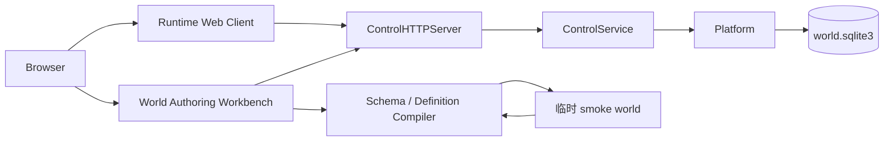

# sim2 网页客户端设计

> 状态：设计冻结，前端实现分阶段交付。当前仓库已经提供本地 HTTP 控制
> API，但还没有把静态网页打包进 Python 服务。

网页是 Platform 的观察与输入层，不是第二个运行时。浏览器永远不直接读
SQLite、YAML、Agent prompt 或 LLM provider；所有数据都来自经过视角过滤的
投影，所有改变都经过 `ControlService` 和 Platform 的校验、事务与事件记录。

## 产品边界

网页包含两个产品面。它们可以共用 HTTP 传输和组件库，但不能共用状态写入
权限。

| 产品面 | 面向用户 | 读取 | 写入 | 当前状态 |
| --- | --- | --- | --- | --- |
| Runtime Web Client | 旁观者、玩家、运行维护者 | 世界投影、地图、公开时间线、角色公开状态 | 玩家对话/交易；维护者暂停、单步和受控事件 | HTTP 投影和控制接口已有，网页待实现 |
| World Authoring Workbench | 世界作者、审查者 | 草稿、Schema、规范 IR、编译诊断、smoke 结果 | 草稿、编译任务、导出世界包 | 服务契约已设计，HTTP 路由和网页待实现 |

Runtime Client 观察的是已经初始化的 SQLite 实例；Authoring Workbench 编辑
的是独立草稿目录。工作台不能修改正在运行的实例，也不能把草稿直接发布成
运行时状态。正式实例仍通过 `sim2 init` 创建。

首版不做实时多人协作、远程暴露默认开放、在线编辑 SQLite、在浏览器执行
Python/SQL/Shell、浏览器持有 API key，或让 Story/God 的内部 prompt 出现在
普通玩家页面。

## 总体结构



网页只处理投影、表单和请求状态。`ControlService` 是 TUI、MUD、HTTP 的
共同入口；新增网页功能必须先扩展这个传输无关的服务，而不是在 HTTP handler
中复制 Platform 逻辑。

## Runtime Web Client

### 页面骨架

桌面端首屏采用可调整宽度的三栏布局，窄屏切换为四个标签页。布局不包含
任何世界专用名称，所有标题、单位、颜色含义和状态标签由投影或世界 locale
提供。

```text
┌ 世界名称 · 世界时间 · 运行状态 · 健康 · 连接游标 ┐
├ 地图/区域 ─────────┬ 公共时间线 ────────────────┤
│                     │ 事件、结果、因果链、任务状态 │
├ 角色/势力 ──────────┼ 详情/交互抽屉 ──────────────┤
│ 位置、活动、需求     │ 对话、交易、观察、审计链接   │
└ 最近提交 · 错误 · 重连 · 权限提示 ──────────────┘
```

1. **World header**：显示 `world_id`、世界时间、日历/季节投影、运行/暂停、
   数据库健康、最近一次命令结果和事件游标。暂停状态必须来自服务端，浏览器
   不根据本地计时器推断世界是否运行。
2. **Map**：消费 `/map` 的 `nodes` 和 `edges`。有 `position` 时按配置坐标
   绘制；没有坐标时使用带固定 seed 的网格布局。节点可展示公开标签、路线、
   安全状态和当前公开占用者。地图只显示当前 viewer 能看到的地点。
3. **Timeline**：消费 `/timeline?limit=<n>&after=<event_id>`。默认显示公开
   叙事投影；用户可以展开结果、来源事件、`causation_id` 和 Story/God 后续
   任务状态。`world_minute.advanced` 默认折叠，审查模式才显示每个 tick。
4. **Characters**：显示可见人物的名称、地点、公开状态、当前行为、剩余时长、
   公开需求和当前目标。详情页按需加载，不能把完整 AgentView 或私有记忆
   发送给旁观者。
5. **Interaction drawer**：玩家可以发送对话、建立/接受交易和移动到已知
   地点；维护者可以暂停、恢复、单步。提交后以服务端结果替换乐观状态，平台
   拒绝时显示结构化错误，不用自然语言关键字猜测失败原因。
6. **Causal inspector**：从一个事件展开“触发它的意图/活动”和“它唤醒的
   Story/God/Reflection 任务”。这只是审计投影，不允许从页面重放或编辑历史
   事件。

### 运行模式

Runtime Client 有三个视角：

| 视角 | 能看到 | 能提交 |
| --- | --- | --- |
| Observer | 公共地图、公共时间线、公开角色状态、健康和指标 | 只读；本地维护模式可单独开启暂停/单步 |
| Player | 自身、已知地点/事实、公开事件和允许的交互对象 | 对话、交易、移动、等待等玩家命令 |
| Operator | Observer 全部内容、任务/审计/健康详情 | 暂停、恢复、单步、受控事件注入和快照操作 |

当前 `sim2 serve` 是绑定 `127.0.0.1` 的开发控制 API，尚未提供登录和远程
授权。它不能直接暴露到公网。真正的 Operator/Player token、CORS allowlist
和反向代理部署属于网页上线前的明确工作项，不能由前端假装解决。

## 数据和请求协议

### 现有接口

这些接口已经由 `src/sim2/api/http.py` 提供，网页首版直接使用，不另造一套
查询协议：

| 方法 | 路径 | 用途 |
| --- | --- | --- |
| GET | `/status` | 世界时间、运行状态和实例信息 |
| GET | `/health` | 数据库/运行时健康；异常返回 HTTP 503 |
| GET | `/metrics` | 运行指标 |
| GET | `/observer?limit=20` | 旁观者聚合投影 |
| GET | `/timeline?limit=100&after=0&ticks=0` | 增量公共时间线 |
| GET | `/map?viewer_id=<id>&observer=0` | 视角过滤后的地图 |
| GET | `/audit` | 维护者审计导出 |
| GET | `/evolution/tasks` | 当前就绪的演化任务 |
| POST | `/pause`、`/resume`、`/step` | 本地维护控制 |
| POST | `/dialogue` | 发送对话 |
| POST | `/trade/offers`、`/trade/accept` | 交易交互 |
| POST | `/players` | 创建/进入玩家 |
| POST | `/events` | 维护模式的事件注入 |

事件游标使用整数 `event_id`。响应中的 `next_after_event_id` 是下一次请求
应使用的 `after`；同一事件可能因重连重复返回，前端必须按 `event_id` 去重。
服务端返回的 `world_minute` 和事件内容优先于浏览器缓存。

### 响应与错误

现有读接口保留各自的投影形状；新增写接口统一采用以下错误字段，旧接口
逐步收敛到同一结构：

```json
{
  "status": "rejected",
  "code": "precondition_failed",
  "message": "the route is no longer available",
  "failed_check": "route.open",
  "retryable": true,
  "path": "intent.parameters.destination",
  "world_revision": 1842,
  "event_id": null
}
```

`code`、`failed_check` 和 `path` 是机器字段；`message` 只是给人看的本地化
说明。浏览器不能通过查找“失败”“拒绝”“wait”等词来决定下一步。

每个改变状态的请求都遵守以下状态机：

```text
submitted → accepted → committed
     └──→ rejected
     └──→ conflict → reload projection → retry (if retryable)
```

客户端可以显示 `submitted` 的进度，但不能把它当成世界事实。只有包含
提交事件或最新投影的响应才可更新地图、库存、关系和角色状态。

### 刷新、缓存和重连

首版使用 1–2 秒轮询，理由是当前 HTTP 服务是轻量的
`ThreadingHTTPServer`，网页不需要每个模拟分钟建立 LLM 请求。刷新规则如下：

1. 首次加载并行读取 `/status`、`/observer`、`/map` 和 `/timeline`。
2. 时间线只带上一次的 `next_after_event_id`；地图和角色投影按
   `world_revision` 或 `ETag`（实现后）刷新。
3. 长 Action 期间不提交新的决策，也不在浏览器运行倒计时；只显示服务端的
   `remaining_minutes`。
4. 网络中断时保留最后一个已确认快照，显示“连接中断”；恢复后从游标继续，
   先合并事件再刷新状态，不能清空页面造成时间倒退。
5. 事件按 `event_id` 去重，时间线按 `world_minute,event_id` 排序。分页边界
   不以浏览器收到的时间作为依据。
6. 失败重试只对 `retryable=true` 的命令进行，并带请求幂等键；暂停、交易和
   事件注入不能因为刷新而重复提交。

稳定后可增加只读 SSE `/stream`，但 SSE 只是事件通知，仍以 `/timeline` 和
`/status` 的服务端投影为事实源。首版不引入 WebSocket 写通道。

## 地图、时间线和演化展示

### 地图

地图投影只包含 `id`、显示名、标签、路线、可见性、安全标记、可选位置和
公开占用者。前端不认识“村庄”“北门”“仓库”等语义；图标由配置标签或
locale 映射决定。没有坐标的世界也必须可用，确定性布局保证同一实例刷新
后位置不跳动。跨区域、多层地图可以先按区域折叠，再展开节点，数据仍是
同一份 `nodes/edges`。

### 时间线

时间线是公共叙事投影，不是原始事件表。它应显示：

- 发生时间、公开参与者、地点和结果；
- 事件类型和来源事件（如果 viewer 有权限）；
- 行为的 expected/actual/delta 是否闭合；
- Story beat、God proposal 或反思任务是否已排队、执行、提交或等待；
- 相关资源/能力变化的配置化 label、单位和合理精度。

普通玩家不显示 `Story Agent`、`God Agent`、`NPC` 等框架名作为世界内人物；
维护者审计页可以显示 role、task_id、provider、延迟和 token 统计，但不显示
API key 或隐藏推理。`export_timeline.py` 生成的完整文件和网页公共时间线都
来自同一事件历史，只是可见字段不同。

### 演化面板

演化面板将“事实”和“提议”分开：

```text
已发生事实 → 累计证据 → Story/God 任务 → 提案 → Platform 校验
     → 注册定义/剧情进度 → 后续 NPC 行为 → 实际结果
```

它不能把“God 提议了制度”显示成“制度已经生效”。只有定义注册事件、行为
结果或世界状态投影提交后才移动到已生效栏。重复提案、等待、冷却和被拒绝
都要有原因与来源事件，帮助审查是否出现死循环。

## World Authoring Workbench

工作台与 Runtime Client 使用相同视觉语言，但有独立路由和数据源：

1. **World**：世界元数据、时钟、locale、属性、地点、路线和地图坐标。
2. **Entities**：资源、物体、人物、势力、关系、库存和初始知识。
3. **Definitions**：Action、Recipe、Capability 和 BT 图；节点只能选择
   Schema 返回的已注册定义。
4. **Evolution**：Story/God 触发器、累计证据、冷却、任务类型和工具契约。
5. **Compile & Test**：结构错误、Expression AST 错误、引用/权限/可达性、
   未绑定 Action、资源守恒和临时 SQLite smoke 结果。

工作台的完整校验层次和规划接口见
[`world-authoring-web.md`](world-authoring-web.md)。它必须调用现有
`world-schema`、Definition Compiler 和 Bootstrap 服务；表单只是这些协议的
客户端，不得复制条件解析、效果结算或执行资格判断。

## 前端实现约束

首版采用轻量静态 TypeScript/HTML，不把新的领域模型带进 Runtime：

```text
web/
  index.html
  app.ts                 # 路由和启动
  api.ts                 # typed HTTP client、超时、重试、幂等键
  state.ts               # snapshot、revision、event cursor
  projection.ts          # 投影到 UI model，不改 Platform 语义
  components/
    header.ts
    map.ts
    timeline.ts
    characters.ts
    interaction-drawer.ts
    evolution.ts
    diagnostics.ts
```

组件只消费 JSON 投影，不导入 `Platform`、SQLite、YAML 或 Agent 工具代码。
在 Python 服务端托管静态资源是后续部署选项；开发阶段也可以用独立静态
服务器代理到 `sim2 serve`。API 地址、数据库路径、provider 和密钥不能写入
页面源码或浏览器 localStorage。

## 分阶段交付

1. **协议层**：为现有投影补充 JSON Schema/契约测试、错误字段、游标边界和
   只读视角测试；修正 HTTP handler 的统一异常映射。
2. **Runtime MVP**：静态页面实现 header、地图、时间线、角色详情和观察模式；
   用轮询和游标完成断线重连。
3. **玩家/维护交互**：接入对话、交易、暂停、单步和结构化拒绝；所有写请求
   使用幂等键和 revision 冲突提示。
4. **演化审查**：加入因果检查器、Story/God 任务、提案结果和审计链接；默认
   隐藏 provider 输入/输出，维护者才可查看脱敏审计。
5. **Authoring MVP**：Schema 驱动表单、表达式编辑器、BT 图、编译诊断、
   smoke run、diff 和导出。
6. **增强**：只读 SSE、地图区域折叠、版本历史、浏览器可访问性和视觉回归。

## 验收矩阵

### Runtime

| 场景 | 验收标准 |
| --- | --- |
| 不同世界 | 换用完全不同的地点、属性和对象，网页不改代码即可显示 |
| 视角隔离 | 玩家看不到私有记忆、隐藏地点或 God 专用上下文；Observer 才能看到公共全局投影 |
| 增量时间线 | 断线重连从 `after` 继续；重复事件不重复显示；游标不会倒退 |
| 长时行为 | Action 执行期间页面不重复提交决策，也不把本地计时当作事实 |
| 写入结果 | 对话/交易/暂停/单步的接受、拒绝、冲突都显示服务端结构化结果 |
| 因果审查 | 从公开事件可追到后续任务和已提交结果，但提议不伪装成已生效事实 |
| 并发与回滚 | tick 冲突、SQLite 回滚和网络重试后，页面最终与最新投影一致 |
| 可访问性 | 键盘可操作、颜色之外有文本状态、支持 Unicode 名称和窄屏布局 |

### Authoring

| 场景 | 验收标准 |
| --- | --- |
| 表单生成 | 字段和选项来自 Schema/IR，换世界包无需改前端词汇表 |
| 表达式 | 使用同一受限 AST 编译；错误指出字段路径和位置 |
| BT 图 | 未注册 Action、循环、越权副作用和不可执行目标被明确标出 |
| Smoke | 在临时 SQLite 运行最小行为并显示第一条真实失败事件 |
| 导出 | 导出的 YAML 能通过 CLI 校验；工作台不修改运行实例 |

## 相关文档

- [客户端使用指南](../client.md)
- [World Authoring Web 工作台](world-authoring-web.md)
- [World authoring and WorldBuilder](../world-authoring.md)
- [运行时协议](runtime-protocols.md)
- [AgentView 与上下文协议](agent-world-schema.md)
