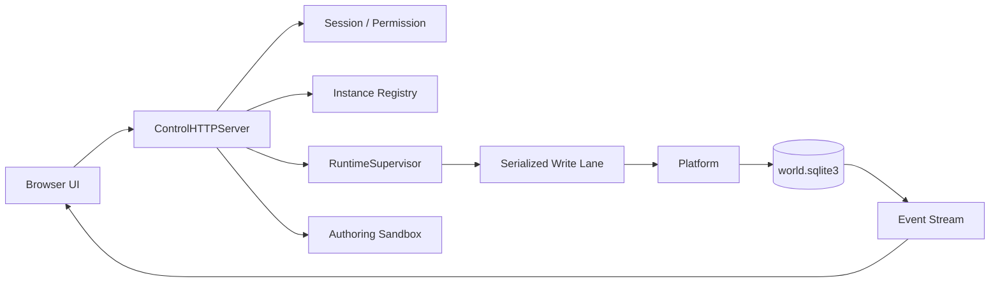

> 说明：本文件记录 v1 之前的端点规划。当前实际 API 已硬切到 `/api/v1`，
> 以 [`web-api-v1-refactor.md`](web-api-v1-refactor.md) 和 `GET /api/v1/meta/contracts` 为准。

# sim2 全功能网页客户端实施规划

> 目标：以网页作为本地单人运行的首选客户端。用户只需启动一次本地服务，
> 之后可以在浏览器内选择世界、创建实例、切换实例、开始或暂停自动演化、
> 以玩家身份行动、观察因果时间线、审查运行状态并编辑世界配置。

## 1. 产品目标与边界

全功能网页不是第二个 Runtime。浏览器不能直接读取 SQLite、YAML、Prompt、
provider 配置或玩家不可见的知识；所有读取都经过视角投影，所有写入都经过
`ControlService`、运行时监督器和 Platform 校验。

首个目标范围是**单机、单用户、本地网页**：

- 一个 `sim2 serve` 进程托管网页和同一时刻的一个活动世界实例。
- 同一个用户既可以是 Operator，也可以进入一个 Player 会话。
- 模型密钥只存在于服务端环境变量和 `~/.sim2/llm.json` 配置引用中。
- 网页可创建并启动多个独立实例，但同一进程只运行一个实例，避免跨进程写入
  同一 SQLite。
- 面向公网的多用户、OAuth、远程部署和水平扩展不属于首轮目标。

完整用户旅程必须收敛为：

```text
打开网页
  → 解锁本机 Operator 权限
  → 选择世界模板或编辑中的草稿
  → 创建实例
  → 进入世界
  → 启动自动演化
  → 暂停/继续/单步/停止
  → 以玩家身份行动或旁观因果时间线
  → 退出后再次打开同一个世界
```

除启动本地服务外，上述流程不应要求用户回到终端。

## 2. 当前能力与缺口

| 能力 | 当前状态 | 缺口 |
| --- | --- | --- |
| 从模板创建实例 | 已实现 `/instances` 与兼容 `/authoring/create` | 草稿发布和修订历史仍待实现 |
| 实例列表与切换 | 已实现 `/instances`、`/instances/activate` | 跨进程锁和远端多机协调不属于本地单用户首版 |
| 自动运行 | 已实现 RuntimeSupervisor 与 `/runtime/start` | 进程重启后的自动恢复策略可作为后续增强 |
| 暂停/继续 | 已实现完整分钟边界暂停和同一 run 继续 | 已开始的 Agent 决策不会被半途取消 |
| 单步 | 已实现 `/runtime/step`，自动运行期间拒绝手动推进 | 可在界面显示更细的单分钟审计 |
| 实时更新 | 4 秒轮询 | 缺少 SSE，事件延迟和重复请求较多 |
| 玩家界面 | 行动、地图、对话、等待和自动运行时钟保护已实现 | 交易面板、错误恢复和角色切换需补齐 |
| 观察界面 | 地图、角色、时间线、演化队列、运行状态机、预算与 usage 已实现 | 缺少 SSE 和历史 run 成本报表 |
| 世界编辑 | Schema 表单、JSON、编译、smoke、导出和“创建并打开”已实现 | 草稿保存/恢复、修订历史和发布队列需补齐 |
| 安全边界 | Observer/Player/Operator session 已隔离，管理写接口要求 Operator | 公网部署认证与 CORS 仍需反向代理层 |
| 成本控制 | 启动时可设置世界分钟、LLM 调用数和 provider | 尚缺跨历史 run 的独立成本报表 |

## 3. 核心架构



关键不变量：

1. 一个服务进程最多有一个自动运行线程。
2. 一个 SQLite 实例同一时刻只有一个写入协调者。
3. LLM 请求不持有数据库事务；模型返回后重新校验版本和前置条件。
4. 暂停、停止和实例切换只发生在完整分钟或完整交互边界。
5. 页面显示的状态必须来自服务端；浏览器本地定时器不决定世界状态。
6. 所有管理型 POST 都需要 Operator session；所有玩家 POST 都需要对应 Player session。

### 3.1 InstanceRegistry

新增进程内实例注册表，负责：

- 扫描 `~/.sim2/instances/*/world.sqlite3`；
- 返回实例 ID、世界包、世界分钟、配置版本和最近修改时间；
- 记住最近活动实例；
- 创建新实例后注册，不要求重启服务；
- `activate(instance_id)` 时关闭旧读服务、停止旧 RuntimeSupervisor，再打开新实例；
- 拒绝激活正在运行、健康检查失败或 schema 不兼容的实例。

实例切换属于显式状态迁移，不是替换 HTTP 进程中的任意路径变量。

### 3.2 RuntimeSupervisor

新增 `RuntimeSupervisor`，由 `ControlHTTPServer` 持有：

```text
stopped → starting → running → pausing → paused
                     ↘ stopping → stopped
                     ↘ failed
```

职责：

- 创建并持有唯一的 `SimulationRunner` 和 provider 集合；
- 在后台线程按完整分钟推进；
- 接收 start/pause/resume/stop 命令；
- 把页面提交的玩家和管理操作送入同一写入协调队列；
- 记录最近错误、当前 provider、调用次数、token 用量和停止原因；
- 服务商冷却（最长 30 秒，见 `llm/gateway.py`）不暂停世界：后台线程保持世界时间不动，
  等冷却结束后继续，状态仍为 `running`，`last_error` 显示等待提示；暂停或停止请求立即结束等待。
  连续 10 次冷却都没有推进世界分钟，才暂停世界并进入 `cooldown`，等用户显式继续。
  LLM 调用次数上限和目标分钟数每一轮都重新检查，失败的调用也计入次数；
- 进程重启时将“DB 标记为 running 但无运行线程”的状态校正为 `interrupted`，
  要求用户显式继续，不能伪装成仍在运行。

暂停语义采用“当前完整边界后暂停”。如果模型调用已经发出，仍允许该 turn
完成并持久化，然后停在下一分钟前。强制中止 HTTP 请求会留下半完成交互，
不作为 Pause 的实现方式。

### 3.3 时间、轮询与实时事件

- P0 保持轮询，保证可回退和易测试。
- P1 增加 SSE：`GET /events/stream?after=<event_id>`。
- SSE 只传输已有事件投影和运行状态变化，不触发 LLM。
- 客户端断线后使用 `Last-Event-ID` 或 `after` 恢复，不能重复显示事件。
- 自动运行状态、世界分钟、当前角色活动和演化任务都通过同一个事件游标更新。

## 4. 网页权限模型

### 4.1 首次解锁

`sim2 serve` 启动时打印一次性本机 Operator token。浏览器首次执行创建实例、
世界编辑、自动运行或暂停等操作时显示“解锁本机管理界面”对话框：

```text
POST /session
{ "role": "operator", "operator_token": "..." }
```

服务端返回短期 Operator session。前端只保存在 `sessionStorage`，关闭标签页
后失效。token 不能进入 URL、日志、localStorage 或审计事件。

### 4.2 权限矩阵

| 操作 | Observer | Player | Operator |
| --- | --- | --- | --- |
| 查看公共世界 | 允许 | 允许 | 允许 |
| 查看自己的私有视角 | 禁止 | 允许 | 仅调试模式 |
| 玩家行动、对话、交易 | 禁止 | 仅自己的角色 | 可进入 Player 会话 |
| 开始、暂停、继续、停止 | 禁止 | 禁止 | 允许 |
| 单步 | 禁止 | 禁止 | 仅停止/暂停态 |
| 创建/激活实例 | 禁止 | 禁止 | 允许 |
| 编辑、编译、导出草稿 | 只读查看 | 只读查看 | 允许 |
| 调用 WorldBuilder | 禁止 | 禁止 | 允许且需要预算确认 |

现有 `/authoring/open|create|build|compile|smoke|export` 必须统一加 Operator
权限检查。测试中的 HTTP helper 也必须显式携带 session，防止权限回归。

## 5. HTTP/API 规划

### 5.1 实例管理

| 方法 | 路径 | 说明 |
| --- | --- | --- |
| GET | `/instances` | 实例列表、健康、世界分钟、最近活动 |
| POST | `/instances` | 从已审核模板创建实例 |
| POST | `/instances/activate` | 激活已有实例 |
| POST | `/instances/create-and-start` | 创建、激活并按明确预算启动 |
| DELETE | `/instances/{id}` | 默认不提供；历史实例不能从网页静默删除 |

### 5.2 运行时控制

| 方法 | 路径 | 说明 |
| --- | --- | --- |
| GET | `/runtime` | 状态机、世界分钟、provider、usage、最近错误 |
| POST | `/runtime/start` | provider、运行分钟上限、调用预算、错误止损 |
| POST | `/runtime/pause` | 在当前完整边界请求暂停 |
| POST | `/runtime/resume` | 恢复同一个 Runner 状态 |
| POST | `/runtime/stop` | 结束本次 run，保留世界状态 |
| POST | `/runtime/step` | 停止/暂停态推进一个完整分钟 |
| GET | `/runtime/usage` | 本 run 和实例累计 usage |

`/pause`、`/resume`、`/step` 保留为兼容别名，但 UI 使用 `/runtime/*`。

### 5.3 玩家与交互

- 保留 `/players`、`/player/entry`、`/player/view`、`/player/act`、`/player/wait`。
- 补齐 counter/reject/withdraw trade API，并在网页提供完整交易抽屉。
- 所有提交增加 `idempotency_key`，浏览器重试不会重复启动行为或交易。
- 玩家退出时清除 Player token 并恢复 Observer session，不把页面留在半授权状态。

### 5.4 作者工作台

- authoring 写操作要求 Operator session。
- 草稿在服务端临时 revision 中保存，可刷新页面恢复。
- 表单依赖来自 Schema，不把世界字段硬编码进 JavaScript。
- “编译”“Smoke”“创建实例”“创建并启动”是四个明确动作，不能用一个按钮隐式完成。
- “创建并启动”必须先展示最终 world ID、实例 ID、provider 和运行预算。

## 6. 页面结构

### 6.1 顶层导航

```text
[世界选择器] [开始游戏] [观察世界] [设计世界] [运行控制] [系统状态]
```

顶部常驻：

- 当前世界与实例；
- 世界时间和日历；
- 运行状态：停止、运行、正在暂停、暂停、失败；
- Operator 解锁状态；
- SSE/HTTP 连接状态；
- 当前 provider 的脱敏标签和本 run usage。

### 6.2 创建世界页

1. 选择内置或受限目录中的模板。
2. 输入实例 ID。
3. 查看配置版本、人物数、地点数和验证结果。
4. 选择“仅创建”“创建并打开”“创建并开始”。
5. “开始”前确认 provider、最大运行分钟、最大 LLM 调用数和错误止损数。

创建后无需重启 HTTP 服务。

### 6.3 玩家页

- 地图：点击地点查看路线距离、预计分钟和可见人物。
- 当前目标与需求：数值必须由投影给出，前端不解释世界字段语义。
- 行动卡：显示代价、预计时间、成功条件和直接/准备性结果。
- 对话与交易：显示对方确认状态，不把提议显示成已达成。
- 结果流：展示服务端接受、拒绝、中断和实际状态变化。
- 世界运行期间，长行为由 Platform 推进；页面不按本地秒数自行完成行为。

### 6.4 观察页

- 自动运行控制：开始、暂停、继续、单步、停止。
- 世界指标、地图、角色、时间线、演化队列。
- 运行诊断：最近一分钟耗时、LLM 调用数、缓存 token、失败与 cooldown。
- 因果检查：事件 → 行为结果 → Story/God 任务 → 状态变化。
- 普通观察者默认隐藏内部 prompt、provider 原始响应和私有记忆。

### 6.5 设计页

- 模板编辑保留表单与高级 JSON 两种模式。
- 编译诊断定位到具体字段。
- Smoke 显示临时实例 ID 和第一条真实失败事件。
- 草稿可保存、恢复、比较修订和导回受控目录。
- WorldBuilder 调用显示预计预算、实际 usage 和停止按钮。

## 7. 成本与安全控制

每次 Start 请求必须包含服务端可验证的预算：

```json
{
  "provider": "remote",
  "max_world_minutes": 1440,
  "max_llm_calls": 120,
  "max_consecutive_llm_errors": 3
}
```

- 任一预算达到上限后进入 `paused_budget`，页面显示原因和继续入口。
- provider 列表来自服务端配置；浏览器不能提交任意 base URL、代理或 API key。
- 服务默认绑定 `127.0.0.1`。监听非回环地址必须显式参数，并在启动时显示风险提示。
- Operator/Player session 有 TTL；服务重启使旧 session 失效。
- 所有审计结果脱敏，不持久化 Operator token、API key、代理凭据和隐藏推理。

## 8. 并发与恢复规则

1. 自动运行、玩家操作、单步和事件注入都进入单实例串行写入队列。
2. 运行线程只在完整分钟边界检查 pause/stop。
3. 同一实例重复 Start 返回 `already_running`，不能启动第二个线程。
4. 运行中创建其他实例可以完成，但激活和切换必须暂停并停止当前运行。
5. 服务关闭时先请求 stop，等待当前完整 turn 结束，再关闭 Platform。
6. 服务异常退出后，下次打开显示 `interrupted`，由用户选择继续或只观察。
7. 快照、回放和时间线游标复用现有 Platform 协议，网页不能建立独立事实源。

## 9. 分阶段交付

### P0：本机全功能闭环

交付：

- Operator 解锁和 authoring 写接口鉴权；
- RuntimeSupervisor、完整运行状态机；
- Start/Pause/Resume/Stop/Step；
- 创建实例后无需重启即可打开；
- 实例列表、活跃实例和健康状态；
- 页面运行控制与结构化错误；
- 自动运行预算和用量显示。

验收：

- 浏览器完成“选模板 → 创建 → 打开 → 自动运行 → 暂停 → 单步 → 继续 → 停止”；
- 两个标签页同时点击 Start 只启动一个 runner；
- 暂停发生在完整分钟边界；
- 服务重启后不会声称世界仍在运行；
- 未解锁页面无法创建实例或调用模型。

### P1：玩家与观察体验

交付：

- SSE 增量事件与断线恢复；
- 完整对话和交易 UI；
- 多标签页 session 协调；
- 因果检查器和运行诊断；
- 移动端布局与键盘操作；
- 角色切换和持续 Player session 恢复。

验收：

- 断网重连不重复、不丢失已提交事件；
- 玩家能看到自己的视角，Observer 看不到私有状态；
- 玩家和自动 NPC 在同一运行器内按完整边界协调。

### P2：世界作者工作台

交付：

- 草稿保存、恢复、修订比较；
- Schema 驱动的完整表单和 Action/BT 关系编辑；
- 从草稿创建独立实例；
- “校验 → 审阅差异 → 创建并启动”流程；
- WorldBuilder 预算、停止和审计 UI。

验收：

- 全新背景包可以在网页完成编辑、校验、smoke、创建和游玩；
- 编辑中的草稿不会改变已运行实例；
- 导出文件能重新导入并保持校验通过。

### P3：发布质量

交付：

- 可选的反向代理部署说明；
- 更强的 session/CSRF/Origin 校验；
- 视觉回归、可访问性和长时浏览器测试；
- 多实例历史和磁盘占用管理；
- 运行耗时、LLM 成本和失败率看板。

## 10. 测试计划

### 后端

- RuntimeSupervisor 状态机注册/取消注册；
- 双 Start、重复 Pause、Pause→Resume、Stop 后 Step；
- 暂停耗时不超过一个完整分钟边界；
- LLM error、provider cooldown、budget exhausted 的停止原因；
- 实例切换和旧实例句柄关闭；
- 写入队列顺序与事务回滚；
- Operator/Player/Observer 权限矩阵；
- SSE cursor、Last-Event-ID 和断线恢复；
- 服务重启的 interrupted 恢复。

### 前端

- 未解锁时管理按钮禁用；
- 按钮在 pending 状态防重复提交；
- 运行状态与按钮组合一致；
- 地图、时间线和角色在完全不同的世界属性上正常显示；
- 窄屏、键盘、屏幕阅读器标签和错误提示；
- 断线提示不会把世界状态误标成暂停或停止。

### 真实模型

- 至少用一个配置的真实 provider 完成 Web 全流程；
- 审查每轮上下文、输出、实际事件和后续 NPC 行为；
- 验证 Pause/Resume 前后没有重复 LLM 调用、重复行为或事件；
- 验证预算停止不会留下半完成事务。

## 11. Definition of Done

满足以下条件后，网页才可以称为全功能本地客户端：

1. 用户只需启动一次服务，浏览器内完成实例创建、打开和运行。
2. 自动运行、暂停、继续、单步和停止都由服务端状态机管理。
3. 同一实例不会出现两个运行线程或两个写入协调者。
4. 玩家、观察者和 Operator 三种视角有清晰且经过测试的权限边界。
5. 页面通过事件游标或 SSE 持续更新，不依赖本地时间猜测。
6. 成本、错误和停止原因对用户可见。
7. Authoring、初始化和 Runtime 使用同一套 Schema、Compiler 和 Platform。
8. 所有关键动作都有 API、状态机、重启和真实模型测试。

## 12. 实施顺序

后续开发按以下顺序推进，避免同时修改 UI、鉴权和运行时后无法定位问题：

1. 会话与权限：Operator token、authoring 写保护、前端解锁。
2. RuntimeSupervisor 与 `/runtime/*`：Start/Pause/Resume/Stop/Step。
3. InstanceRegistry 与 `/instances/*`：创建、打开、切换。
4. 网页运行控制、创建并启动、成本预算。
5. SSE、玩家交易与因果审查。
6. 草稿持久化、修订比较和从草稿创建。
7. 可访问性、响应式、长时真实模型与发布检查。
